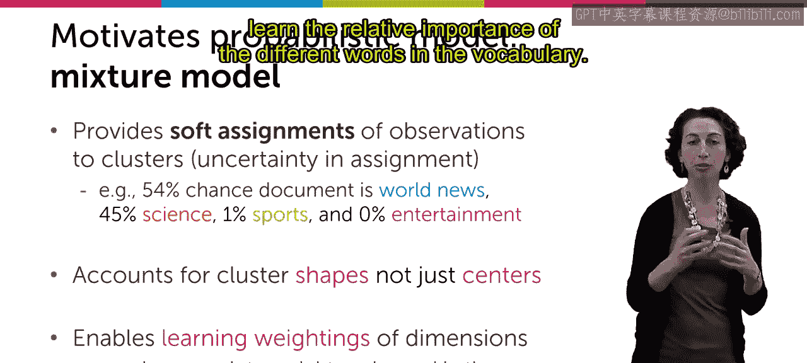

# 机器学习（分类，聚类和检索）：第3-4课：概率聚类模型的动机 🎯

在本节课中，我们将要学习概率聚类模型的基本动机。我们将探讨K均值算法的局限性，并理解为何需要转向基于概率模型的聚类方法，例如混合模型。这些方法能够提供更丰富的信息，例如数据点属于各个簇的“软”分配概率，并能更好地处理不同形状和重叠的簇。

在上一模块中，我们讨论了K均值作为一种算法化的聚类方法。现在，在课程的剩余部分，我们将转向基于概率模型的聚类方法，并与K均值进行比较和对比。

那么，我们为何首先对概率方法感兴趣呢？为了说明这一点，我们可以回到我们的任务：学习用户对一组主题的偏好。为此，我们讨论了将文档聚类到一组主题中，然后结合用户对已读文章的反馈和这种聚类结构，来学习用户对这些主题的偏好集合。

但我们很少遇到数据完全可分的情况。例如，在这个场景中，想象有一篇文章，我们不太清楚它是否与关于世界新闻的其他文章更相似，还是与关于科学的其他文章更相似。也许它介于两者之间。但为了讨论方便，假设它更接近这个科学主题，即这个橙色簇。这是否意味着当用户表示他们不喜欢这篇文章时，我们只应在更新用户对簇4的偏好信息时包含该信息？或者，也许这也应该以某种方式影响我们对用户喜欢簇2的看法？因此，我们看到，K均值所做的硬分配并不能完全反映真实情况。相反，我们希望做的是能够以某种方式捕捉这篇文章是分配给簇2还是簇4的不确定性，然后利用这种不确定性从数据集中提取额外信息。

例如，在学习用户对一组主题的偏好时，我们可以考虑做更复杂的事情。

K均值还有其他局限性。请记住，当K均值将数据点分配给一个簇时，它只考虑簇中心。

这意味着它没有考虑簇的形状。你可以认为这等同于假设所有簇都具有这种球对称形状，并且它们都是大小相等的球体。这意味着所有维度都被平等加权，并且在我们计算那个分数时，在所有不同的簇中使用相同的权重。因此，区分这些簇的唯一因素是这些簇的位置，即它们的簇中心。

然而，你可以修改K均值，使用加权欧几里得距离或缩放欧几里得距离，而不是我们在这里展示的这种标准形式的欧几里得距离。但关于这一点有两件事：一是它仍然假设所有簇具有相同的轴对齐椭圆形状，这意味着当我们权衡不同维度的重要性时，在每个不同的簇中权重完全相同；另一件事是权重集必须预先指定。

因此，K均值在以下情况下会遇到困难：

以下是K均值可能遇到困难的情况：
1.  如果簇具有不同的分布范围，特别是当它们没有很好地分离时。例如，考虑以下情况：有两个小的橙色和蓝色簇，以及一个非常大的绿色簇。这里说的“大”，不是指簇中数据点的数量多，而是指该簇内点的分布范围。在这种情况下，K均值算法会这样做：如果我们固定簇中心位于这三个位置，并查看我们的Voronoi镶嵌图（这些线所绘制的），它会说这个区域内的所有点都被分配给这个橙色簇，这个区域内的所有点都被分配给这个蓝色簇，只有这里的点被分配给这个绿色簇。结果，它把出现在这个绿色簇中的观测点错误地分配给了橙色或蓝色簇。
2.  当簇重叠时。同样，如果我们考虑将簇中心固定在这里，K均值将简单地按如下方式分割这些簇。现在发生的情况不一定是错误的标签，我的意思是，将这些蓝色点分配给橙色簇是不正确的。在这些情况下，如果不事先知道它来自蓝色还是橙色簇，也没有任何其他区分信息，在这些区域（我将它们涂成蓝色），你本应对观测点属于蓝色簇还是橙色（或蓝色与绿色，抱歉，是绿色和橙色）存在不确定性，但K均值却做出了硬分配。K均值做出硬分配，而显然存在不确定性。
3.  我们提到的K均值没有考虑的另一点是，如果簇具有不同的形状或这些形状的方向，特别是如果这些形状事先未知，不同维度的权重应该是多少。例如，如果我们看这里的这个观测点，在K均值下，它会说，到蓝色簇的距离更小，所以这个观测点将被分配给蓝色簇，而没有考虑到绿色簇沿这个轴有很大的分布范围。

因此，我们需要的是一种能够考虑簇形状的方法，并说，嗯，不仅仅是看簇中心，我还想考虑到绿色簇沿这个维度有这种分布范围，也许它更可能属于绿色簇，而不是这个紧凑的球形蓝色簇。

这些局限性促使我们采用一种使用混合模型的概率方法。混合模型可以提供数据点到簇的所谓软分配，这些软分配将考虑这些簇分配中的不确定性。

例如，也许我们有一篇文档，软分配会说，该文档有54%的概率是关于世界新闻，45%的概率是关于科学，1%的概率是关于体育，0%的概率是关于娱乐。

混合模型还可以考虑簇的形状，而不仅仅是簇中心。最后，另一个非常重要的事情是，我们将最终学习这些混合模型的参数，并且我们可以实际学习不同维度上的权重。例如，我们可以针对每个簇，学习词汇表中不同单词的相对重要性。

在本节课中，我们一起学习了转向概率聚类模型的动机。我们探讨了K均值在硬分配、忽略簇形状和大小、处理重叠簇等方面的局限性。这些局限性促使我们引入混合模型，它能够提供软分配以量化不确定性，并能学习每个簇的形状和特征权重，从而为聚类问题提供更灵活、更强大的解决方案。