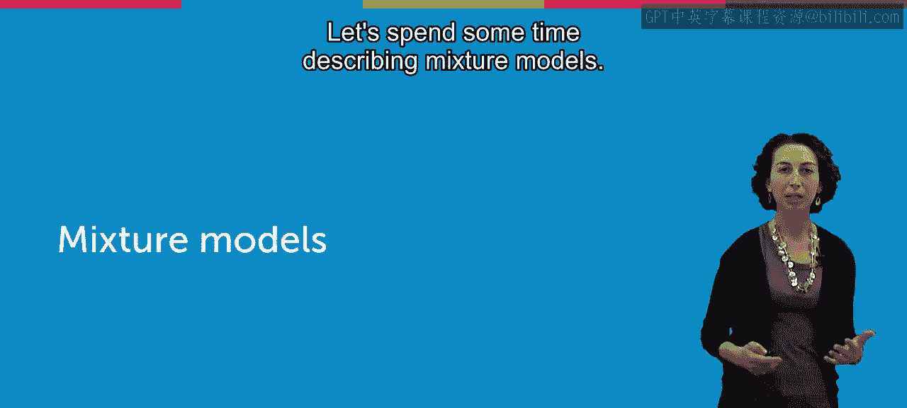
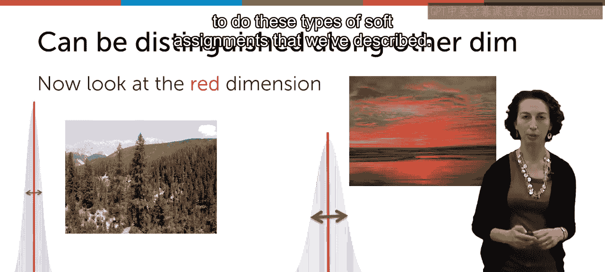

# 华盛顿大学《机器学习（分类，聚类和检索，第3-4课⧸共4课）｜Machine Learning》中英字幕 p162 40_在图像数据集中汇总未知类别.zh_en -BV1Sr421F7N7_p162-

。

Let's spend some time describing mixture models and here as a motivating application。

 we're going to use this idea of trying to discover groups of related images。

 so that is cluster images， and the reason we're going to use this application is because it's really visually appealing and very intuitive because of that structure。

So remember here our goal is to discover， for example。

 this group of all images relating to clouds and all images about sunsets and images about dogs and images about pink flowers and images about the ocean and things like this。

 but remember because we're in an unsupervised setting。

 the output of our algorithm are just going to be these groupings or cluster assignments。

 rather than labels， so we're not actually going to label the group as clouds but you could go through and do that post facto。

Okay， so to start with， let's discuss our image representation and for the sake of this module and for the assignment that you're going to be working with。

 we're going to use a really， really simple image representation where we just simply average the RGB。

 red， green blue values so the pixel intensities across every pixel in the image to get a single RGB vector per image。

So for example， maybe this image of clouds has an RGB vector 0。050。70。

9 and here we've normalized all these RGB values to be between 011 and then maybe this sunset image has an R value of 0。

85， green value 0。05， blue value 0。35 and finally this trees or forest image， has an RGB vectors， 0。

02，0。950。4。Now that we have a quantitative representation of our images。

 we can turn to our data analysis and our modeling。So to start with。

 let's imagine that we take all of the cloud images。

 so for now let's imagine that these images have labels， they don't。

 that's the point of this clustering task， but for the sake of building up the model。

 let's imagine that we could grab out just the images of clouds。

And then let's just look at the blue index in this RGB vector and histogram。

 what that blue intensity is across all these cloud images in our data。

 so maybe the histogram would look something like this where the average value is pretty high 0。

8 but there's some spread around that， and the spread might look something somewhat like a bell curve where maybe there are lots of images that have blue intensities around 0。

8 and very few with extremely high values and very few with extremely low blue values。

Then we could look at all the sunset images and make the same type of histogram。

 but now because we're looking at these sunset images and you tend not to get lots of blues in these images。

 maybe the average value is much lower like 0。3 and perhaps there's also a lot less spread in terms of the range of blue values we see across these sunset images。

And then we could do the same thing for forest images。

 but maybe here the blue intensity is a bit higher than in sunsets because you can get parts of the image that are really about the sky。

 so maybe it's a bit higher 0。42 and a little bit more spread than we saw for sunset images。Okay。

 but remember that。We don't actually have these labels of sunset forest cloud。

 we just have a whole bunch of jumbled up images and for each one we have its blue intensity and we can make a histogram over all images in our data and maybe the histogram would look something like this where there are these multiple humps。

 three different humps， and what that would really correspond to is the fact that there are three different categories of images that we're looking at the sunset forest and cloud images that we talked about before。

And if we look at any single image， for example， maybe this forest image shown here where I've placed the image with what its blue intensity might be。

 so something around 0。4 well。Maybe from this histogram here， we could say， oh， well。

 there's some group of images with high blue intensity and I'm going to call that one cluster。

 one group and this forest image is clearly not in that group。

 but now I'm in this position where I don't really know there seem to be maybe two other groups and I don't know which one this goes into。

Well， in this case， one thing we can actually do is we can look at another dimension of our observation factor。

 we can look at the red intensity in the set of images。

And if we look at the histogram over red intensities over all forest images in our data set， well。

This intensity is probably pretty low in most of these images。

 not many reds appear in images of forests。But if we look at the sunset images。

Then the red intensities are going to be really high， maybe something centered around 0。9。

 So whereas when we looked at the blue category， it was pretty hard to distinguish between forests and sunsets。

 when we look at the red dimension，Maybe along that dimension。

 things are much more separable so the point I want to make here is that actually sometimes when we're thinking about doing clustering and thinking about probabilities of assignments of observations。

 two clusters， the thing that can allow us to distinguish between the different clusters really appears when we're looking at a higher dimensional space than just one dimension like blue but to this point really all we've talked about is our data thinking about histograming。

 these values， these intensity values and this idea that there might be some structure there。

 but what we want to turn to is a model to actually capture this clustering structure and to do these types of soft assignments that we've described。

