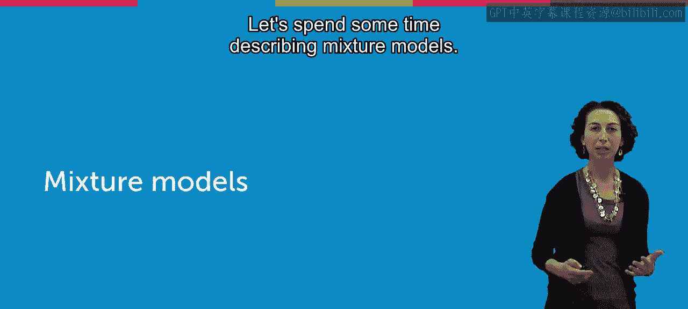
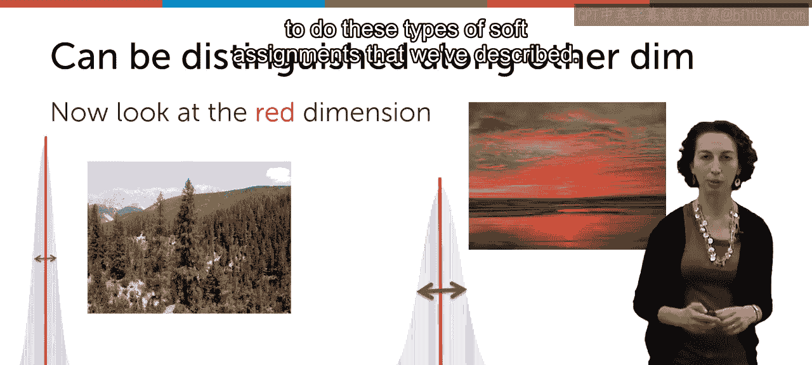
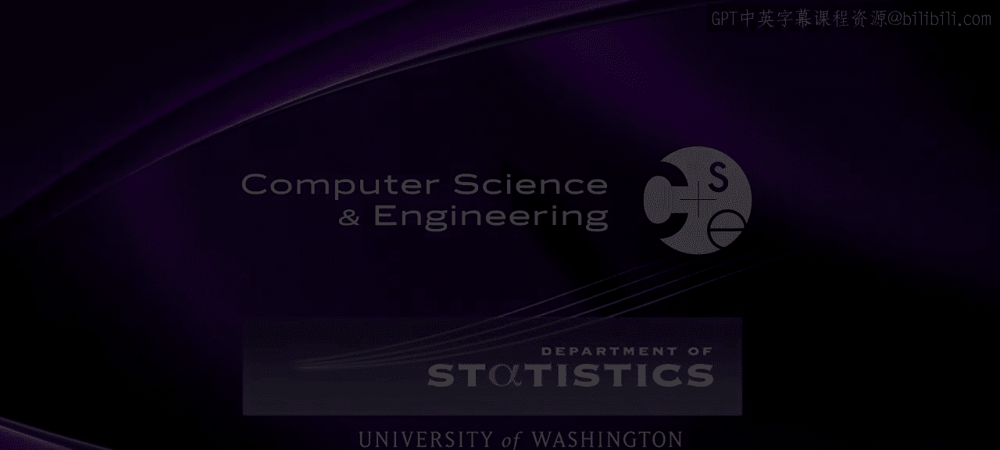

# 机器学习（分类，聚类和检索）：第3-4课：在图像数据集中汇总未知类别 🌄

在本节课中，我们将学习如何使用混合模型来发现图像数据集中未知的类别或分组。我们将以图像聚类作为核心应用场景，因为它直观且视觉吸引力强。我们的目标是让算法自动将相似的图像（如云朵、日落、森林）归为一组，而无需预先知道这些标签。

---

## 图像表示方法

为了进行数据分析与建模，我们首先需要将图像转化为数值表示。在本模块及后续作业中，我们将使用一种极其简单的表示方法：计算图像中所有像素的RGB（红、绿、蓝）通道强度平均值，从而为每张图像得到一个三维的RGB向量。

以下是几个示例：
*   一张云朵图像的RGB向量可能是 `[0.05, 0.70, 0.9]`。
*   一张日落图像的RGB向量可能是 `[0.85, 0.05, 0.35]`。
*   一张森林图像的RGB向量可能是 `[0.02, 0.95, 0.4]`。

请注意，所有RGB值都已归一化到0到1之间。

---

## 从数据观察到模型构建

上一节我们介绍了如何用RGB向量表示图像。本节中，我们来看看如何通过分析这些数据来构建聚类模型。为了便于理解模型的构建过程，我们先假设自己知道图像的类别标签。

### 单维度分析：蓝色通道

如果我们只查看所有“云朵”图像的蓝色通道强度，并绘制其直方图，可能会得到类似下图的结果。其平均值较高（例如0.8），且分布近似钟形曲线（即正态分布），大部分图像的蓝色强度集中在0.8附近。

接着，查看所有“日落”图像的蓝色通道。由于日落图像中蓝色较少，其蓝色强度的平均值会低得多（例如0.3），且分布范围可能更窄。

最后，查看“森林”图像的蓝色通道。由于森林图像中可能包含天空部分，其蓝色强度平均值可能略高于日落图像（例如0.42），分布也稍广一些。

然而，关键点在于：**我们实际上并没有这些标签**。我们拥有的只是一大堆混合在一起的图像及其蓝色强度值。如果绘制所有图像的蓝色强度直方图，可能会看到多个“峰”，例如三个。这正好对应了我们之前假设存在的三个图像类别：日落、森林和云朵。

此时，如果我们观察一张具体的图像（例如蓝色强度约为0.4的森林图像），仅凭蓝色直方图很难精确判断它属于哪个组。它显然不属于蓝色强度高的“云朵”组，但似乎还有另外两个组，我们无法确定它属于哪一个。

### 引入更高维度：红色通道

在这种情况下，我们可以引入另一个观测维度——红色通道强度。

*   对于森林图像，其红色强度通常很低，因为森林中红色不多。
*   对于日落图像，其红色强度通常非常高，可能集中在0.9左右。

因此，虽然在蓝色维度上难以区分森林和日落图像，但在红色维度上，它们可能变得非常容易区分。这个例子说明，**有时我们需要在更高维的空间中观察数据，才能有效地区分不同的聚类**。

到目前为止，我们的讨论都基于对数据值（强度值）绘制直方图并观察其中可能存在的结构。接下来，我们将转向一个正式的模型，来捕捉这种聚类结构，并实现我们之前描述的“软分配”。

---

## 混合模型简介

以下是混合模型的核心思想与组成部分：

1.  **模型假设**：我们假设观测到的数据（如图像的RGB向量）是由多个不同的“成分”或“簇”生成的。每个簇都有自己的概率分布（通常是多元高斯分布），用于描述属于该簇的数据点的特征。
2.  **隐变量**：对于每个数据点，我们引入一个隐变量 `z`，表示它来自哪个簇。在聚类任务中，这个 `z` 正是我们想要推断的。
3.  **生成过程**：混合模型的生成过程可以描述为：
    *   首先，根据混合权重 `π`（一个概率向量）随机选择一个簇 `k`。公式为：`z ~ Categorical(π)`。
    *   然后，从该簇对应的概率分布 `p(x|θ_k)` 中生成观测数据 `x`。例如，若使用高斯分布，则 `x ~ N(μ_k, Σ_k)`。
4.  **模型参数**：一个混合模型的主要参数包括：
    *   混合权重：`π = [π_1, π_2, ..., π_K]`，其中 `π_k = P(z=k)`，且 `Σ π_k = 1`。
    *   每个簇的分布参数：例如对于高斯混合模型，每个簇有其均值向量 `μ_k` 和协方差矩阵 `Σ_k`。
5.  **软分配**：与“硬分配”（每个点只属于一个簇）不同，混合模型为每个数据点 `x_i` 计算属于各个簇的后验概率 `γ_{ik} = P(z_i=k | x_i)`。这就是“软分配”，它量化了数据点与每个簇的关联程度。

通过期望最大化（EM）等算法，我们可以从无标签数据中自动学习出这些模型参数，从而完成聚类任务。

---

## 总结

本节课中，我们一起学习了如何利用混合模型对图像进行聚类。我们从简单的RGB向量表示开始，通过分析单维度（蓝色通道）和双维度（红-蓝通道）数据，理解了在更高维空间中数据更易分离的道理。最后，我们介绍了混合模型的基本概念，包括其生成过程、核心参数以及软分配的思想。这个模型为我们提供了一种强大的数学框架，用于在无监督条件下发现数据中潜在的分组结构。