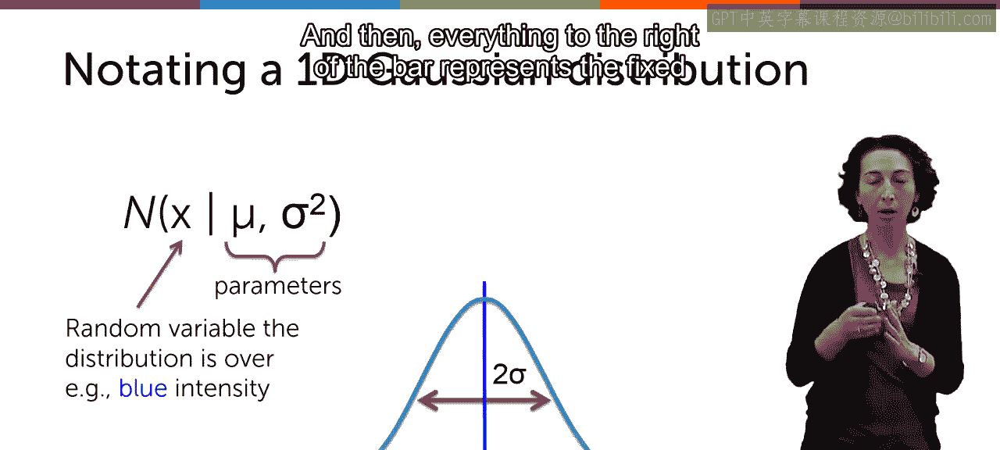
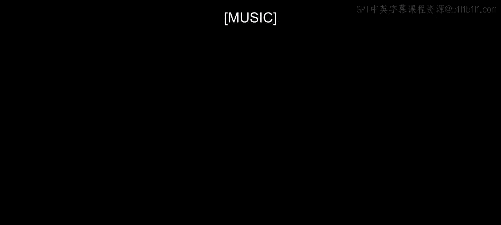

# 华盛顿大学《机器学习（分类，聚类和检索，第3-4课⧸共4课）｜Machine Learning》中英字幕 p163 41_单变量高斯分布.zh_en -BV1Sr421F7N7_p163-

。

But before we get to our mixture model， I want to provide some background on one of the components that's going to be a really。

 really key component to the model that we're going to describe。

 and this is something called a Gaussian distribution。

So let's go back to this histogram over blue intensities just for the cloud images and we said this histogram might look something like this bellshad curve Well when we're taking our probabilistic model-based approach。

 we're going to treat the blue intensity in every image as an observed random quantity and we're going to place a distribution over that random quantity and that distribution is going to have a set of parameters and we're going to aim to learn those parameters from the data and so the distribution that we're going to use here to model this type of shape。

 this type of spread of data points is something called a Gaussian distribution。

And in this application， we're going to assume that a Gaussian distribution provides a pretty good fit for every。

Different image category like clouds。Sunsets and forests， and every dimension of the observed vector。

 whether we're looking at the red， green， or blue dimension。And in one dimension， so for example。

 when we're just looking at our blue intensity dimension。

Then this Gaussian is fully specified by two parameters， a mean and a variance。

 or sometimes people refer instead to the square root of the variance。

 which is called the standard deviation。So the mean specifies where this Gaussian lives。

 so it centers the distribution and the variance determines the spread of the distribution。

So for example， here's a Gaussian with the same variance， but a different mean。

So a smaller mean than the example we showed before。And now here's a Gaussian with the same mean。

 but smaller variance， and here are examples with larger and larger variances。

So we can see how tuning these two different parameters changes what this distribution looks like in terms of its location and its spread and we're going to notate this Gaussian distribution as follows with this n。

 sometimes the Gaussian distribution is referred to as the normal distribution that's where the n comes in and this x is going to refer to the random variable over which this distribution is placed。

 so in the example we're looking at that's the blue intensity in the image。

 and then everything to the right of the bar represents the fixed parameters of the Gaussian。

 the mean and the variance。

