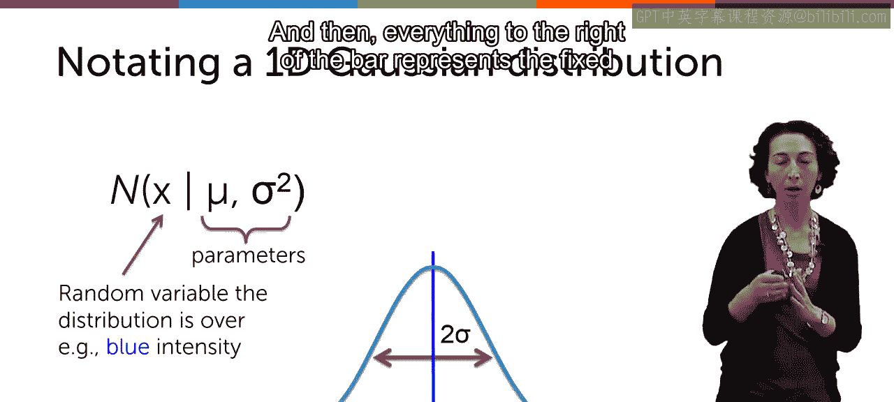

# 机器学习：分类、聚类与检索：3-4：单变量高斯分布 🧮

在本节课中，我们将学习高斯分布（也称为正态分布）的基本概念。高斯分布是概率模型中的一个关键组成部分，尤其在处理连续数据时非常有用。我们将了解它的定义、参数以及如何通过调整这些参数来改变分布的形状。

---

在深入探讨混合模型之前，我们需要先了解一个核心组件，它将成为后续模型描述的关键部分，这就是高斯分布。

让我们回顾一下仅针对云朵图像的蓝色强度直方图。我们曾提到，这个直方图可能看起来像一条钟形曲线。当我们采用基于概率模型的方法时，我们会将每张图像中的蓝色强度视为一个观测到的随机变量，并为这个随机变量设定一个分布。这个分布将包含一组参数，我们的目标是从数据中学习这些参数。我们将使用高斯分布来建模这种类型的数据分布形状。

在这个应用中，我们假设高斯分布能够很好地拟合每一个不同的图像类别（如云朵、日落、森林）以及观测向量的每一个维度（无论是红色、绿色还是蓝色维度）。

---

## 一维高斯分布

当我们仅关注蓝色强度这一维度时，这个高斯分布完全由两个参数决定：均值（mean）和方差（variance）。有时人们也使用方差的平方根，即标准差（standard deviation）。

*   **均值** 决定了高斯分布的中心位置。
*   **方差** 决定了高斯分布的离散程度。

以下是不同参数组合的高斯分布示例：

*   **相同方差，不同均值**：下图展示了一个与之前示例方差相同但均值较小的分布。
*   **相同均值，不同方差**：下图展示了一个与之前示例均值相同但方差较小的分布。
*   **方差增大**：下图展示了方差逐渐增大的分布示例。

通过调整这两个参数，我们可以改变分布的位置和离散程度。

---

## 数学表示

我们使用以下符号来表示高斯分布：

`N(x | μ, σ²)`

其中：
*   `N` 代表正态分布（Normal distribution）。
*   `x` 代表该分布所描述的随机变量（在我们的例子中是图像的蓝色强度）。
*   `μ` 是分布的均值。
*   `σ²` 是分布的方差。

竖线 `|` 右侧表示高斯分布的固定参数。

---

## 总结

本节课中，我们一起学习了单变量高斯分布。我们了解到，高斯分布是一个由均值和方差两个参数完全定义的钟形概率分布。均值决定了分布的中心位置，而方差决定了数据的离散程度。这种分布是构建更复杂概率模型（如混合模型）的基础组件。