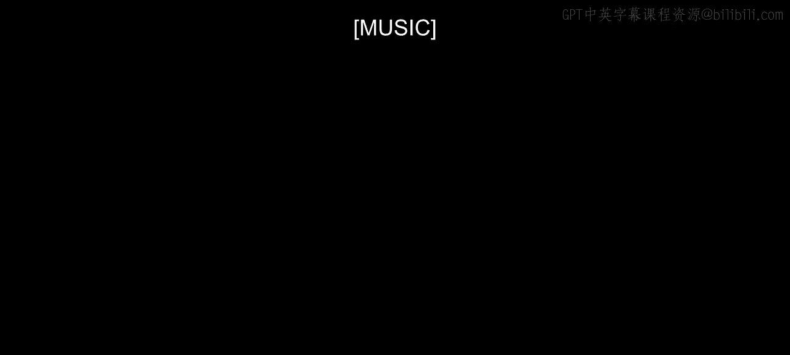
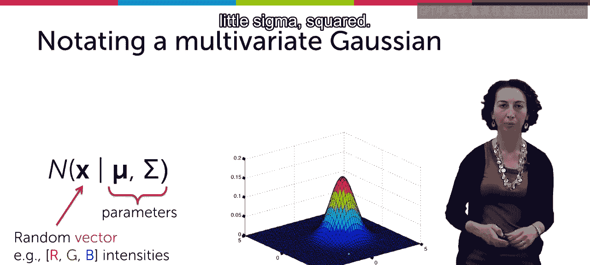

# 华盛顿大学《机器学习（分类，聚类和检索，第3-4课⧸共4课）｜Machine Learning》中英字幕 p164 42_二元和多元高斯分布.zh_en -BV1Sr421F7N7_p164-

。

When specifying a Gaussian distribution over two random variables。

 we assign probability density for the pair of random variables everywhere over the range of values that each of these variables can take。

 and as in 1 D， there's just a single hump to this distribution， so for example here。This would be。

The place that where there's most。Probability。So it's most likely that the blue and green random variables。

 so thesities of thoses， thetensities of blue and green in the images fall within this range。

Whatever if you were to drop down this point and look at the blue value and the green value。

That would represent the mean of this distribution in the most probable region because in a Gaussian。

 the mean is also equivalent to the mode of the distribution and when we walk away from that mode。

We're walking to regions of lower probability。And another way to view a Gaussian distribution in two dimensions and the one that's more commonly used because of being able to see it on 2D plots is what's called a contour plot and a contour plot is just a bird's eye view of this mesh plot。

 this three-dimensional mesh plot so you take this three dimensionmenional mesh。

 you look down at it from the very top and you plot these curves。

 these ellipses of equal probability。Where the coloring represents the intensity。

 So how high it was in probability。 So again， this center point is the region。Of highest probability。

And this blue shading represents low probability， just like in the mesh plot。

 so this ring would be lower probability。And we see lower probability as we walk out in this direction or in this direction。

Or in this direction or any direction moving away from the peak。

 The question is just how rapidly it drops off and it drops off most rapidly。In this direction。

 least rapidly。In this direction here。And somewhere in between。

 between these two different directions that we've shown。 Okay。

 so this contour plot is going to be our standard representation of a Gaussian in two dimensions。

In two dimensions， a Gaussian is fully specified by a mean vector and a covariance matrix。

 so this mean vector has elements that center the distribution along every dimension。 So for example。

 in this case， mu1 centers the distribution along the blue axis So the blue intensity and mu2 centers the distribution along the green intensity and then the crosshas pinpoint the center of the distribution jointly in the blue and green intensity space。

 Then the covariance matrix specifies the spread and orientation of the distribution along the diagonal of this covariance matrix we have the varianceance terms for each of the dimensions。

 So the top left hand corner， we see sigma blue squared so that's the variance。

Along just the blue intensity direction or dimension of the observation vector。

 and likewise for sigma green square， that's the variance just along that one dimension。

 but then we have this other parameter， sigma blue comma green。

or green comma blue and actually those are the same value because it's a symmetric matrix that's not actually a detail you really need to know。

 but anyway what those off diagonal terms specify is the correlation structure of this distribution so what's the orientation of these ellipses？

So let's look at a few examples of covariance structures that we could specify。

 so one is a diagonal covariance with equal elements along that diagonal first by specifying a diagonal covariance。

 what we're seeing is that there's no correlation between our two random variables because there are zeros in the off diagonals。

And what this means is that having one random variable like this blue intensity being high or low doesn't relate to whether the other random variable。

 like the green intensity is high or low， and furthermore by having equal values of the variances along the diagonal。

 what we end up with is this circular shape to the distribution because we're saying that the spread along each one of these two dimensions is exactly the same。

In contrast， if we were to specify different variances along the diagonal。

 what this means is that the spread in each of these dimensions is different and so what we end up with are these axis aligned ellipses。

And finally， if we consider a full covariance that allows for correlation between our two random variables。

 we can provide these non axis aligned ellipses。So in this example that we're showing here。

 if the blue intensity is high， it's more likely that the green intensity is also high。

 so these would be what are called positively correlated random variables。

And if the blue intensity is low， it's more likely that the green intensity is also low。well。

 we can define a Gaussian in any number of dimensions， not just one or two。

 and in this case we have a mean vector where the number of elements in that vector is exactly the same as the number of dimensions that we're in the dimensionality of the random vector X that we're looking at and then this covariance matrix has dimension。

 let's say we're looking at a random vector x that has d different dimensions then our covariance matrix is going to be a D by D matrix theyre going to be D varianceance parameters along the diagonal of that matrix and then these off diagonals are going to capture this correlation structure amongst these d different random variables。

The matrix is also something that's called positive semideinite， but again。

 if you don't know what that means， that's okay， I just want to put that out there as a word of warning is that there are some constraints on what the elements of this matrix can be okay but notationally we're going to use a very similar notation to what we use in the one- dimensional case so we have this n of x and then this bar。

 but now we have mu in this capital sigma instead of just the variance term little sigma squared。

