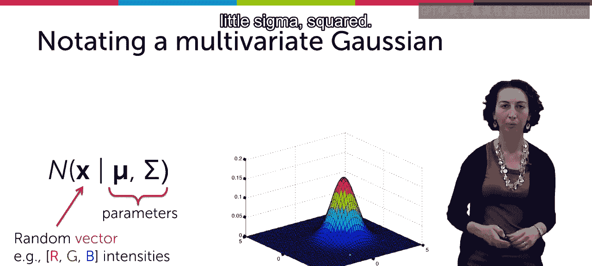

# 机器学习：第3-4课：二元和多元高斯分布

在本节课中，我们将学习高斯分布在多维空间中的扩展。我们将从二元高斯分布开始，理解其可视化表示和参数含义，然后将其推广到任意维度的多元高斯分布。核心概念将通过**公式**和**代码**进行描述。

---

## 二元高斯分布的可视化

上一节我们介绍了一维高斯分布，本节中我们来看看它在二维空间中的形态。当我们在两个随机变量上指定一个高斯分布时，我们为这对变量在其取值范围内的每一个点都分配了概率密度。

与一维情况类似，这个分布只有一个“峰”。例如，在下图中，概率密度最高的区域就是分布的中心点。

这个中心点代表了分布的平均值，也是概率最大的区域。在高斯分布中，均值也等同于分布的众数。当我们远离这个众数时，就进入了概率较低的区域。

另一种更常用的二维高斯分布可视化方法是**等高线图**。等高线图是上述三维网格图的俯视图。

它绘制了等概率的椭圆曲线，其中颜色深浅代表概率密度的高低。中心点仍然是概率最高的区域，蓝色阴影区域代表低概率。随着我们向任意方向远离峰值，概率都会降低，只是在不同方向上降低的速度不同。

## 二元高斯分布的参数

在二维空间中，一个高斯分布完全由两个参数决定：一个**均值向量**和一个**协方差矩阵**。

*   **均值向量** `mu`：其元素决定了分布沿每个维度的中心位置。例如，`mu1` 将分布中心定在蓝色强度轴上，`mu2` 定在绿色强度轴上。这两个值共同确定了蓝绿强度空间中的分布中心点。
*   **协方差矩阵** `Sigma`：它指定了分布的**展布**和**方向**。

以下是协方差矩阵各部分的含义：
*   **对角线元素**：是每个单一维度的方差。例如，左上角的 `sigma_blue^2` 是蓝色强度方向的方差，右下角的 `sigma_green^2` 是绿色强度方向的方差。
*   **非对角线元素**：如 `sigma_blue,green`，指定了分布中两个随机变量之间的**相关性**结构，即这些椭圆的**朝向**。

## 协方差结构示例

让我们通过几个例子来理解不同的协方差结构如何影响分布形状。

**1. 对角协方差（元素相等）**
当协方差矩阵是对角矩阵且对角线元素相等时，意味着两个随机变量之间**没有相关性**（非对角线为零），并且沿每个维度的展布相同。这会产生一个**圆形**的分布。

**2. 对角协方差（元素不等）**
如果协方差矩阵是对角矩阵但对角线元素不相等，意味着变量间仍无相关性，但沿每个维度的展布不同。这会产生**轴对齐的椭圆**。

**3. 完整协方差**
如果协方差矩阵是完整的（非对角线元素不为零），则允许两个随机变量之间存在相关性。这会产生**非轴对齐的椭圆**。例如，在图中展示的情况下，如果蓝色强度高，绿色强度也倾向于高，这称为**正相关**。

## 推广到多元高斯分布

我们可以将高斯分布定义在任意维度 `d` 上，而不仅仅是一维或二维。

*   **均值向量** `mu`：是一个 `d` 维向量，其元素数量与随机向量 `X` 的维度相同。
*   **协方差矩阵** `Sigma`：是一个 `d x d` 的矩阵。其对角线有 `d` 个方差参数，非对角线则捕捉这 `d` 个随机变量之间的相关性结构。

该矩阵需要是**半正定**的，这对矩阵元素有一定的约束。在表示法上，我们使用与一维情况类似的符号，但用 `mu` 和 `Sigma` 代替了单一的方差项 `sigma^2`：

`N(x | mu, Sigma)`

---

## 总结

本节课中我们一起学习了高斯分布从一维到多维的扩展。我们首先通过三维网格图和等高线图理解了二元高斯分布的形态。然后，我们深入探讨了其核心参数——均值向量和协方差矩阵——如何共同决定分布的位置、展布和方向。通过分析对角协方差和完整协方差的例子，我们看到了变量间相关性对分布形状的影响。最后，我们将这些概念推广到了任意维度的多元高斯分布，为后续处理高维数据打下了基础。