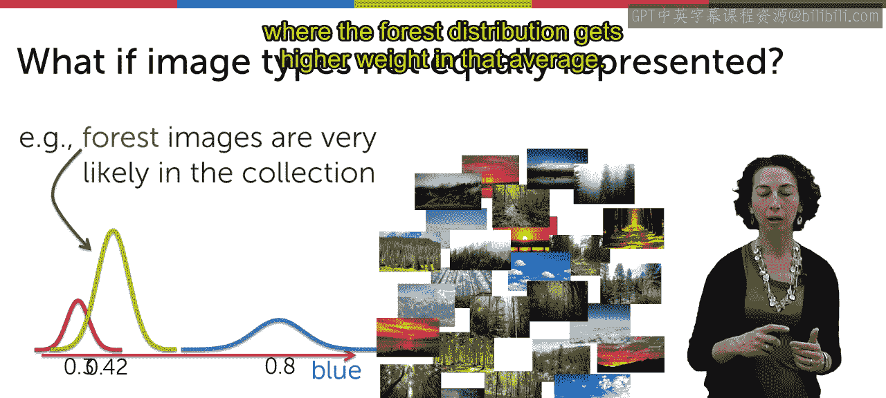
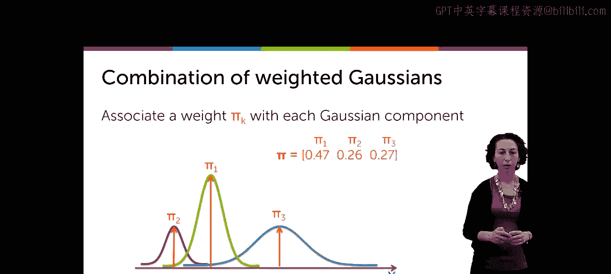
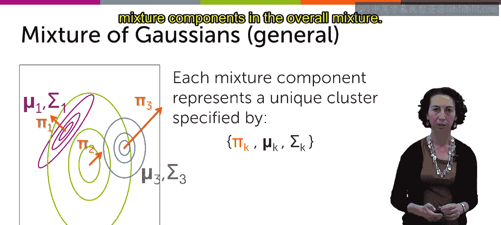
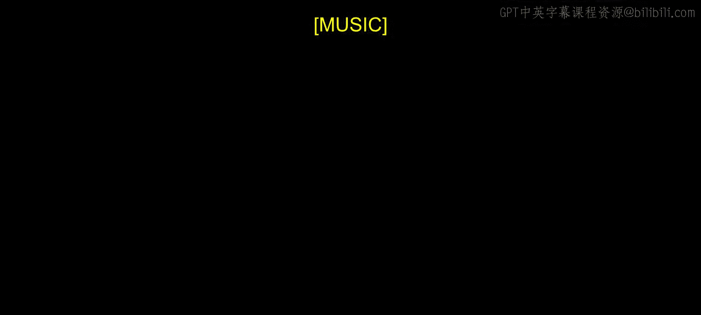

# 华盛顿大学《机器学习（分类，聚类和检索，第3-4课⧸共4课）｜Machine Learning》中英字幕 p165 43_高斯混合模型.zh_en -BV1Sr421F7N7_p165-

。

Now that we provided some background on Gaussian distributions。

 we can turn to a very important special case of a mixture model and one that we're going to emphasize quite a lot in this course and in the assignments。

 and that's called a mixture of Gaussians。And remember that for any one of our image categories and for any dimension of our observed vector like the blue intensity in that image。

 we're going to assume a Gaussian distribution to model that random variable。

 so for example for forest images if we just look at the blue intensity。

 then we might have a Gaussian distribution shown with the green curve here which is centered about this value 0。

42。And I want to mention here that we're actually assuming a Gaussian for the entire three dimensional vector RGB。

 and that Gaussian can have correlation structure and it will have correlation structure between these different intensities。

 because the amount of RGB in an image tends not to be independent。

 especially within a given image class。But for the sake of illustrations and keeping all the drawing simple。

 we're just going to look at one dimension like this blue intensity here， but really in your head。

 imagine these Gaussians in this higher dimensional space。Okay。

 but just to go back to what we were saying， we have a Gaussian per category forest。

Sunsets and clouds。But remember， of course we don't have those labels of our images。

 we can't separate and analyze each one of those classes separately to learn the parameters of those distributions。

 Instead what we have is this pretty nasty。Space of intensities mixed over all these different images so again。

 if we just look at the slice along the blue intensity value。

 then maybe our histogram would look like this three hump distribution that we showed before so this is just a histogram over values in our data but we're going to take a model based approach and somehow we want to model this distribution so the distribution over blue intensity in our entire data set and a question is how are we going to do this。

Well， to do this， we're going to take each one of our category specific distributions and simply average them together。

So the resulting density is going to be an average of each one of these categoryspec Gaussians。

 but this simple averaging assumes that each one of these different categories appears in equal proportion in our data so we have equal numbers of sunset cloud and forest images。

 but what if， for example， there are many more forest images than sunset or cloud images in our data well in that case we'd want a more heavily weight the forest distribution in this mixture in this average so we would do a weighted average over these different distributions where the forest distribution gets higher weight in that average。

More formally， we introduce a set of cluster weights， pi k， one for each cluster K。

So in this example where we're going to assume a model with three different clusters。

 which happens to correspond to the truth， where we have forests， clouds and sunsets， we'd have pi1。

 pi 2 and pi3 where these weights are capturing the relative proportion of these images in our entire data set。

And each one of these weights has to live between zero and one。

And the sum of the weights across each of the clusters has to equal exactly one。

 and so what this means is when we're doing our。Weighted average and these are the weights that we're using in that weighted average。

 this is something that's called a convex combination So remember or I didn't actually mention this。

 so you might not know it， but it's a distribution， a Gaussian is a distribution。

 so that means if we look at all the mass if we integrate over that distribution over our random variable。

 the sum is one probabilities add to one or in the continuous space。

 they integrate to one Now when we're looking at this mixture model。

If because we're doing a convex combination of these individual Gaussians。

 each of which integrates to one， then the overall result is still going to integrate to one。

 so it still provides a valid distribution。And then finally。

 to complete our mixture model specification or mixtures of Gaussians in particular。

 not only do we have a mixture weight for each one of our different clusters。

 we also have a cluster specific mean and variance term in one dimension。

And remember that those means and variances specify the location and the spread of each one of these different distributions that comprise our mixture model。

And when we're thinking about mixtures of Gaussians in higher dimensions。

 so I'm only going to go up to a picture in two dimensions。

 not really the three dimensional Gaussians that we would be working with for this RGP vector。

 but two dimensions is as much as I can manage a plot。

 we end up with just a generalization of the cluster parameters I talked about on the previous slide。

 the mixture weights are exactly the same that doesn't change or vary with dimensionality。

 but now instead of just a mean and a scalar variance。

 we have a mean vector and covariance matrix for each one of these Gaussians。

 so remember these means and covariances specify not only the location but also the shape and the orientation of these different ellipses。

And then when we're thinking about the mixture weights。

 it's pretty hard to annotate on these types of contour plots。

 just think of taking each one of these distributions。

 which are shown in these green fusia and blue colors and then weighting them and this weight。

 pi k is coming out of the board out of the slide here。

 and that represents how much we're emphasizing each one of these different mixture components in the overall mixture。

