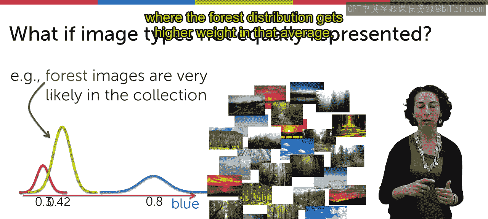
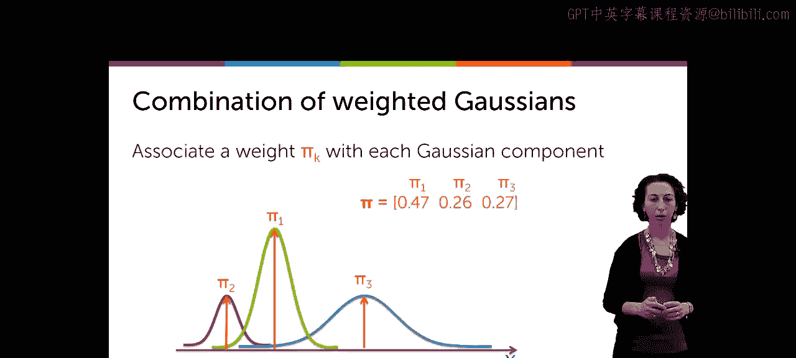
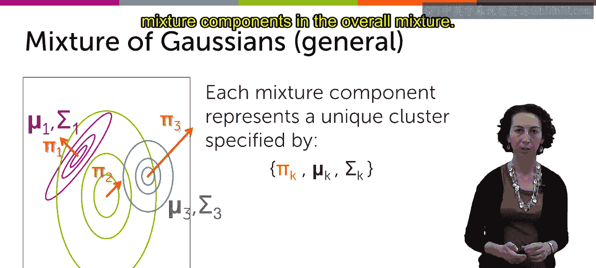
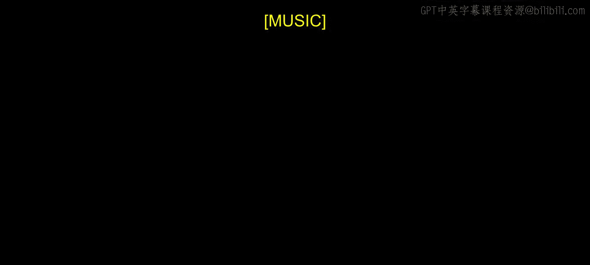

# 机器学习（分类，聚类和检索）：第3-4课：高斯混合模型 🧮

在本节课中，我们将要学习一种非常重要的混合模型特例——高斯混合模型。我们将详细介绍其核心概念、模型构成以及如何通过加权平均的方式，将多个高斯分布组合起来以描述复杂的数据分布。

---

上一节我们介绍了高斯分布的基础知识，本节中我们来看看一个非常重要的混合模型特例，也是本课程和作业中会重点强调的模型，它被称为高斯混合模型。请记住，对于我们的任何一个图像类别，以及观测向量的任何一个维度（例如图像中的蓝色强度），我们都将假设一个高斯分布来对该随机变量进行建模。

例如，对于森林类别的图像，如果我们只观察蓝色强度，那么我们可能会得到一个高斯分布，如这里的绿色曲线所示，其中心大约在0.42这个值。这里需要说明的是，我们实际上假设整个三维RGB向量服从一个高斯分布，并且这个高斯分布可以具有相关性结构，这些不同强度值之间会存在相关性，因为图像中的RGB值往往不是独立的，尤其是在给定的图像类别内。但为了便于说明和保持绘图简洁，我们只观察蓝色强度这一个维度。不过，请在脑海中想象这些高斯分布存在于更高维的空间中。

回到我们所说的，我们为每个类别（森林、日落、云）都有一个高斯分布。但请记住，我们当然没有这些图像的标签，我们无法将每个类别分开并单独分析来学习这些分布的参数。相反，我们拥有的是一个相当复杂的、混合了所有这些不同图像类别的强度空间。

再次，如果我们只观察蓝色强度值的切片，那么我们的直方图可能看起来像之前展示过的这个三峰分布。这只是我们数据中值的直方图，但我们将采用基于模型的方法，我们想要以某种方式对这个分布（即我们整个数据集中蓝色强度的分布）进行建模。问题是，我们该如何做到这一点？

为了做到这一点，我们将取每个类别特定的分布，并简单地将它们平均在一起。因此，得到的密度函数将是这些类别特定高斯分布的平均值。但这种简单的平均假设了每个不同的类别在我们的数据中以相等的比例出现，即我们有数量相等的日落、云和森林图像。

但是，如果例如在我们的数据中，森林图像的数量远多于日落或云图像，那么在这种情况下，我们希望在这个混合（即这个平均）中更重地加权森林分布。因此，我们将对这些不同的分布进行加权平均，其中森林分布在该平均中获得更高的权重。

---

更正式地，我们引入一组聚类权重 **π_k**，每个聚类K对应一个权重。在这个例子中，我们假设一个具有三个不同聚类的模型（恰好对应于我们拥有森林、云和日落的真实情况），我们将有 **π_1**、**π_2** 和 **π_3**。这些权重捕捉了这些图像在我们整个数据集中的相对比例。

以下是关于这些权重的关键点：
*   每个权重必须在0和1之间。
*   所有聚类的权重之和必须恰好等于1。

这意味着当我们进行加权平均时，我们使用的就是这些权重，这被称为凸组合。请记住，高斯分布是一个分布，这意味着如果我们对该随机变量的分布进行积分，其总和（或质量）为一。在混合模型中，由于我们是对这些各自积分为一的高斯分布进行凸组合，因此整体结果仍然会积分为一，所以它仍然提供了一个有效的分布。

最后，为了完成我们的混合模型规范（特别是高斯混合模型），我们不仅为每个不同的聚类有一个混合权重，在一维情况下，我们还有一个聚类特定的均值 **μ_k** 和方差 **σ_k²**。这些均值和方差指定了构成我们混合模型的每个不同分布的位置和展宽。

当我们考虑更高维度的高斯混合模型时（我将只展示二维的图片，而不是我们处理RGB向量时真正使用的三维高斯分布，但二维是我能绘制图的极限），我们最终得到的只是上一张幻灯片讨论的聚类参数的一般化。

以下是高维情况下的参数：
*   混合权重 **π_k** 完全相同，不随维度变化。
*   但现在，我们不再只是一个均值和标量方差，而是为每个高斯分布都有一个均值向量 **μ_k** 和协方差矩阵 **Σ_k**。

这些均值和协方差不仅指定了位置，还指定了这些不同椭圆（等高线）的形状和方向。当我们考虑混合权重时，很难在这种等高线图上标注，只需想象取这些以绿色、紫红色和蓝色显示的分布中的每一个，然后对它们进行加权。这个权重 **π_k** 是从图板（幻灯片）中延伸出来的，它代表了我们在整体混合中对每个不同混合成分的强调程度。

---

本节课中我们一起学习了高斯混合模型的核心思想。我们了解到，它通过为每个潜在类别（或聚类）分配一个高斯分布、一个混合权重 **π_k**，以及相应的参数（均值 **μ_k** 和方差/协方差 **Σ_k**），来对复杂的数据分布进行建模。模型通过凸组合（加权平均）这些高斯成分来形成整体的概率密度函数，从而能够灵活地描述多模态数据。