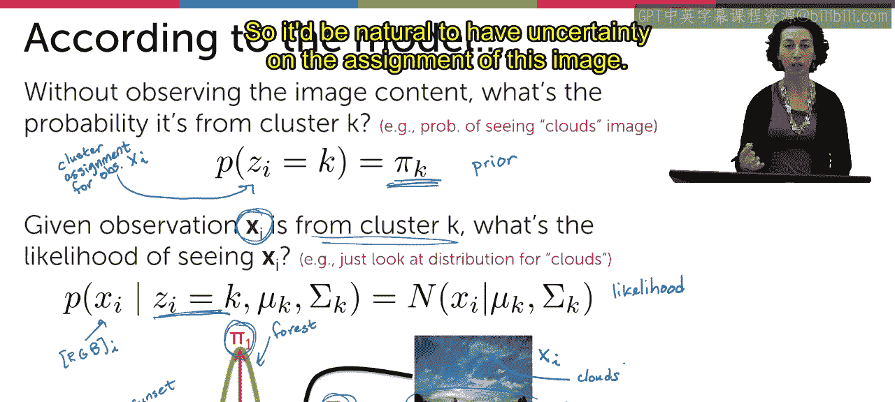

# 华盛顿大学《机器学习（分类，聚类和检索，第3-4课⧸共4课）｜Machine Learning》中英字幕 p166 44_解释高斯混合模型的项.zh_en -BV1Sr421F7N7_p166-

。

And when we're thinking about using mixture models to do clustering。

 note that they can also be used just to do what's called density estimation。

 so estimate those types of curves over the histograms that we drew earlier but in our case we're going to focus in on the clustering application and there there's a really important other variable that we're going to introduce。

 and that is the cluster indicator， the Simon variable for every one of our observations so we have。

This is the。Quster。Assignment。Four observation， X， I。

So this is exactly the same variable that we had in K meanss that was assigning observations to clusters。

 but in that case just using the cluster center， okay。

 so let's step back and think about what our model is saying。

And the first question we can think about is what's the probability that the I data point in our data is associated with the Cath cluster。

 so for example， when we're talking about our image we could say what's the probability that the Ith image I see is。

 let's say in the cluster of cloud's images and let's talk about this before we've actually observed what the image is。

 all we know is it's the Ith index in our dataset。Okay， well。

 this is fully specified by the Mi weight pi K， because that tells us how prevalent cloud images are in our data。

So that's given right here， and if we don't observe the content of the image。

 then we just are caring about how many cloud images do we have relative to forest images relative to sunset images？

So we say that the prior probability that the Ih image is assigned to cluster K is given by pi k。

Another question is what if I know that an image comes from cluster K。

 okay so I'm going to fix that I already know that it's a clouds image。Now I can say。

 what's the likelihood of observing the RGB vector associated with this image， so X I。Given that。

The image came from the Ca cluster， this cluster of cloud images。And in this case。

 what we do is we simply go to this is the。Distribution。Of。Cloud images or distribution of blue。4。

Cloud images。And we say， okay， let's take this one image I have。 This is my X I image。

 and I look at its blue intensity， and I say under this distribution for clouds， how likely is it？

Well。It's pretty likely。So it's a reasonable guess that or it's reasonable to say that this was a clouds image。

 but I can also look at this probability under， remember this was the forest category。

And I could say， well， what's the likelihood of this image under the forest category， Well。

 it's not that high， but on the other hand。What we know is that there are many more forest images in our data than cloud images。

 so what we're going to be doing when we're going to form our soft assignments。

 which we'll talk about in the next section is we're going to be thinking about waitinging these two terms saying well what's the prior probability that this image is from any one of these different classes so in this case。

It's most likely a forest image。But then I say， okay， well。

 now I've observed the content of this image， the RGB vector for this image， and I want to say。

 I need to weight that in。And。Under the sunset category。It's extremely。

 extremely unlikely there's basically zero probability of observing this blue intensity value under that category so I can rule it out regardless of what the weight is on that category。

 but for these other categories， these other clusters。

 there's going to be some competition between how much I'm likely to just see images of that type versus how likely it is under that category。

And we're going to use both of these things to represent our uncertainty about the cluster assignment。

So just to circle back and make sure we're very clear when we're looking at the probability of an observed RGB vector。

RGB for image I， given that it's in cluster K。Then this is just a single Gaussian with mean muk and covariance sigma K。

 and this is referred to as the likelihood。Term。Whereas before we call this the prior term。

And I want to point out that this image， indeed there should be uncertainty about whether it's assigned to the clouds cluster or the forest cluster because here we see some trees。

And here we see some clouds。So it would be natural to have uncertainty on the assignment of this image。

