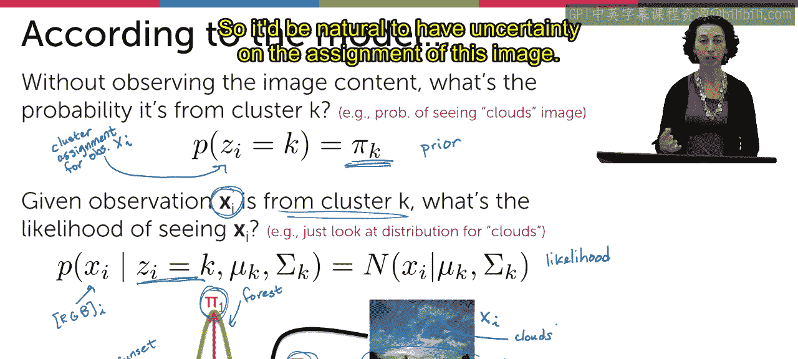

# 机器学习（分类，聚类和检索）：第3-4课：解释高斯混合模型的项

在本节课中，我们将学习高斯混合模型（GMM）中各项的含义，并理解它们如何共同作用以进行聚类。我们将重点关注模型中的先验概率和似然项，并解释它们如何影响对数据点所属簇的“软”分配。

## 概述

上一节我们介绍了高斯混合模型的基本形式。本节中，我们将深入探讨模型中的两个核心组成部分：**先验概率**和**似然**。理解这些项是理解GMM如何量化数据点属于某个簇的不确定性的关键。

## 先验概率：数据点属于某个簇的初始信念

首先，我们考虑一个基本问题：在观察到数据点本身的具体内容之前，第 `i` 个数据点属于第 `k` 个簇的概率是多少？

例如，在我们的图像数据集中，这可能是在看到图像像素之前，问“第 `i` 张图片是云朵图片的概率是多少？”

这个概率完全由混合权重 `π_k` 决定。`π_k` 代表了第 `k` 个簇在整个数据集中所占的比例或普遍程度。

因此，我们可以说，第 `i` 个观测值被分配到第 `k` 个簇的**先验概率**由 `π_k` 给出。

**公式表示：**
`P(z_i = k) = π_k`
其中 `z_i` 是第 `i` 个数据点的簇分配指示变量。

## 似然：在已知簇类别下观测到数据的概率

现在，我们考虑另一个问题：假设我们已经知道一个数据点来自某个特定的簇（例如，已知一张图片是“云朵”类别的图片），那么观测到该数据点具体特征值（例如其RGB向量 `x_i`）的概率是多少？

在这种情况下，我们只需查看定义该簇的高斯分布。对于第 `k` 个簇，其分布由均值 `μ_k` 和协方差矩阵 `Σ_k` 参数化。

因此，在已知数据点属于第 `k` 个簇的条件下，观测到其特征向量 `x_i` 的概率，就是该高斯分布在 `x_i` 处的概率密度。

**公式表示：**
`P(x_i | z_i = k) = N(x_i | μ_k, Σ_k)`
这个项被称为**似然**项。

## 结合先验与似然：形成软分配

理解先验和似然后，我们就能理解GMM如何进行“软”聚类分配。

当我们实际观察到一个数据点 `x_i` 时，我们需要结合两方面信息来判断它最可能属于哪个簇：
1.  **先验 (`π_k`)**：每个簇本身的普遍性。即使某个图像看起来不太像典型的“森林”图片，但如果数据集中森林图片占绝大多数，它仍有可能是森林图片。
2.  **似然 (`N(x_i | μ_k, Σ_k)`)**：该数据点与每个簇的匹配程度。一个非常蓝的图片在“云朵”分布下的概率会很高，而在“日落”分布下的概率则几乎为零。

GMM通过贝叶斯规则将这两者结合起来，计算数据点属于每个簇的**后验概率**。这个后验概率就是我们的“软”分配，它量化了归属每个簇的不确定性。

例如，一张同时包含云朵和树木的图片，其RGB向量在“云朵”簇和“森林”簇的高斯分布下都可能有一定的似然值。同时，我们需要考虑数据集中云朵和森林图片的先验比例。最终的后验概率会反映这种竞争和不确定性，而不是像K-Means那样做出“非此即彼”的硬性决定。

## 核心概念总结

以下是高斯混合模型用于聚类时涉及的核心变量和概念：

*   **观测数据 (`x_i`)**：第 `i` 个数据点的特征向量（例如，图像的RGB值）。
*   **簇分配变量 (`z_i`)**：一个隐变量，表示第 `i` 个数据点属于哪个簇。在GMM中，我们估计的是它的概率分布。
*   **混合权重 (`π_k`)**：第 `k` 个簇的**先验概率**。表示在选择一个数据点时，它来自第 `k` 个成分的概率。
*   **簇参数 (`μ_k`, `Σ_k`)**：定义第 `k` 个高斯分布的均值和协方差。
*   **似然 (`N(x_i | μ_k, Σ_k)`)**：在已知数据点属于第 `k` 个簇的条件下，观测到其特征 `x_i` 的概率。

## 总结

本节课中，我们一起学习了高斯混合模型中两项关键组成部分的含义。**先验概率 `π_k`** 代表了数据点属于某个簇的初始信念，由该簇在数据中的整体比例决定。**似然项 `N(x_i | μ_k, Σ_k)`** 则衡量了在假设数据点来自某个特定簇的条件下，观测到其具体特征值的可能性。

理解这两项是理解GMM如何工作的基础。在下一节中，我们将看到如何利用这两项计算后验概率，从而实现对数据点的软聚类分配，这比K-Means的硬分配更能表达现实数据中固有的不确定性。