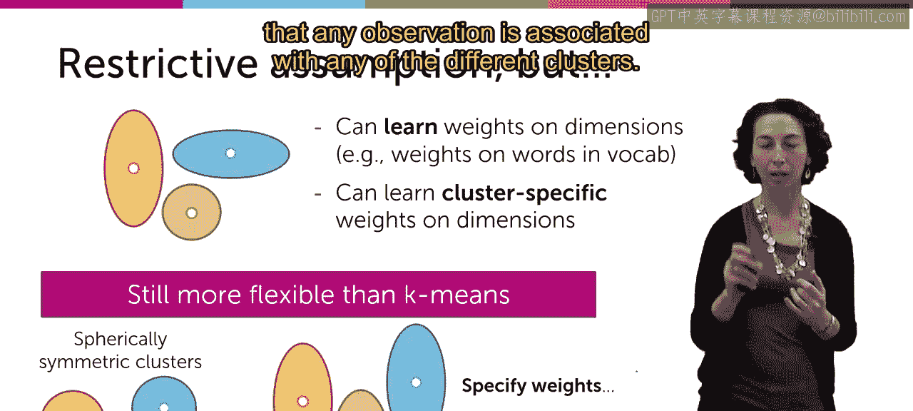
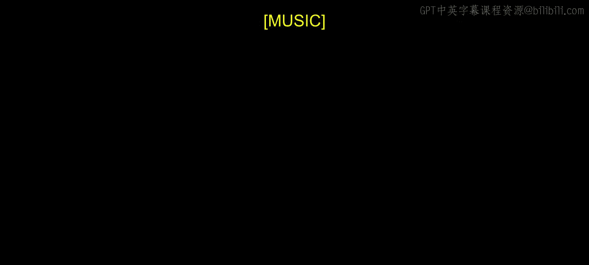

# 华盛顿大学《机器学习（分类，聚类和检索，第3-4课⧸共4课）｜Machine Learning》中英字幕 p167 45_扩展高斯混合模型用于文档聚类.zh_en -BV1Sr421F7N7_p167-

。

To wrap up our discussion on mixture models， I want to discuss how we can think about applying this mixture model to our document clustering task and this is something else that you guys are going to explore in the assignment and remember our goal is to discover groups of related articles but when we're using our mixture model what we're aiming to do is to account for uncertainty in the assignments of data points to these clusters like this article that lies between this blue and orange cluster and for our document representation。

 we're going to use our standard TF IDF vector so it's going to be a vector with the number of elements of this vector equal to the size of the vocabulary and so then based on this document representation we can think of embedding our documents in R to the V So the real space with V different dimensions where V is the size of the vocabulary and this picture here we're just showing two dimensions of course。

It's as if we had a vocabulary which is two different words and then based on this representation。

 our goal of using mixtures of Gaussians is to discover clusters that might look like something like the following and again our mixtures of Gaussians are going to be able to provide soft assignments of data points to these clusters and in the next section we're going to describe algorithmically how we provide these soft assignments。

But let's think a little bit more about applying just a vanilla mixture of Gaussians to this application in particular this high dimensionional document representation。

 because in two dimensions when we talked about parameters of the Gaussian。

 we said there was a mean vector okay that has two parameters that we're going to need to learn。

 which centers this distribution， but then there's this covariance matrix and in two dimensions we had four parameters。

 there was the variance terms so the spread along each one of our two dimensions and then the off- diagonal term which captured the correlation structure and we very quickly mentioned that it's a symmetric matrix so it turns out these off- diagonal terms sigma 12 and sigma 21 are equal。

 so really there are three unique parameters that we need to specify in two dimensions for this Gaussian or three parameters that we're going to need to learn from the data。

But when we're looking at V different dimensions and imagine V is really large。

 if we allowed for a full covariance matrix， we would have v times v plus1 over two unique parameter solar learn。

 and that's a lot on the order of v squared parameters。

 and the way that we get v times v plus1 over 2 instead of v squared is by the fact that it's a symmetric matrix。

 so it's not quite v squared parameters。Okay， so instead of specifying these full covariance matrices。

 what we're going to do is assume a diagonal form to the covariance matrix。

So there's going to be a variance term for each one of our different dimensions， one to capital v。

 and then all of the off diagonal terms are going to be fixed to zero and so we're just going to be learning the variances along the different dimensions。

And so what this means is that instead of having an arbitrarily aligned ellipse。

 we're going to constrain ourselves just to looking at access aligned ellipses。

And this represents a restrictive assumption。But I want to mention a few things The first is that we can actually learn the weights on the different dimensions and these can be different between the different clusters。

 so in one cluster we might learn that one word is more important than the other word informing the score of the observation under that cluster and that could be different than in the other clusters。

So this represents a formulation that's still a lot more flexible than what you had in K means because remember in K means the typical formulation would just assume spherically symmetric clusters。

 that's specific case of axis aligned ellipses where the variance terms are all the same they're all sigma squared along the diagonal and we said we could also do a weighted version of Euclidean distance。

 but that would give us these axis aligned ellipses that were exactly the same between different clusters。

And furthermore， in the case of K means， we had to specify those late weights。

 whereas in the next section， we're going to show that we can actually learn the weights of this mixture model so the weights on these different dimensions that are cluster specific。

And in addition to learning the parameters of these different Gaussians from the data。

 we're also going to learn the soft assignments so the。

Probability that any observation is associated with any of the different clusters。

