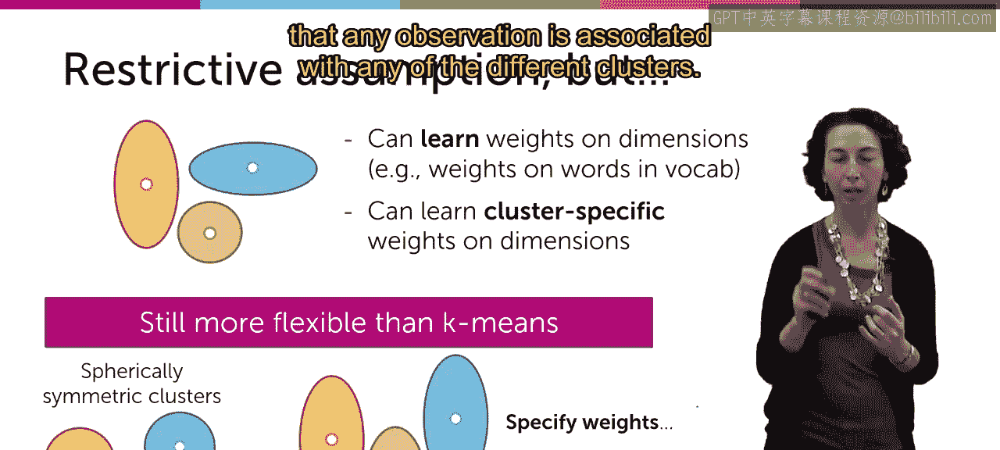

# 机器学习（分类，聚类和检索）：第3-4课：扩展高斯混合模型用于文档聚类 📄

在本节课中，我们将学习如何将高斯混合模型应用于文档聚类任务。我们将探讨如何利用该模型处理高维文档数据，并理解其相较于K均值等方法的优势。最后，我们将简要介绍算法如何为数据点提供“软分配”。

---

在上一节中，我们讨论了混合模型的基本概念。本节中，我们将看看如何将其具体应用于文档聚类。我们的目标是发现相关的文章组，但使用混合模型时，我们旨在处理数据点分配到不同簇的不确定性，例如一篇介于蓝色和橙色簇之间的文章。

对于文档表示，我们将使用标准的TF-IDF向量。这是一个向量，其元素数量等于词汇表的大小。基于此表示，我们可以将文档嵌入到R^V空间，即一个具有V个不同维度的实数空间，其中V是词汇表的大小。下图仅展示两个维度的情况，这相当于我们有一个仅包含两个不同单词的词汇表。

基于此表示，使用高斯混合模型的目标是发现可能如下所示的簇。同样，我们的高斯混合模型将能够为这些簇提供数据点的软分配。在下一节中，我们将从算法层面描述如何提供这些软分配。

---

但让我们更深入地思考一下，将标准的高斯混合模型应用于这个特定的高维文档表示会怎样。因为在二维情况下，当我们讨论高斯的参数时，我们说过有一个均值向量，它有两个需要学习的参数，用于确定分布的中心。但还有一个协方差矩阵，在二维情况下有四个参数：两个方差项（沿两个维度的扩展）和两个非对角线项（捕捉相关结构）。我们曾简要提到它是一个对称矩阵，因此实际上sigma_12和sigma_21是相等的。所以，在二维情况下，我们只需要指定三个唯一参数，或者说需要从数据中学习三个参数。

然而，当我们面对V个不同维度，并且想象V非常大时，如果我们允许一个完整的协方差矩阵，我们将需要学习V*(V+1)/2个唯一参数。这大约是V^2个参数。我们得到V*(V+1)/2而不是V^2，是因为它是一个对称矩阵。因此，这并非完全是V^2个参数。

因此，我们不指定这些完整的协方差矩阵，而是假设协方差矩阵具有对角线形式。这意味着，对于我们的每个不同维度（从1到V），都会有一个方差项，而所有非对角线项都将固定为零。这样，我们只需要学习不同维度上的方差。

这意味着，我们不再考虑任意方向的对齐椭圆，而是将自身限制在仅考虑轴对齐的椭圆。这代表了一个限制性假设。但我想提几点：

首先，我们实际上可以学习不同维度上的权重，并且这些权重在不同的簇之间可以不同。例如，在一个簇中，我们可能学到某个单词在计算该簇下观测值的得分时比另一个单词更重要，而这可能与其他簇中的情况不同。

因此，这种表述仍然比K均值中的表述灵活得多。因为在K均值中，典型的表述只假设球面对称的簇，这是轴对齐椭圆的一个特例，即所有方差项都相同（对角线上的所有值都是sigma^2）。我们说过也可以使用加权欧几里得距离的版本，但这会给我们提供在不同簇之间完全相同的轴对齐椭圆。

此外，在K均值的情况下，我们必须预先指定这些权重，而在下一节中，我们将展示我们实际上可以学习这个混合模型的权重，即这些特定于簇的不同维度上的权重。

除了从数据中学习这些不同高斯的参数外，我们还将学习软分配，即任何观测值与任何不同簇相关联的概率。

---

本节课中，我们一起学习了如何将高斯混合模型的思想扩展到文档聚类。我们理解了在高维TF-IDF向量空间中，使用对角协方差矩阵的实用性和优势，它允许我们学习特定于簇的维度权重，并为数据点提供概率性的软分配，这比K均值等硬分配方法提供了更丰富的信息。