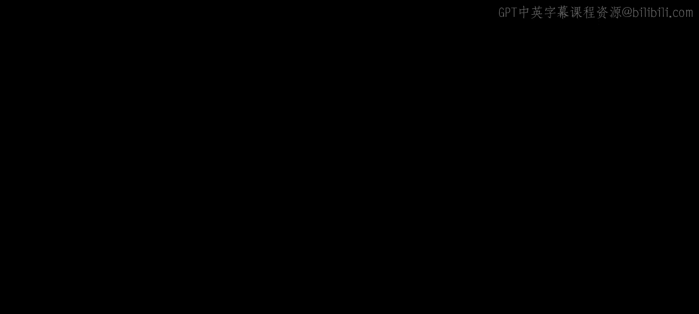
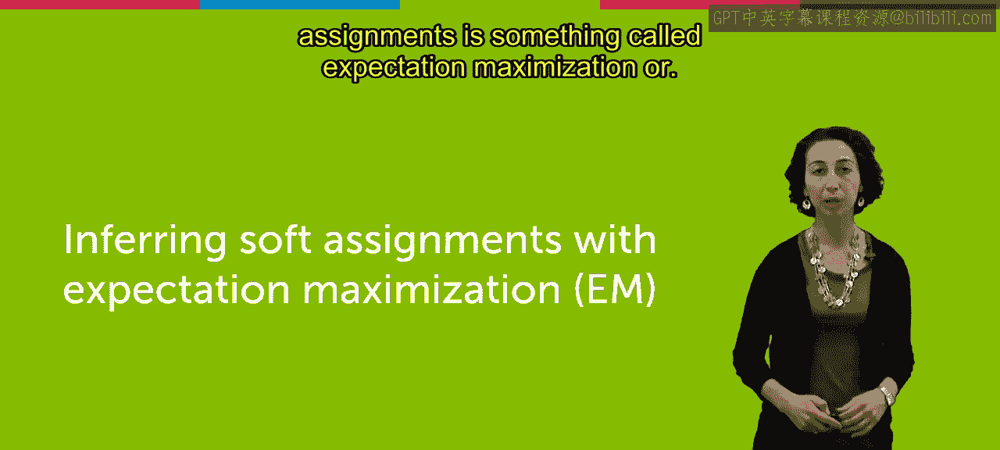
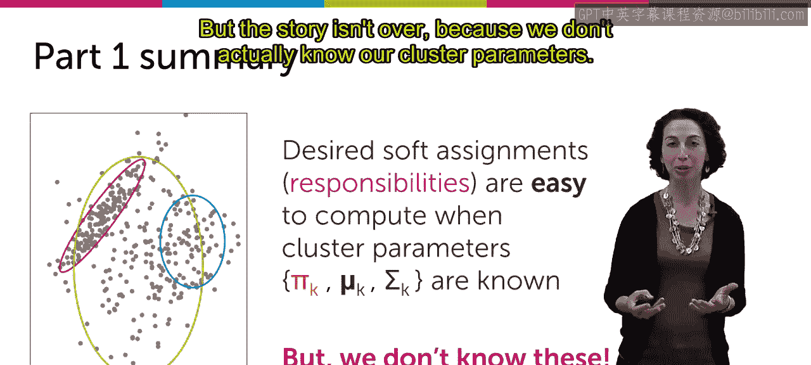

# 华盛顿大学《机器学习（分类，聚类和检索，第3-4课⧸共4课）｜Machine Learning》中英字幕 p168 46_从已知聚类参数计算软分配.zh_en -BV1Sr421F7N7_p168-

。

The algorithm we're going to use to infer the cluster parameters as well as the soft assignments is something called expectation maximization or EM。

And the idea is we start with a set of unlabeled observed inputs， such as the data shown here。

 and the goal is to output a set of soft assignments per data point。

 meaning an allocation of that data point to each one of the clusters。

 and in this example there are three different clusters， a fusia cluster。

 a green cluster and a blue cluster and the shadings of the individual data points indicates the uncertainty of our assignment of that data point to each of these different clusters。

And a key question here is how are we going to output these soft assignments just from this set of unlabeled data points？

Well， to begin with， let's assume that we actually know the cluster parameters and we just want to compute the soft assignments having fixed the values of these cluster parameters。

The soft assignments are quantified by something called the responsibility vector。

 so for each observation I， we form a responsibility vector with elements， R1， R2。

 all the way up to R capital K， where capital K is the total number of clusters。

In our mixture model and each element are I little K。

Represents the responsibility that cluster K takes for observation I so in particular it's the probability that observation I is assigned to the K cluster so that's this term here。

Given， remember， this bar means given。The set of cluster weights and shape。So that's here。

 remember the pis are the weights and the mus and the sigma specify the shapes of each of the clusters。

 and we're going to condition on the observed value of the I data point， so that's Xi here。

So just to make sure this notation is very clear。What we're writing here when we write probability of the first thing is the random variable that the distribution is over。

And then on the right hand side of this given sign， this bar。These are going to be a set of。

Fix values。That define。The probability distribution。

But before we get to specifying this probability in equations。

 let's gain some intuition by looking at a set of pictures and in this example we're going to assume that there' are just two clusters。

 this green and blue cluster with spherically symmetric shapes and we're going to assume that there's basically equal weightings between the two clusters which we see from the fact that they have very similar numbers of data points which are represented by these little stars。

 and then we're going to hone in on a single observation which is outlined with this pink color and we're going to look at the soft assignment of this observation to these two clusters and what we see in this case here is that this highlighted observation is closer to the center of the green cluster than it is to the blue cluster so as a result the green cluster is going to take more responsibility for this observation than the blue cluster though still both split responsibility for。

This observation。But in contrast， in this situation here， notice that we've shifted our。

Highlighted data point towards the blue cluster， so now this key observation is closer to the center of the blue cluster and this blue cluster as a result is going to take more responsibility for this data point。

But finally if the。Key observation where somewhere in between the two clusters。

 then there'd be basically split responsibility between the green and blue cluster representing a lot of uncertainty in the cluster membership for that data point。

But what if one cluster weighed much more heavily in the mixture model than the other cluster。 So。

 for example， what if this green cluster had a lot more mass than the blue one。

 And we see this now by the green cluster having lots and lots of data points in the blue cluster having just a few。

 Well， in this case， if we look at this highlighted observation that was on the boundary of the green and blue clusters。

We're still of course uncertain about the cluster membership。

 but the green cluster starts to seem like a much more likely explanation for this observed point。

And so what happens is because of this imbalance in the proportion of the clusters in our mixture model。

 the green cluster starts to take more responsibility for that point than the blue point。

 whereas previously it was exactly split between the two clusters。In equations。

 we're saying that we need to weigh this initial or prior probability that a given observation comes from any one of our clusters with how likely the observed value is under each of these clusters。

So that's this second term here。So， for example。Let me switch colors here。

Maybe I'll choose a red color if we look at a data point here。

Maybe we would say that this data point is。Very unlikely。Under the green cluster。

Even though our prior probability on the green cluster is much higher。

So we really have to consider both of these two terms together。

Then in order to make this a valid probability， we need to normalize over all possible cluster assignments。

These equations quantified the discussion that we had in the last section where we talked about having to weigh the prior term which represented。

 just， for example， the prior probability that out of our set of images we're going to grab out an image and that image is going to be a cloud image with the likelihood term which represented for a given image based on the values that we're observing of that image。

 how likely are those values under a given cluster assignment。And as we see now。

 it is indeed the combination of these two terms that determine our soft assignments。So in summary。

 if we know the cluster parameters， then computing these soft assignments is really trivial。

 all we have to do is for each one of our possible clusters。

 we compute the prior times the likelihood to form our responsibility and then just normalize this vector so that it sums to one over all the possible clusters。

But the story isn't over because we don't actually know our cluster parameters。

 that's something that we also have to somehow infer just from our unlabeled data。

