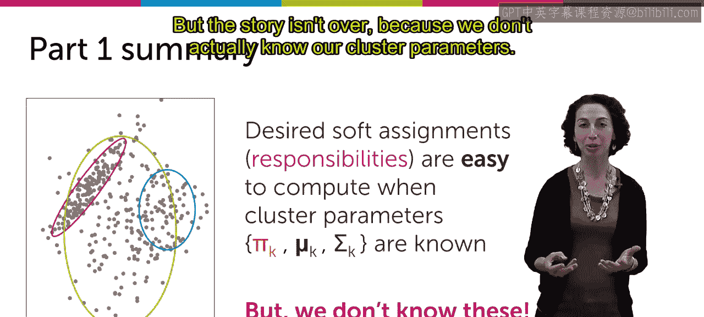

# 机器学习（分类，聚类和检索）：第3-4课：从已知聚类参数计算软分配 🧮

在本节课中，我们将学习如何从一组未标记的数据点出发，计算每个数据点属于各个聚类的“软分配”。软分配量化了数据点属于每个聚类的概率，而非硬性地将其归入单一类别。我们将首先探讨在**已知聚类参数**的情况下，如何计算这些软分配。

---

上一节我们介绍了软分配的概念。本节中，我们来看看如何具体计算它。软分配通过一个称为**责任向量**的量来量化。

对于每个观测数据点 `i`，我们形成一个责任向量，其元素为 `R_i1, R_i2, ..., R_iK`，其中 `K` 是聚类总数。每个元素 `r_ik` 表示第 `k` 个聚类对观测点 `i` 所承担的“责任”，具体来说，它是在给定聚类权重和形状参数的条件下，观测点 `i` 被分配给第 `k` 个聚类的概率。用公式表示如下：

`r_ik = P(z_i = k | π, μ, Σ, x_i)`

这里，`z_i` 是表示观测点 `i` 所属聚类的隐变量，`π` 是各聚类的混合权重，`μ` 和 `Σ` 定义了各聚类的中心（均值）和形状（协方差），`x_i` 是观测到的数据点值。

---

为了更直观地理解，让我们通过一个包含两个聚类的例子来说明。假设有两个球形对称的聚类，一个绿色，一个蓝色，并且它们拥有大致相同数量的数据点（权重相近）。

以下是几种不同情况下，一个特定观测点（用粉色高亮显示）的责任分配情况：

*   **情况一：靠近绿色聚类中心**
    高亮的观测点距离绿色聚类中心更近。因此，绿色聚类对该点的责任大于蓝色聚类，但两者仍共同承担对该点的责任。

*   **情况二：靠近蓝色聚类中心**
    当高亮点移向蓝色聚类中心时，蓝色聚类将承担更多责任。

*   **情况三：位于两聚类中间**
    如果观测点位于两个聚类的中间位置，则绿色和蓝色聚类将几乎平分对该点的责任，这反映了该数据点聚类归属的高度不确定性。

---

但是，如果混合模型中一个聚类的权重远大于另一个呢？例如，绿色聚类拥有大量数据点，而蓝色聚类只有少数几个。

在这种情况下，即使观测点位于两个聚类的边界上，我们虽然仍不确定其具体归属，但权重更大的绿色聚类看起来是更可能的解释。因此，由于混合模型中聚类比例的不平衡，绿色聚类对该边界点的责任会超过蓝色聚类，而此前两者的责任是均分的。

---

在数学上，我们需要将观测点来自任一聚类的**先验概率**（即混合权重 `π_k`），与在该聚类下**观测到当前数据值的可能性**（即似然 `P(x_i | μ_k, Σ_k)`）结合起来考虑。公式如下：

`r_ik ∝ π_k * N(x_i | μ_k, Σ_k)`

这里，`N(x_i | μ_k, Σ_k)` 是高斯分布的概率密度函数。例如，一个数据点可能来自高权重聚类（先验概率高）的**先验概率**很大，但根据其观测值，它在该聚类下的**似然**却非常低。因此，我们必须同时考虑这两项。

为了使 `r_ik` 成为一个有效的概率（即所有 `k` 上的 `r_ik` 之和为1），我们需要对所有可能的聚类分配进行归一化。完整的计算公式是：

`r_ik = [π_k * N(x_i | μ_k, Σ_k)] / [Σ_{j=1}^{K} π_j * N(x_i | μ_j, Σ_j)]`

这个公式量化了我们之前的讨论：软分配由**先验项**（代表从数据集中随机抽取一个样本，它属于某类别的初始概率）和**似然项**（代表在给定类别下，观测到当前数据值的可能性）共同决定。两者的结合最终决定了我们的软分配。

---

本节课中我们一起学习了在已知聚类参数（混合权重 `π`、均值 `μ` 和协方差 `Σ`）的情况下，如何计算软分配。总结来说，计算过程非常简单直接：

1.  对于每一个可能的聚类 `k`，计算先验概率 `π_k` 与似然 `N(x_i | μ_k, Σ_k)` 的乘积。
2.  将上述乘积对所有聚类 `k` 求和，得到归一化分母。
3.  用每个聚类的乘积除以这个总和，得到归一化的责任值 `r_ik`，它构成了一个和为1的概率向量。

然而，故事并未结束，因为在现实中，我们通常**并不知道**这些聚类参数，它们也需要我们从无标签数据中推断出来。这将是后续课程要解决的核心问题。