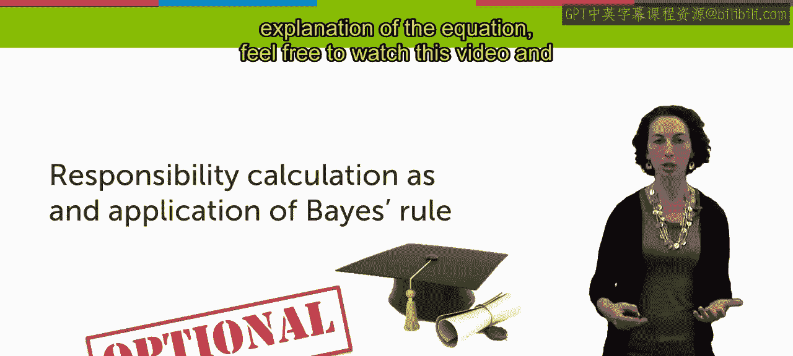
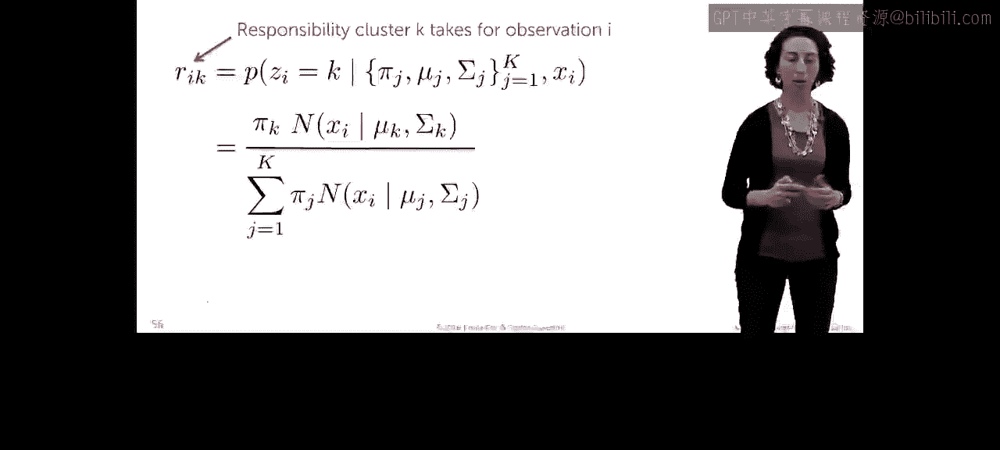
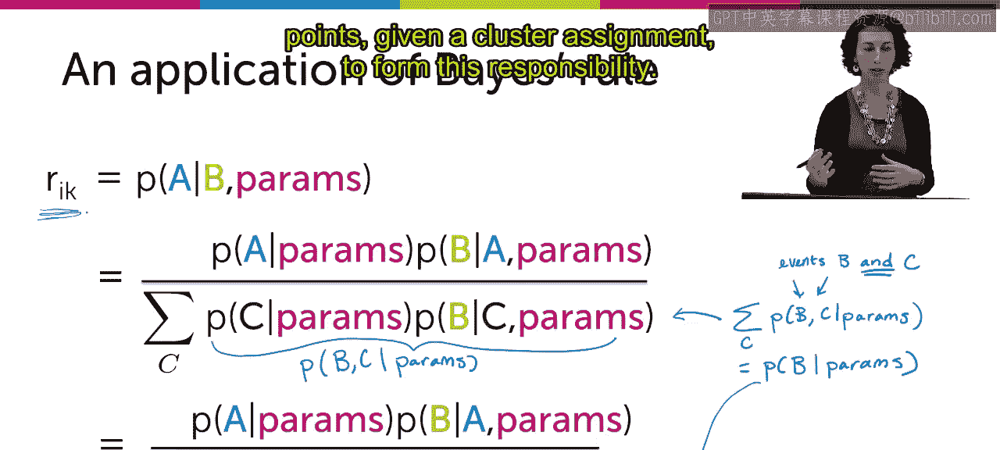

# 华盛顿大学《机器学习（分类，聚类和检索，第3-4课⧸共4课）｜Machine Learning》中英字幕 p169 47_可选：责任作为贝叶斯规则.zh_en -BV1Sr421F7N7_p169-

。

But before we continue our story about the EM algorithm。

I wanted to spend a little bit of time showing how these soft assignments are actually an application of something called Bayes rule。

 and this is advanced material， so we're going to make this an optional video and for those who are happy with the level of description of the responsibility equation in the previous video。

 then that's fine， skip ahead to the next video， but for those who are interested in a little bit more detailed derivation and explanation of the equation。

Feel free to watch this video and see a few more details。Okay。

 so remember that our responsibilities were the probability of an assignment of observation I to cluster K。

 given our cluster parameters and given the observed data value Xi。

Well， let's just call all those cluster parameters just parameterss。

 and then what we see is that we can rewrite this equation and say pi k。

 so the prior probability of an assignment of Z equals k is just what's written here。

 probability Z equals k given our parameters where in this case the only parameter we actually need is pi K。

And likewise， for this likelihood term we can write it generically as probability of our observed data point。

 X， given an assignment to cluster K， Z equals k， and given our model parameters， where again。

 here in this case， the only parameters that we're going to need are muK and Sigma K。Okay。

 but we're trying to write things more generically so that we can show how this is an application of BayE rule。

 but to do this， we're going to say that the eventziI equals k。

 we're going to call that event A and the event that we observe a value XI for our I data point。

 we're going to call event B。Now using this we can rewrite the terms in our numerator as probability of A given our parameters and probability of B。

 given A and our parameters。Then we can do the same thing in the denominator where now we're going to call the event Z equals J an assignment of observation I to cluster J。

 we're going to call that some event C， and so we can rewrite the numerator as probability of C。

 given our parameters times the probability of B still the same observed value now given this event C and again our model parameters and in the denominator we're going to sum over all these possible event C。

And then putting all these pieces together， we have the following， we have that our responsibilities。

 our probability of A， given B， and our parameters。

 and we rewrote that on the previous slide in the following form。We're here in the denominator。

 if we look at this thing here inside， we get that this is by definition equivalent to probability of events B and C。

 given。Our model parameters。 And so when we look at this sum event。We have some over event C。

 probability of events B and C given our parameters。So this means just to be clear。Events。B， and。s。

Then。Again， if we sum over one of these events， if we're looking at every time B occurs with a specific example of C and then we're summing over all possible values of C。

 that's exactly equivalent to just the probability of that single event B given，Our model parameters。

So then using this fact， this is how we get the denominator here。

And now what we see is we have just a much more general form of standard base rule in particular。

The standard way we would write B rule is that probability of A， given B。

Is equal to probability of a， probability of B given a。Divideed by probability of B。

And we see exactly this form， except the only difference is we're also conditioning on something。

 our model parameters， and we're doing so for every term in this basees rule。Okay， so in summary。

 the derivation of the equation for the soft assignments is just an application of Bes rule so that we can utilize known quantities from our model like the prior probabilities of cluster assignments and the likelihood of data points given a cluster assignment to form this responsibility。

