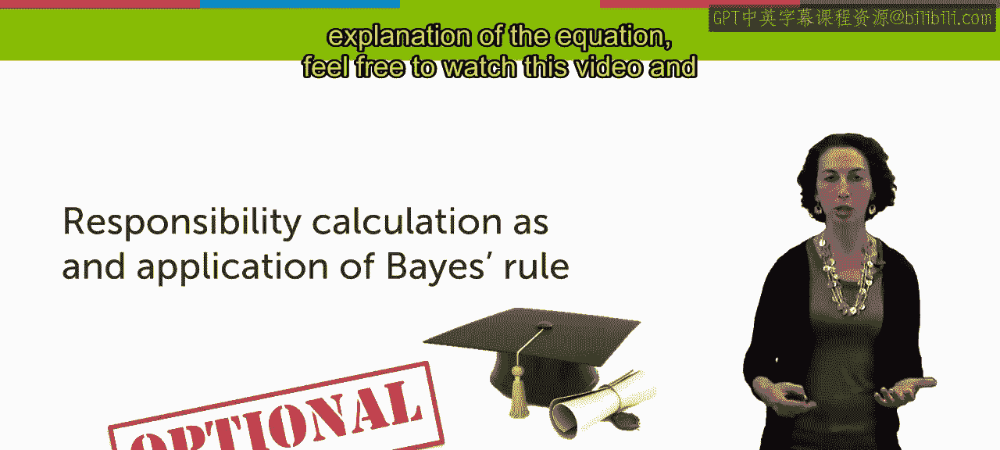
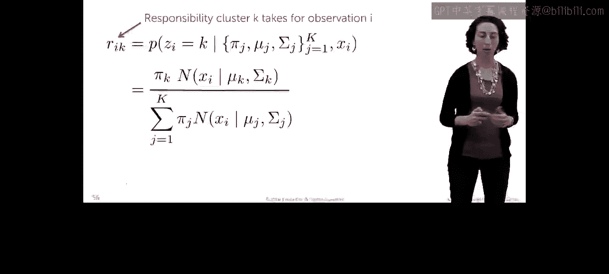
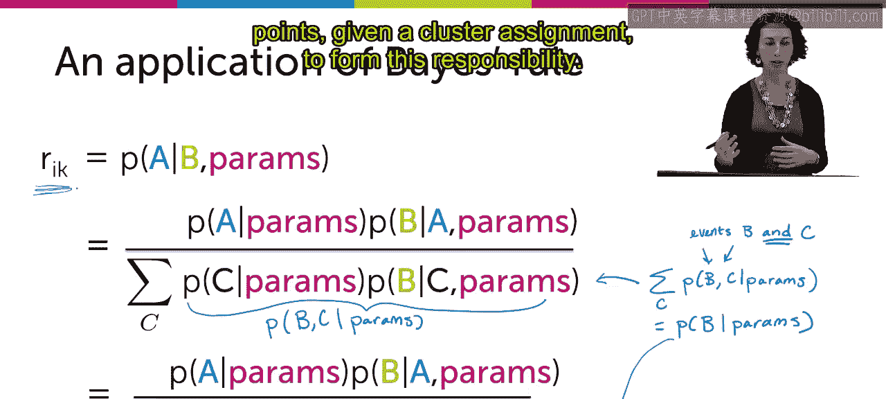

# 机器学习（分类，聚类和检索）：第3-4课：可选：责任作为贝叶斯规则 📚

在本节中，我们将深入探讨期望最大化算法中“责任”这一核心概念背后的数学原理。具体来说，我们将看到，之前视频中介绍的软分配公式，实际上是**贝叶斯规则**的一个直接应用。理解这一点，能让我们更深刻地把握混合模型参数估计的逻辑。

在上一节，我们介绍了期望步骤中计算“责任”的公式。本节中，我们来看看这个公式如何从概率论的基本原理——贝叶斯规则中推导出来。

---

## 责任公式的回顾与泛化

首先，让我们回顾一下责任的定义。责任 `r_ik` 表示在给定模型参数和观测数据点 `x_i` 的条件下，数据点 `i` 属于聚类 `k` 的概率。用数学符号表示为：

**公式：** `r_ik = P(z_i = k | x_i, 参数)`

为了进行更一般的推导，我们先将模型参数（如混合权重 `π_k`、均值 `μ_k`、协方差 `Σ_k`）统称为 **`参数`**。

这样，我们可以将责任公式的分子部分拆解为两项：
1.  **先验概率**：`P(z_i = k | 参数)`。在我们的模型中，这直接就是混合权重 `π_k`。
2.  **似然**：`P(x_i | z_i = k, 参数)`。这由第 `k` 个高斯分布 `N(x_i | μ_k, Σ_k)` 给出。

---

## 引入事件符号

为了清晰地应用贝叶斯规则，我们引入事件符号：
*   将事件“`z_i = k`”记为事件 **`A`**。
*   将事件“观测到数据点 `x_i`”记为事件 **`B`**。

利用这些符号，责任公式的分子可以重写为：
`P(A | 参数) * P(B | A, 参数)`

在分母中，我们对所有可能的聚类 `j` 求和。对于每个 `j`，我们定义事件“`z_i = j`”为某个事件 **`C_j`**。因此，分母中的每一项可以写为：
`P(C_j | 参数) * P(B | C_j, 参数)`

---

## 应用贝叶斯规则

将上述部分组合起来，责任公式变为：

**公式：**
`P(A | B, 参数) = [P(A | 参数) * P(B | A, 参数)] / [Σ_j P(C_j | 参数) * P(B | C_j, 参数)]`

现在，观察分母中的求和项 `Σ_j P(C_j | 参数) * P(B | C_j, 参数)`。根据概率的链式法则，`P(C_j | 参数) * P(B | C_j, 参数)` 等于联合概率 `P(B, C_j | 参数)`。

因此，对整个分母求和 `Σ_j P(B, C_j | 参数)`，实际上就是对所有可能的聚类分配 `C_j` 进行边际化，其结果正是 **`P(B | 参数)`**，即在给定参数下观测到 `x_i` 的概率（也称为证据）。

于是，责任公式简化为经典贝叶斯规则的形式：

**公式：**
`P(A | B, 参数) = [P(A | 参数) * P(B | A, 参数)] / P(B | 参数)`

这与标准的贝叶斯公式 `P(A|B) = P(A) * P(B|A) / P(B)` 完全一致，唯一的区别是我们在所有项中都**条件依赖于模型参数 `参数`**。

---

## 总结

本节课中我们一起学习了责任公式的贝叶斯解释。我们通过以下步骤完成了推导：

1.  **回顾责任定义**：将其视为一个后验概率。
2.  **泛化与符号化**：将模型参数和观测数据抽象为事件。
3.  **分解与重组**：将公式拆分为先验与似然的乘积。
4.  **应用边际化**：将分母的求和识别为对证据项 `P(B|参数)` 的计算。

最终我们得出结论：**期望最大化算法中用于软分配的“责任”计算公式，是条件化于模型参数后的贝叶斯规则的一个直接应用**。它利用了我们模型中已知的量（聚类分配的**先验概率** `π_k` 和给定聚类后数据点的**似然** `N(x_i | μ_k, Σ_k)`），来计算数据点属于每个聚类的**后验概率** `r_ik`。理解这一点，有助于将EM算法的E步骤牢固地建立在概率论的基础之上。