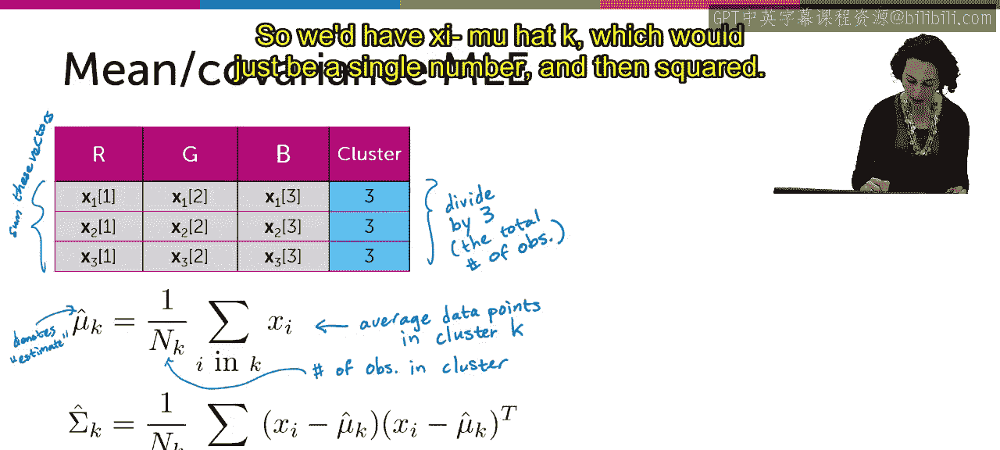
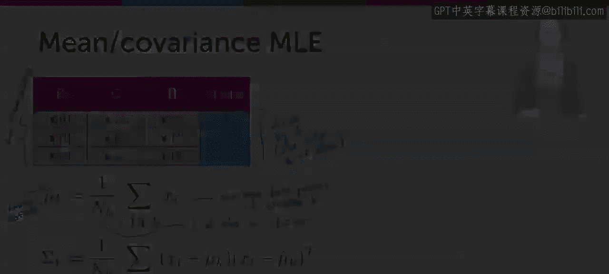
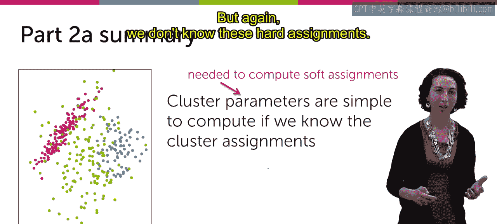
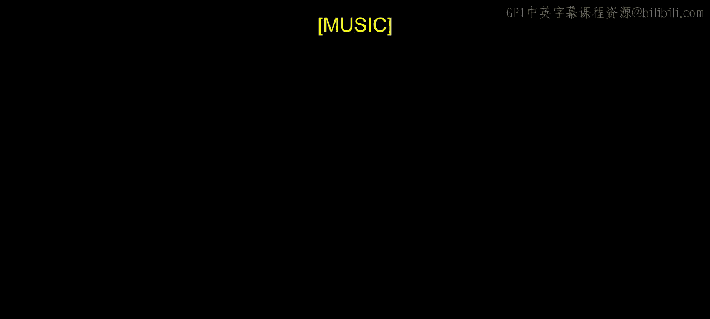

# 华盛顿大学《机器学习（分类，聚类和检索，第3-4课⧸共4课）｜Machine Learning》中英字幕 p170 48_从已知聚类分配估计聚类参数.zh_en -BV1Sr421F7N7_p170-

。

Continuing our EM story， so far we've shown that if we know the cluster parameters。

 then the soft assignments are very easy to compute。Well， now let's consider the alternative。

 let's assume that we know the cluster assignments and we want to infer our cluster parameters。

 and for this part we're going to assume that we have hard assignments of observations to clusters and in pictures these hard assignments are showed by the colors of each data point and when we have these hard assignments。

 we just have three different colors in this plot rather than the spectrum of colors that we showed earlier when we are talking about having soft assignments。

But once we've fixed these cluster assignments， a question is， does this data point here。

 which is assigned to this green cluster influence our parameter estimation problem for estimating the parameters of the fusia cluster or the blue cluster？

And the answer is no。Only the observations that are assigned to a given cluster inform the parameters of that cluster。

And we saw this in K means when we were talking about updating the means just using the observations that were assigned to a given cluster。

 but now we're going to have a more general form of an update where we're not just updating the centers of these clusters。

 but also the shapes。But just to emphasize， fixing the cluster assignments means that our estimation problem decouples over our different clusters。

Let's go back to our image clustering task and assume that we store our data。

 the RGB values associated with each image， as well as these hard cluster assignments in a table as shown here。

Well， the first thing we're going to do is we're going to split up this table based on these hard cluster assignments。

 so we're going to have one table of data points that are assigned to cluster 3。

 one table of data points assigned to cluster2 and another table of data points assigned to cluster1。

 and then we're going to consider each one of these data tables completely independently when we're forming our parameter estimates for each one of these clusters。

 so let's look， for example， at the data points associated with cluster 3。

 when we're going to form our parameter estimates what we're going to do is something called maximum likelihood estimation。

 which we saw in the classification course where we're going to search over all possible parameter settings and find the settings that maximize the likelihood of our observed data under our specified model。

So remember that each one of our clusters is specified with a Gaussian distribution that has two parameters。

 a mean and a covariance。And let's spend a little bit of time talking about the form of the maximum likelihood estimate of these two parameters。

Well， for the mean， the maximum likelihood estimate is exactly equal to just the sample mean。

 so what we're going to do is simply average data points that are in cluster K。So here。

NK represents the number of observations。In cluster K。

And here we're just summing over the data indices of points in this table that had this hard assignment to cluster three。

 for example， and we're summing up all these values， so it would be this vector。

So we would just literally sum。These vectors。And then we would。Divide by。3。

The total number of observations。Not to be confused with the fact that it's also the label of this cluster。

 cluster three， that's not what I mean， I mean the fact that there are three rows in this table。Okay。

 so that would provide our estimate of the mean and we denote our estimate with this little hat here。

And if you look at this equation， you see that it's exactly the same equation that we used in K meanss when we went to update the cluster centers。

 we looked at all data points assigned to a given cluster and just computed the average of those data points。

Okay， but now we also have this covariance term， which determines the spread and orientation of the ellipses in the Gaussian。

And for this， the maximum likelihood estimate is also given by what's called the sample covariance estimate。

 where first we're going to subtract off from each of our data points， the estimated mean。

 and then we're going to compute the outer product of these data points， only summing over again。

 the data points in cluster K and dividing by the total number of observations in cluster K So in the scalar case。

 if we just have our estimate this would be our estimate of the variance in the k cluster。

 this would be equal to one over number of observations in that cluster summing over observations in cluster little K。

And here， instead of this transpose， because this is a vector， we would just have scalar。

 so we'd have Xi minus mu hat k， which would just be a single number and then squared。

And finally， for our cluster proportions， we simply count the number of observations in cluster K and divide by the total number of observations。

 and that forms our estimate of the weight on the k cluster。

So remember pi K was the weight on the k cluster and the hat represents the fact that this is our estimate of this in particular maximum likelihood estimate。

 and I want to emphasize here that the form of pi hat K is not specific to mixtures of Gaussians。

 which is what we've been focusing on in this module， but it would hold if you had。

 for example mixtures of multinomials or mixtures of other distributions， but of course。

 when we talked about the mean and covariance estimates on the previous slide。

 that was specific to having Gaussians defining each one of our clusters。So in summary。

 if we knew the cluster assignment， so the assignments of each data point to a given cluster。

 then computing the estimates of the cluster parameters is very， very straightforward。But again。

 we don't know these hard assignments， so what are we going to do？

