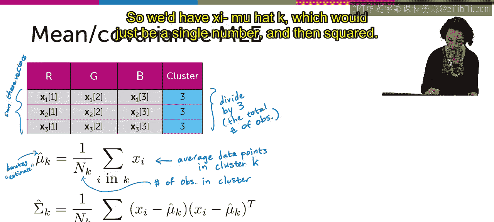
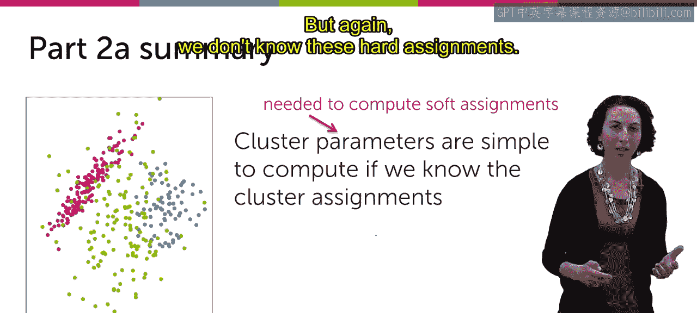

# 机器学习（分类，聚类和检索）：第3-4课：从已知聚类分配估计聚类参数 🧮


在本节课中，我们将学习当已知数据点属于哪个聚类时，如何估计每个聚类的参数。我们将重点讨论高斯混合模型，并介绍最大似然估计方法。

---

上一节我们介绍了在已知聚类参数的情况下如何计算软分配。本节中，我们来看看相反的情况：假设我们已知每个数据点的聚类分配，如何推断出聚类的参数。

我们将假设数据点有**硬分配**，即每个点确定性地属于一个聚类。在图中，这体现为每个数据点有明确的颜色（例如三种颜色），而不是之前软分配时显示的连续颜色谱。

一旦固定了这些聚类分配，一个关键点是：分配给绿色聚类的数据点，会影响我们对紫色或蓝色聚类参数的估计吗？答案是不会。**只有分配给特定聚类的观测数据，才会影响该聚类的参数估计**。我们在K均值算法中见过类似情况，更新聚类中心时只使用分配给该聚类的点。但现在，我们将进行更一般的参数更新，不仅更新聚类中心，还更新其形状（协方差）。

回到我们的图像聚类任务，假设我们将数据的RGB值以及硬聚类分配存储在下表中。

首先，我们将根据硬聚类分配拆分这个数据表。例如，我们会得到一个属于聚类3的数据表，一个属于聚类2的数据表，以及一个属于聚类1的数据表。然后，在形成每个聚类的参数估计时，我们将完全独立地考虑这些数据表。

以聚类3的数据点为例，我们将使用**最大似然估计**方法来估计其参数。这意味着我们将搜索所有可能的参数设置，并找到在指定模型下使观测数据可能性最大的设置。

每个聚类由一个高斯分布指定，该分布有两个参数：均值（μ）和协方差（Σ）。让我们花点时间讨论这两个参数的最大似然估计形式。

对于均值，最大似然估计恰好等于样本均值。我们只需对属于聚类K的所有数据点取平均。

以下是估计公式：

**均值估计公式：**
```
μ̂_k = (1 / N_k) * Σ_{i ∈ C_k} x_i
```
其中，`N_k` 表示分配给聚类 `k` 的观测数量，`C_k` 是属于聚类 `k` 的数据点索引集合，`x_i` 是第 `i` 个数据点的向量。

这个公式与K均值算法中更新聚类中心的公式完全相同：查看分配给给定聚类的所有数据点，并计算这些数据点的平均值。

现在，我们还有协方差项，它决定了高斯分布中椭圆的扩散和方向。其最大似然估计由所谓的**样本协方差估计**给出。

**协方差估计公式：**
```
Σ̂_k = (1 / N_k) * Σ_{i ∈ C_k} (x_i - μ̂_k)(x_i - μ̂_k)^T
```
首先，我们从每个数据点中减去估计的均值，然后计算这些中心化数据点的外积，最后对属于聚类 `k` 的所有数据点求和，并除以聚类 `k` 中的观测总数。

在标量情况下（即单变量数据），这就是方差的估计公式：
```
σ̂_k^2 = (1 / N_k) * Σ_{i ∈ C_k} (x_i - μ̂_k)^2
```




最后，对于聚类比例（混合权重），我们只需计算聚类 `k` 中的观测数量，然后除以观测总数。

**混合权重估计公式：**
```
π̂_k = N_k / N
```
其中，`π_k` 是聚类 `k` 的权重，`N` 是数据点总数。需要强调的是，`π̂_k` 的估计形式并非高斯混合模型特有，它也适用于其他分布（如多项混合分布）的混合模型。然而，前面讨论的均值和协方差估计公式，是专门针对由高斯分布定义每个聚类的情况。

---

**总结**




本节课中，我们一起学习了在已知数据点聚类分配的情况下，如何估计聚类参数。核心要点是：
1.  参数估计问题在固定分配后会**解耦**，每个聚类的参数可以独立估计。
2.  使用**最大似然估计**方法，均值估计为样本均值，协方差估计为样本协方差，混合权重估计为各类别的样本比例。
3.  这些计算非常直接，但前提是我们知道硬分配。然而在现实中，我们通常并不知道这些分配，这引出了我们接下来要讨论的期望最大化（EM）算法。