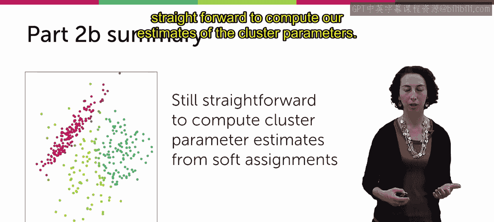

# 华盛顿大学《机器学习（分类，聚类和检索，第3-4课⧸共4课）｜Machine Learning》中英字幕 p171 49_从软分配估计聚类参数.zh_en -BV1Sr421F7N7_p171-

。

Well， to move towards something that we might be able to do。

 let's talk about what would change if we only knew the soft assignments instead of hard assignments。

That is， how would we estimate our cluster parameters from a set of soft assignments of observations to our set of clusters？

Well now， instead of having an observation in a single cluster and no other cluster。

 each observation is really going to be in every cluster。

 it's going to have some split allocation across our different clusters based on the responsibility vector。

 the soft assignment of that observation。And so we're going to think about how to update our cluster parameters based on allocating a single observation to our entire set of clusters。

So when we go to do maximum likelihood estimation from soft assignments。

What we're going to do is we're going to form a data table where for every observation。

 every row of this table， we're going to introduce a set of weights that correspond to the responsibility vector。

 so this looks very similar to what we did in boosting with weighted observations。

But now instead of having a single weight associated with each row， each different data point。

 we have a set of weights and these set of weight sum to one。

 but just like in boosting with weighted observations。

 these weights are going to modify our row operations that we're performing in doing our maximum likelihood estimation。

 but when we have these split allocations of data points across our multiple clusters。

 it's hard to think about counting observations in a cluster so in this case what we can think about doing is computing the total weight in each one of these clusters just summing over the responsibilities in the cluster and think of this as the effective number of observations in each one of our clusters。

And then what we're going to do is pretty similar to what we did when we had hard assignments where we're going to form cluster specific data tables。

 but now instead of dividing up our data table into here are the ones in cluster one。

 here the ones in cluster two， cluster three， every observation is going to appear in each of these data tables。

 because there's some responsibility taken by each cluster for that observation。

 of course it could be zero， but generically let's think of some responsibility for cluster to a given observation。

And so we're going to form a table where we specify the cluster weights associated with each one of our observations。

So here would be the table associated with cluster one。

 and here's the table for cluster 2 and cluster  three。Then for each one of our clusters。

 we're going to compute a maximum likelihood estimate of the cluster parameters。

 but with these weights modifying the row operations that we're doing。

So here are updated maximum likelihood estimates where we're accounting for weights on our observations。

 which we see here。So in particular we see that every row operation。

 so every time we're touching a given data element XI， it's going to be multiplied by RIK。

And the other thing I want to note is that when we're computing the total number of observations in the cluster。

 now we're going to call this NK soft based on our set of soft assignments。

 and this is going to be the effective number of observations in that cluster。

 which is just that some of the responsibilities in that cluster。

We do a similar modification when we go to estimate our cluster proportions where now instead of calculating the total number of observations in a cluster。

 we compute the effective number of observations in that cluster。

 and then we simply divide by the total number of observations in the data。

 which is equivalent to the total effective number of observations， just the sum of this vector here。

So in equations， our updated estimate of our cluster proportions is written as follows where we simply replace NK with this NK soft。

Note that if our responsibilities just took values  zero or1。

 that is if we were making hard assignments of observations to a cluster。

 then things would just default back to what we showed in the previous section。So in particular。

 we can think of this responsibility vector， which now just has a single one in one of these clusters as representing a one hot encoding of the cluster assignment。

So to see the equivalence between what we have here and what we showed in the previous section。

 we can look at our set of equations for our maximum likelihood estimates based on soft assignments。

And we can show that if we actually plug in hard assignments。

 then we get out the set of equations we presented in section 2A。So to begin with。

 we can look at our estimate of the cluster proportions and note that if RIK。

Just takes values in the set0 or 1。 Then what this sum is going to be is we're just going to count。

Observation， I。In cluster。Kay。If R IK。Equals1。Um。So this sum here is just going to default to counting the number of observations in cluster K。

And that's exactly what we had before， and now if we go to our estimate of the mean。And。

When we think about multiplying by RIK。We're only going to be adding X to this sum。

 where remember here our sum is over all the data points if X is in cluster K。Only add。X I。

If I is in K。That is if RIK equals1。And in this case。

 this equation would reduce to 1 overnkk sum I in cluster K X I。

 which again is exactly what we had before。Finally， for our estimate of the covariance。

 it's going to be the same as above。Where we're only going to be adding these outer products if observation I is in cluster K and things are going to default to the same equation as in the hard assignment case。

And just to make this explicit， it's 1 over Nk sum I in K。X I minus mu hat k。

X I minus mu hat K transpose。So this at least serves as a little sanity check that the equations that we presented in this section for our maximum likelihood estimates based on soft assignments。

Might at least not be wrong because we show that if we plug in a hard assignment。

 we get out the maximum likelihood estimates that we knew to be true from before。

What we've seen in this section is that based just on soft assignments。

 it's still straightforward to compute our estimates of the cluster parameters。

🎼。