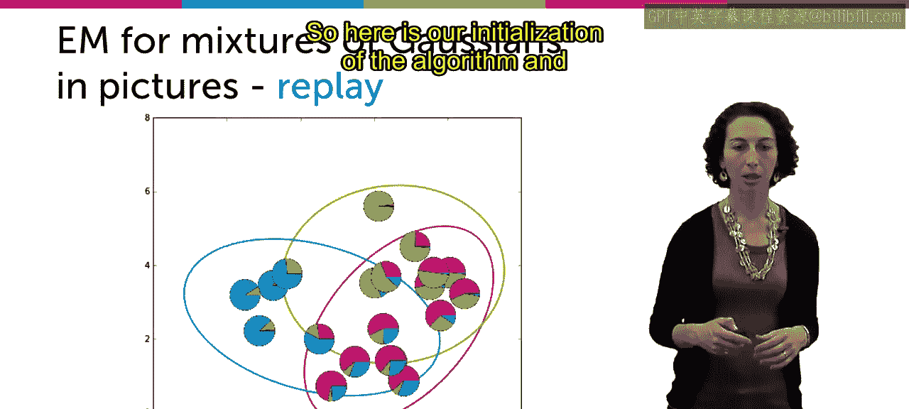
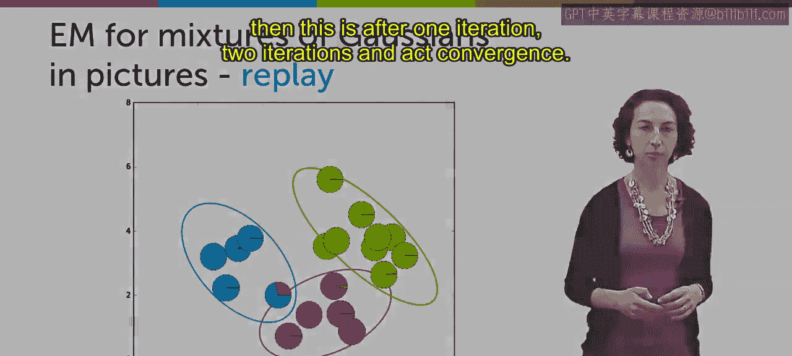

# 华盛顿大学《机器学习（分类，聚类和检索，第3-4课⧸共4课）｜Machine Learning》中英字幕 p172 50_EM算法在方程和图片中的迭代.zh_en -BV1Sr421F7N7_p172-

。

We showed that if you know the cluster parameters， then it's easy to compute the soft assignments and then we showed that if you know the soft assignments。

 it's very straightforward to estimate the cluster parameters。

 so this motivates an iterative algorithm where we're going to cycle between these two steps。

And the algorithm that we're going to present is a special case of a more generic algorithm called expectation maximization or EM。

So more formally， the EM algorithm for mixtures of Gaussians is going to cycle between two steps where in the first step。

 which is called the E step， we're going to estimate our cluster responsibilities。

 given the current estimate of our cluster parameters and the equation for this for the mixture of Gaussian case is shown here。

 which is just a specific example of the equations that we showed previously。

 then the second step of the algorithm， which is called the M step。

 is to compute the maximum likelihood estimate of our cluster parameters。

 given our current estimate of the soft assignments。And so the update here。

 the maximum likelihood estimate based on a set of soft assignments。

 takes the form of the equations that we showed previously。In pictures。

 the EM algorithm works as follows， the first step is to initialize our set of model parameters。

So our mixture weights at the zeroth iteration。Our means。And our covariances。

And those are represented by the ellipses shown in this picture where each one has a center and a given spread and orientation。

 then having fixed these。Cluster parameters。Then we compute。Our responsibilities。

So our estimate of the responsibilities。At the first iteration are based just by computing that prior times the likelihood term for each cluster and then normalizing。

So I won't repeat the equations here， but just to show in pictures the point here is that this data point。

 so each one of these big circles is a data point and it's also a pie chart which is indicating the responsibilities associated with that data point so for example this data point here maybe this has a responsibility vector at the first iteration that is。

Maybe it's something like 0。52。In the fuchsia color and 0。4。

In the blue cluster and has a responsibility 0。08 to the green cluster。

And then having computed these responsibilities for each of our data points。

We go and we reest our cluster parameters。 so we're going to。Maximize。The likelihood。Given our。

Soft assignments。R I K。At the first iteration。And this is going to lead to updated estimates of our cluster parameters。

 pi hat K at iteration1。Mu Hake iteration1， Sigma hat。K and iteration one。

 and what you see in this picture is that these ellipses have shifted and changed。

So then based on these new set of clusters or the parameters associated with these clusters。

We're going to recompute our responsibilities。So our estimate of the responsibilities at the second iteration。

And then we're going to rinse and repeat。Until convergence and we're going to talk about convergence more in the next section。

But here is our plot at convergence and what you see is that our clusters are pretty clean。

 they in my point of view capture the structure of the data fairly well， and really critically。

 if we look at， for example， this observation here， we see that even after convergence。

 there's still uncertainty that's represented in that observations cluster assignment。

And I want to emphasize that that's exactly what we want from this algorithm。

 in contrast to K means that would have made a hard decision about whether that observation was going to be associated with the blue cluster or the fusion cluster here。

 EM provides this sense of uncertainty about which cluster this observation should be associated with。

And this is true for other observations as well， not as much as for this observation that's clearly on the boundary of these two clusters。

But in summary， hopefully we see now in pictures the difference between what EM gives us and K means。

 and again just to emphasize not only is it giving us these soft assignments。

 but we also have estimates of the cluster parameters so that the shapes of these different clusters and their locations in the space。

 not just the cluster locations。So let's watch this one more time and before we do just remember each one of these circles。

 these little pie charts is a data point， and the color shown in the pie chart represent the responsibilities associated with that observation。

 so how much it's currently associated with any one of the three clusters in our model。

And these ellipses represent the three different 2D Gaussians in this example。

 and as we're going through these plots， it's going to show the updates to both the responsibilities and our estimates of these cluster parameters。

So here's our initialization of the algorithm， and then this is after one iteration， two iterations。

 and at convergence。

