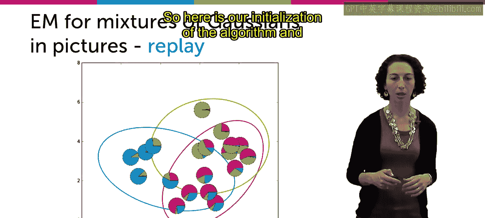
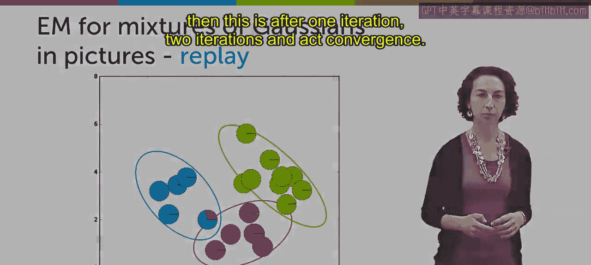

# 机器学习：第3-4课：EM算法在方程和图片中的迭代

在本节课中，我们将学习期望最大化（EM）算法在高斯混合模型中的应用。我们将看到该算法如何在两个步骤之间循环迭代：E步（估计责任）和M步（更新参数），并通过直观的图片演示其收敛过程。

## 算法概述

上一节我们介绍了高斯混合模型的基本概念。本节中，我们来看看如何通过迭代算法来估计模型的参数。该算法的核心思想是：如果已知聚类参数，则很容易计算软分配（责任）；反之，如果已知软分配，则可以直接估计聚类参数。这启发了一种在两个步骤之间循环的迭代算法。

我们将要介绍的算法是更通用的期望最大化（EM）算法的一个特例。

## EM算法的两个步骤

更正式地说，用于高斯混合模型的EM算法将在两个步骤之间循环：

**E步（期望步）**：在给定当前聚类参数估计值的情况下，估计我们的聚类责任。对于高斯混合模型，其公式如下所示，这只是我们之前展示公式的一个具体例子。

**M步（最大化步）**：在给定当前软分配估计值的情况下，计算聚类参数的最大似然估计。此处的更新，即基于一组软分配的最大似然估计，采用我们之前展示的方程形式。

## 算法流程图示

在图片中，EM算法的工作流程如下。

### 第一步：初始化参数

算法的第一步是初始化我们的模型参数集。在第0次迭代时，初始化我们的混合权重、均值和协方差。这些参数由图中所示的椭圆表示，每个椭圆都有一个中心、一定的展宽和方向。

### 第二步：计算责任（E步）

在固定这些聚类参数之后，我们计算责任。第一次迭代时对责任的估计，仅基于为每个聚类计算先验乘以似然项然后进行归一化。图中每个大圆圈代表一个数据点，同时也是一个饼图，表示与该数据点相关的责任。例如，某个数据点在第一次迭代时的责任向量可能是：品红色聚类0.52，蓝色聚类0.4，绿色聚类0.08。

### 第三步：更新聚类参数（M步）

为每个数据点计算出这些责任后，我们去重新估计聚类参数。我们将在给定第一次迭代的软分配 \( r_{ik} \) 的情况下，最大化似然。这将导致聚类参数的更新估计：第一次迭代的 \( \hat{\pi}_k \)、\( \hat{\mu}_k \) 和 \( \hat{\Sigma}_k \)。从图中可以看到，这些椭圆已经发生了移动和变化。

### 第四步：迭代至收敛

然后，基于这组新的聚类参数，我们将重新计算责任（第二次迭代的责任估计）。接着，我们将重复清洗和重复这个过程，直到收敛。我们将在下一节更多地讨论收敛性。

以下是收敛时的图示。可以看到，我们的聚类相当清晰，并且很好地捕捉了数据的结构。非常关键的是，如果我们观察某个边界上的数据点，会发现即使在收敛之后，该观测值的聚类分配中仍然存在不确定性。

需要强调的是，这正是我们希望从该算法中得到的结果。与K-means会对观测值应属于蓝色聚类还是品红色聚类做出硬性决定不同，EM算法提供了关于该观测值应与哪个聚类相关联的不确定性度量。这对于其他观测值也是如此，尽管不如这个明显位于两个聚类边界上的观测值那么显著。

## 总结

总而言之，我们现在通过图示看到了EM算法与K-means的区别。再次强调，EM算法不仅提供了这些软分配，还提供了聚类参数的估计，从而得到了这些不同聚类的形状及其在空间中的位置，而不仅仅是聚类中心的位置。

让我们再看一遍这个过程。请记住，每个小饼图圆圈代表一个数据点，饼图中显示的颜色代表与该观测值当前相关联的责任，即它与模型中三个聚类中任何一个的关联程度。这些椭圆代表本例中的三个不同的二维高斯分布。随着我们浏览这些图，它将展示责任和我们对这些聚类参数估计的更新。

*   这是算法的初始化状态。
*   这是一次迭代后的状态。
*   这是两次迭代后的状态。
*   这是收敛时的状态。

在本节课中，我们一起学习了EM算法在高斯混合模型中的迭代过程，包括其核心的E步和M步，并通过可视化图示理解了参数与责任如何交替更新直至收敛，以及软分配所带来的不确定性优势。