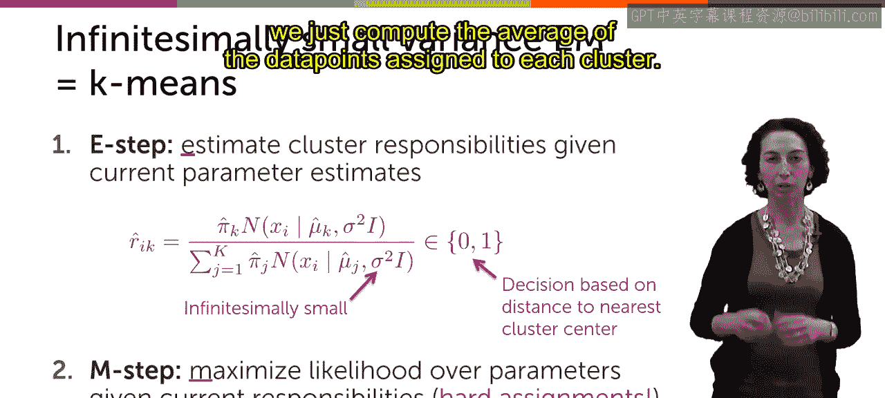

# 华盛顿大学《机器学习（分类，聚类和检索，第3-4课⧸共4课）｜Machine Learning》中英字幕 p174 52_与K-means的关系.zh_en -BV1Sr421F7N7_p174-

。

Finally， I wanted to draw a connection between EM for mixtures of Gaussians and ourK means algorithm。

And to do this， let's consider a mixture of Gaussians where we have spherically symmetric Gaussians that are the same between the different clusters just having different cluster centers。

 so this is equivalent to having covariances。that have sigma squared along the diagonal and the sigma squared is exactly equal along every element of this diagonal。

 so this is going to be the covariance matrix associated with each of the different clusters。

And then what we're going to do is we're going to take this variance term and we're going to drive it to zero。

 so we have these infinitesimally tight clusters。Well。

 because we have these spherically symmetric clusters。

 when we go to compute the relative likelihood of an assignment of an observation to one cluster versus another cluster。

 that just depends on the relative distances to the cluster centers and because we've driven those variances to zero。

 those relative likelihoods go to either one or zero。

 and this happens because of the certainty the clusters have indicated by their zero variances or theyre in the limit zero variances。

And of course， when we're computing our cluster responsibilities。

 we're also weighing in the relative proportions of these different clusters。

 but this is completely dominated by the significant differences in the likelihoods。

 that ratio being either zero or one。And so what ends up happening here is data points are going to be fully assigned to a single cluster just based on the distance to that cluster center。

 and this is just like what we see in K means。And so when we apply our EM algorithm to this mixture of Gaussians with these variances that are。

 of course the same across dimensions， but then shrinking those to zero is in the E step when we're estimating our responsibilities。

 we're going to get these responsibilities that are just zero or1 for the reasons that we just described and then when we go to do our M step。

 we're just going to update our cluster means， the variances are fixed in the limit to zero。

 and when we're estimating our cluster means and of course our cluster proportions to。

 these cluster means are just going to look at the data points that are now hard observe hard assigned to that cluster and use that to estimate the mean in that cluster。

 and so what we see is that these two steps of our EM algorithm are exactly what we do in K means where we make hard assignments of observations to clusters just based on the distance。

to the cluster center， and then we recenter the clusters where we just compute the average of the data points assigned to each cluster。

