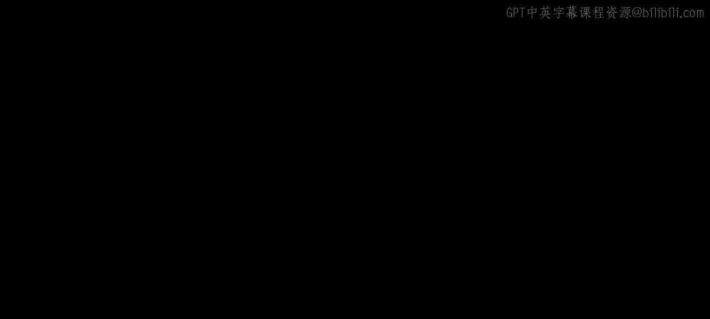
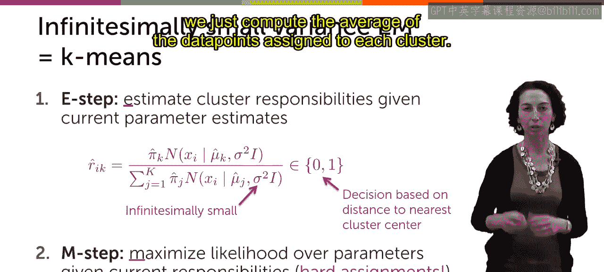

# 机器学习：第3-4课：K-means与高斯混合模型EM算法的关系



在本节课中，我们将探讨高斯混合模型的期望最大化算法与K-means聚类算法之间的深刻联系。我们将看到，在特定条件下，前者可以退化为后者，这有助于我们理解两种算法在思想上的统一性。

## 从高斯混合模型到K-means

上一节我们介绍了高斯混合模型的EM算法。本节中，我们来看看当模型满足特定条件时，它与我们熟悉的K-means算法有何关联。

为了建立这种联系，我们考虑一个特殊的高斯混合模型。该模型中，每个簇对应的高斯分布都是**球面对称**的，并且所有簇的协方差矩阵相同，唯一的区别在于它们的中心点位置不同。

这意味着每个簇的协方差矩阵Σ具有以下形式：
```
Σ = σ² * I
```
其中，`σ²`是一个标量方差，`I`是单位矩阵。也就是说，矩阵对角线上的元素都是相同的`σ²`，非对角线元素为0。

## 方差的极限：趋近于零

接下来，我们将这个方差项`σ²`**驱动至零**。这意味着每个高斯分布簇都变得**无限紧密**，分布范围无限小。

由于这些簇是球面对称的，当我们计算一个观测点属于某个簇的相对似然度时，该值仅取决于该点到各簇中心的**相对距离**。又因为方差被驱动至零，这些相对似然度会趋向于**要么是1，要么是0**。

这种现象源于簇的“确定性”：零方差（或在极限情况下趋近于零的方差）表明簇内几乎没有不确定性。当然，在计算簇的“责任”时，我们也会考虑不同簇的混合比例，但这一项完全被似然度之间巨大的差异（比值要么是0要么是1）所主导。

## 硬分配与K-means的等价性

最终导致的结果是：数据点将根据其到簇中心的距离，被**完全地、确定性地分配**给某一个簇。这与我们在K-means算法中看到的现象完全相同。

因此，当我们对具有上述特性（各维度方差相同且趋近于零）的高斯混合模型应用EM算法时：
*   **在E步**：如刚才所述，我们估计出的“责任”值将只是0或1。
*   **在M步**：我们将更新簇的中心。方差在极限下固定为零，而簇中心的估计（以及簇比例的估计）将仅基于那些被**硬分配**到该簇的数据点来计算其均值。

## 算法步骤对比

我们可以看到，EM算法的这两个步骤，恰好对应了K-means算法的两个核心操作：

以下是K-means算法的两个核心步骤：
1.  **分配步骤**：根据数据点到簇中心的距离，将每个观测点**硬分配**给最近的簇。
2.  **更新步骤**：重新计算每个簇的中心，即计算分配给该簇的所有数据点的平均值。

这正是我们上面描述的、在方差趋近于零时高斯混合模型EM算法的E步和M步。

---



本节课中，我们一起学习了高斯混合模型EM算法与K-means算法之间的理论联系。我们通过将高斯混合模型中各簇的方差驱动至零，展示了EM算法中的软分配如何退化为K-means中的硬分配，并且更新簇中心的步骤也变得完全一致。这揭示了K-means可以被视为高斯混合模型EM算法在特定极限情况下的一个特例，帮助我们从一个更统一的概率视角来理解聚类算法。