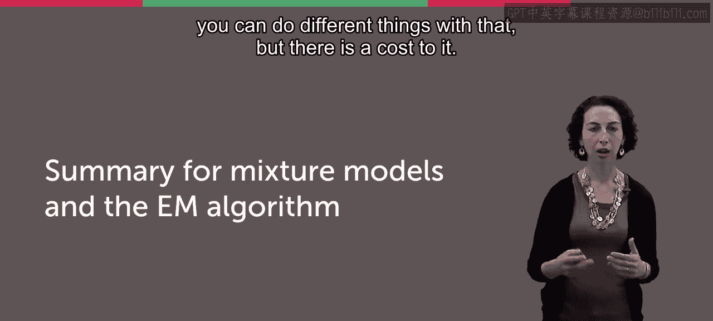
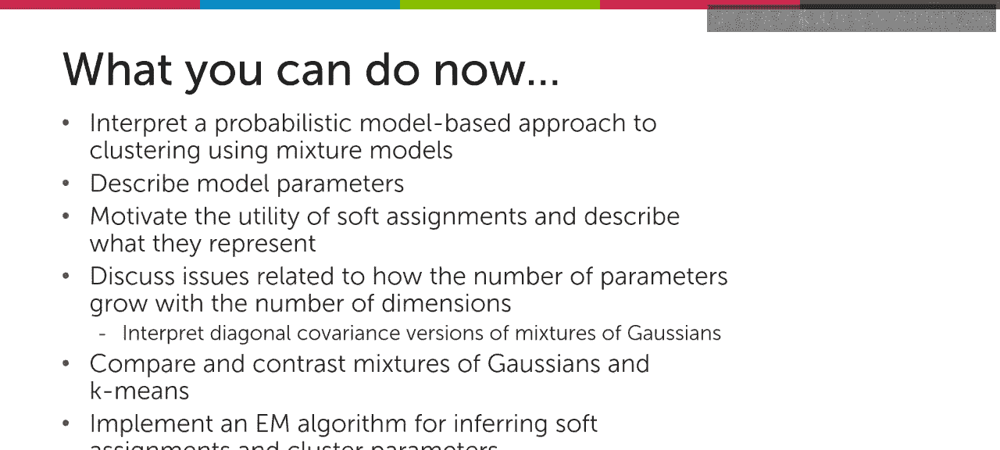

# 华盛顿大学《机器学习（分类，聚类和检索，第3-4课⧸共4课）｜Machine Learning》中英字幕 p175 53_简要回顾.zh_en -BV1Sr421F7N7_p175-

。

In this module we've covered a lot of ground to start with。

 we motivated taking a probabilistic model based approach to clustering and showed mixtures of Gaussians as a special example of such an approach。

Then we presented the EM algorithm， which is a very generally useful algorithm and we specified it specifically for mixtures of Gaussians and throughout the module we've compared and contrasted these modelbased approaches with the k means algorithm that we described in the last module and what we saw in this module is that you can actually view K means as a special case of EM for mixtures of Gaussians so thinking about mixtures of Gaussians in EM in order to infer our cluster parameters and our soft assignments really is a generalization of the K means algorithm that we showed before but there is a cost to it because there are a lot more parameters that we have to think about learning from data and in addition there's a computational cost to doing EM instead of K means both when we're computing our responsibilities and when we're estimating our model parameters each of these steps is more intensive than the steps that you have to perform in K means so it。

Trade off in terms of flexibility and the descriptive output you get。

 you get these soft assignments capturing uncertainty and you can do different things with that。

 but there is a cost to it。

And in summary， I'll just leave you with a list of things that you should be able to do having watched this module。

你。