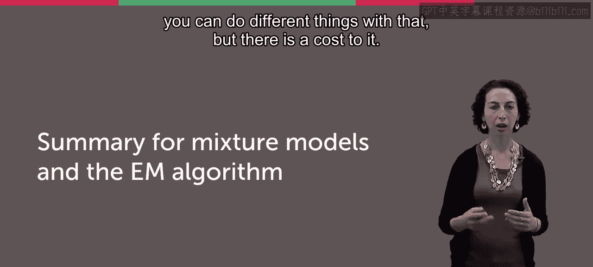
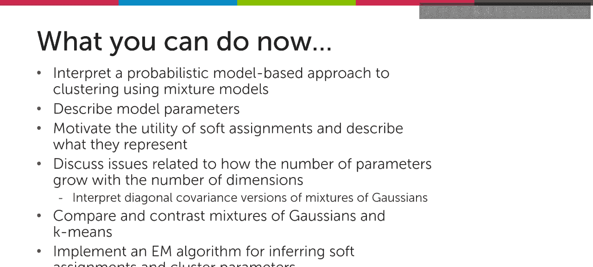

# 机器学习（分类，聚类和检索）：3-4：简要回顾 📚

在本节课中，我们将回顾模块三到四的核心内容，总结基于概率模型的聚类方法，特别是高斯混合模型与EM算法，并将其与之前介绍的K均值算法进行对比。

---

## 模块内容回顾

在本模块中，我们首先介绍了采用基于概率模型的方法进行聚类的动机，并以高斯混合模型作为此类方法的一个具体示例。

上一节我们介绍了聚类的基本动机，本节中我们来看看具体的算法实现。我们详细阐述了EM算法，这是一个具有广泛适用性的通用算法，并特别针对高斯混合模型进行了具体说明。

在整个模块中，我们将这些基于模型的方法与上一个模块中描述的K均值算法进行了比较和对比。我们在本模块中看到，实际上可以将K均值视为高斯混合模型EM算法的一个特例。因此，为了推断我们的聚类参数和软分配，思考高斯混合模型和EM算法，确实是我们之前展示的K均值算法的一种推广。

但这种推广是有代价的，因为我们需要从数据中学习更多的参数。此外，使用EM算法而非K均值也会带来计算成本——无论是在计算责任值时，还是在估计模型参数时，这些步骤都比K均值中需要执行的步骤更为复杂。

因此，这是在灵活性和获得的描述性输出之间的一种权衡。你可以获得这些捕捉不确定性的软分配，并利用它们做不同的事情，但这是有代价的。

---

## 学习目标总结

以下是完成本模块学习后，你应该能够做到的事情列表：

*   解释采用基于概率模型的方法进行聚类的动机。
*   描述高斯混合模型作为概率聚类的一个示例。
*   阐述EM算法的一般原理及其在高斯混合模型中的应用。
*   比较和对比K均值算法与基于高斯混合模型的EM算法。
*   理解将K均值视为EM算法特例的观点。
*   评估使用更复杂的概率模型（如高斯混合模型）所带来的灵活性提升与计算成本增加之间的权衡。

---

本节课中我们一起学习了基于概率模型的聚类核心思想，掌握了高斯混合模型与EM算法的基本原理，并理解了其与K均值算法的联系与区别。关键在于认识到，更强大的模型能提供更丰富的输出（如软分配），但也需要承担更高的计算和参数学习成本。