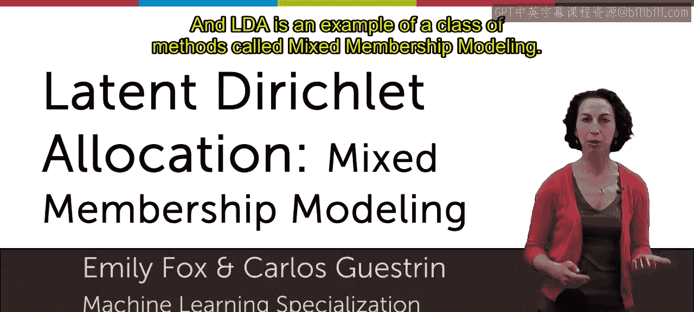
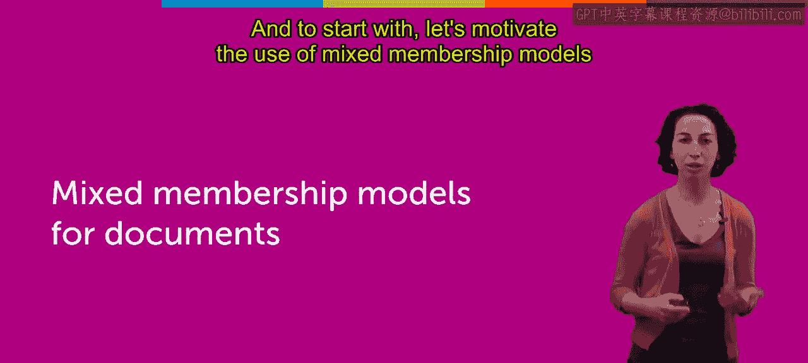
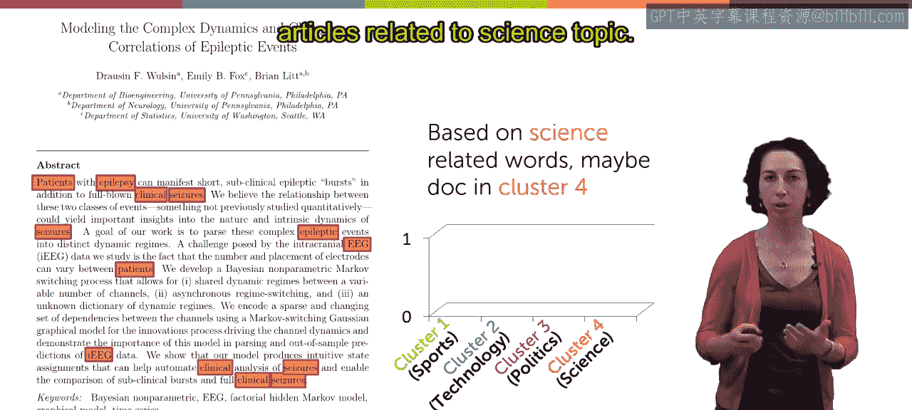
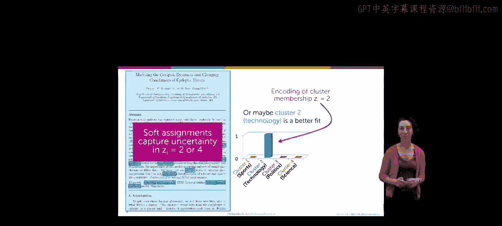
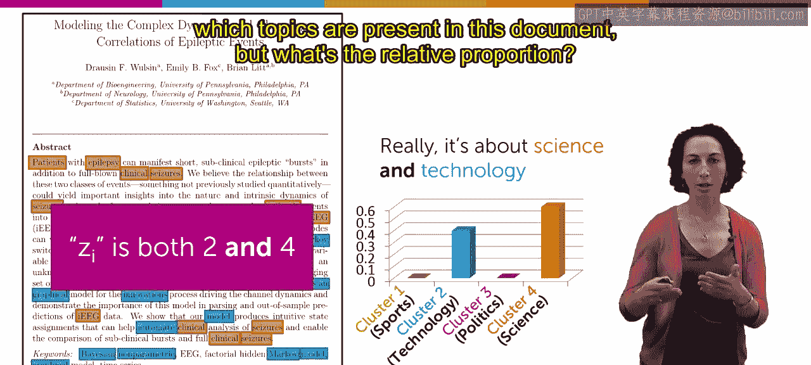

# 华盛顿大学《机器学习（分类，聚类和检索，第3-4课⧸共4课）｜Machine Learning》中英字幕 p176 54_文档的混合成员模型.zh_en -BV1Sr421F7N7_p176-

。

In this module， we're going to cover a really popular probabilistic model for document analysis called latent Deishly allocation or LDA。

 and LDA is an example of a class of methods called mixed membership modeling。

And to start with， let's motivate the use of mixed membership models in the context of our document analysis。

So far， we've described clustering models where the goal is to group related articles into disjoint sets or clusters where these clusters capture the topics prevalent in the corpus。

And in this context， every document is assigned to a single topic。A question though， is。

 is an article really about just one topic like science？In the last module。

 we talked about soft assignments capturing uncertainty in this cluster assignment。

 but the clustering model still assumes that each document is assigned to a single topic。

 We might just have uncertainty in what that assignment is from the observed data。

To make this more concrete， let's look at a specific example where we have an article that's entitled modeling the complex Ds and changinging correlations of epileptic Even。

 and in this article we see words like patients Elepsy EG clinical。

 so based on the content of this article， maybe a clustering model would group this article with other articles related to science topic and maybe that's cluster 4 in our infert clustering。

 and what this bar chart here represents is simply a one-ho encoding of our assignment of this article to cluster 4。

 Z equals4。

But this article also has words like asynchronous， automatic model， and things like this。

 which might mean that it's really an article about technology。

 and so maybe we should group it with other tech articles， which in this case is cluster 2。Well。

 our soft assignments that we talked about in the last module capture our uncertainty about whether this article should be assigned to cluster 2 or cluster 4 assigned to the science cluster or the technology cluster。

But maybe what we really want to capture is the fact that the article is about science and technology。

That is ZI is really to and for， and so I put ZI in quotes because it's not going to be a single variable associated with a document to represent this mixed assignment like what we saw in our clustering model。

 but in essence what we're saying is that this document has membership in both of these clusters to n4 and we're going to go through in this module exactly how we think about forming this type of mixed membership assignment。

And importantly， the other thing that we're going to want to capture is not only which topics are present in this document。

 but what's the relative proportion， how prevalent are these topics？

So this is where mixed membership models come in because mixed membership models allow us to associate any given data point with a set of different cluster assignments。

 or in this case， a document with a set of topics， rather than assuming that every document is associated with just a single cluster or topic or capturing uncertainty in that single assignment like the soft assignments we talked about before。

