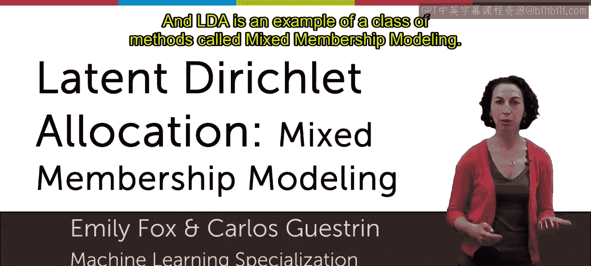
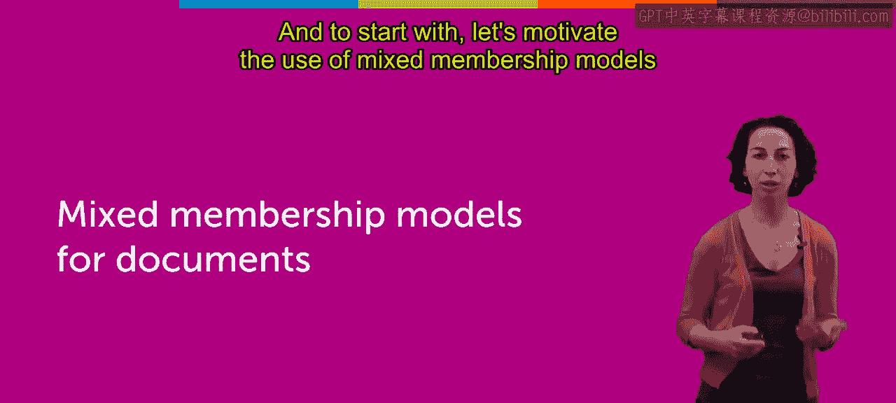
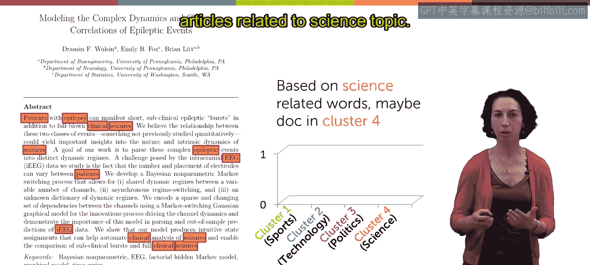
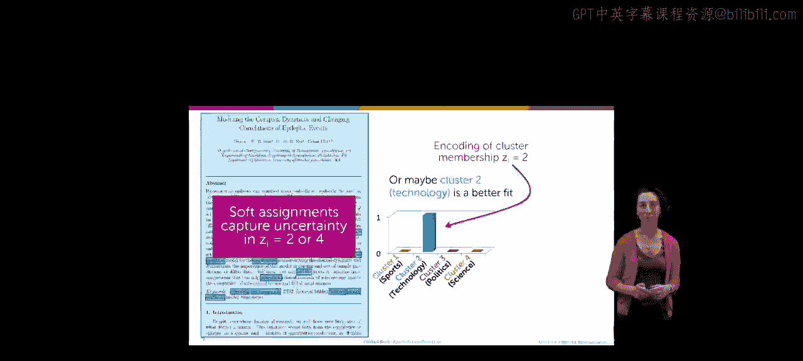
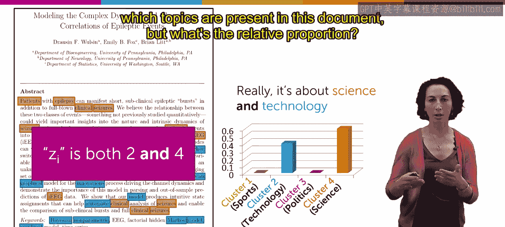

# 机器学习：第3-4课：文档的混合成员模型


## 概述

在本节课中，我们将学习一种非常流行的文档分析概率模型，称为**潜在狄利克雷分配**。这个模型是**混合成员模型**的一个例子。我们将从理解为什么需要混合成员模型开始，然后逐步介绍其核心概念和工作原理。



---



## 混合成员模型的动机

上一节我们介绍了聚类模型，其目标是将相关文章分组到不相交的集合或簇中，这些簇代表了语料库中普遍的主题。在这种模型中，每篇文档都被分配到一个单一的主题。

但一个问题随之而来：一篇文章真的只关于一个主题吗？例如，一篇名为《模拟癫痫事件的复杂动态和变化相关性》的文章，其中包含了“患者”、“癫痫”、“脑电图”、“临床”等词语，可能被归类到“科学”主题。然而，文章中也出现了“异步”、“自动”、“模型”等词语，这表明它也可能与“技术”主题相关。

我们之前讨论的软分配可以捕捉到这种将文章分配到“科学”簇还是“技术”簇的不确定性。但也许我们真正想要捕捉的是这篇文章**同时**关于科学和技术的事实。也就是说，一篇文档可以拥有多个主题的“成员资格”，而不仅仅是一个。

更重要的是，我们不仅希望知道哪些主题存在于文档中，还希望了解这些主题的**相对比例**，即每个主题在文档中的普遍程度。

这就是混合成员模型的用武之地。它允许我们将任何一个数据点（在此处是文档）与一组不同的簇分配（即主题）关联起来，而不是假设每篇文档只与一个簇或主题相关联。

---

## 混合成员模型的核心思想

混合成员模型的核心在于，每篇文档不再由一个单一的隐藏变量（如 `Z_i`）表示其所属主题，而是由一个**主题分布**来描述。

具体来说，对于第 `i` 篇文档：
*   我们引入一个参数 `θ_i`，它是一个**概率向量**。
*   这个向量的长度等于主题总数 `K`。
*   向量中的第 `k` 个元素 `θ_{i,k}` 表示第 `i` 篇文档中主题 `k` 的**比例**。

用公式表示，对于一篇文档 `i` 和所有主题 `k=1...K`，有：
`θ_i = (θ_{i,1}, θ_{i,2}, ..., θ_{i,K})`，其中 `∑_{k=1}^{K} θ_{i,k} = 1` 且 `θ_{i,k} ≥ 0`。

例如，如果一篇文章 60% 关于科学，40% 关于技术，那么它的 `θ_i` 向量在科学主题对应的位置值约为 0.6，在技术主题对应的位置值约为 0.4，在其他主题位置的值接近 0。



---

## 从主题分布生成词语

理解了文档的主题分布后，我们来看看如何根据这个分布生成文档中的词语。这个过程分为两步：

1.  **为每个词语选择一个主题**：对于文档 `i` 中的第 `j` 个词语，我们根据该文档的主题分布 `θ_i` 随机抽取一个主题 `Z_{i,j}`。例如，`P(Z_{i,j} = “科学”) = θ_{i,科学}`。
2.  **从选定的主题中生成词语**：每个主题 `k` 本身也有一个在所有词语上的分布 `φ_k`。确定了词语 `W_{i,j}` 的主题 `Z_{i,j}` 后，我们再根据该主题的词语分布 `φ_{Z_{i,j}}` 来生成这个具体的词语。

以下是这个生成过程的伪代码描述：



```python
对于语料库中的每一篇文档 i：
    得到该文档的主题比例向量 θ_i
    对于文档 i 中的每一个词语位置 j：
        根据多项式分布 Multinomial(θ_i) 抽取一个主题 Z_{i,j}
        根据该主题的词语分布 Multinomial(φ_{Z_{i,j}}) 抽取一个词语 W_{i,j}
```

---

## 潜在狄利克雷分配模型

**潜在狄利克雷分配** 是上述混合成员思想的一个具体实现，也是一个完整的生成式概率模型。它得名于其使用了狄利克雷分布作为先验分布。

LDA 模型的完整生成过程如下：

1.  对于每个主题 `k` (从1到 `K`)：
    *   从狄利克雷分布 `Dir(β)` 中生成主题 `k` 的词语分布 `φ_k`。
    （`β` 是一个超参数，通常是一个值很小的向量，鼓励主题分布是稀疏的，即每个主题只与少数词语强相关。）

2.  对于每篇文档 `i` (从1到 `M`)：
    *   从狄利克雷分布 `Dir(α)` 中生成文档 `i` 的主题分布 `θ_i`。
    （`α` 也是一个超参数，通常值较小，鼓励文档的主题分布是稀疏的，即每篇文档只涉及少数几个主题。）
    *   对于文档 `i` 中的每个词语 `j` (从1到 `N_i`，`N_i` 是文档长度)：
        a. 根据多项式分布 `Multinomial(θ_i)` 抽取一个主题 `Z_{i,j}`。
        b. 根据多项式分布 `Multinomial(φ_{Z_{i,j}})` 抽取词语 `W_{i,j}`。



---

## 总结

本节课我们一起学习了文档分析中的混合成员模型，特别是**潜在狄利克雷分配** 模型。

*   我们首先探讨了传统硬聚类或软聚类模型的局限性，即它们假定每篇文档仅属于一个主题。
*   为了捕捉文档涉及多个主题的现实情况，我们引入了**混合成员模型**的概念。其核心是为每篇文档定义一个**主题比例向量 `θ_i`**，来描述各个主题在文档中的占比。
*   接着，我们描述了基于主题比例生成文档词语的两步过程：先为每个词语按比例选择一个主题，再从该主题的词语分布中生成具体词语。
*   最后，我们介绍了完整的 **LDA 模型**。它是一个生成式概率模型，使用狄利克雷分布作为主题分布和文档分布的先验，并通过上述两步过程生成整个语料库。

LDA 使我们能够以更细腻的方式理解文档集合，不仅能发现潜在的主题，还能量化每篇文档中这些主题的混合情况。