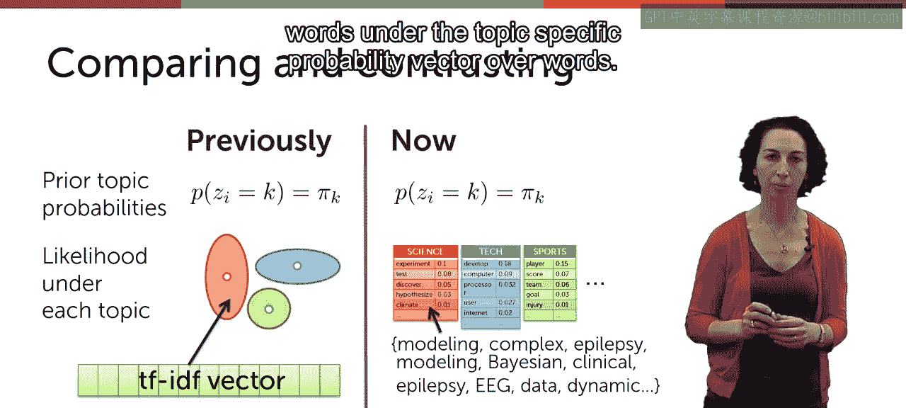

# 华盛顿大学《机器学习（分类，聚类和检索，第3-4课⧸共4课）｜Machine Learning》中英字幕 p177 55_另一种文档聚类模型.zh_en -BV1Sr421F7N7_p177-

。

To build up to mixed membership models for documents， though。

 it's helpful to first present an alternative clustering model to the mixture of Gaussian model we presented in the last module。

So just to emphasize， we're going back to our clustering model where we're going to assume this more simple structure where every document is assigned to a single topic。

But so far， when we've looked at our documents， we've represented them with this TF IDDF vector。

 and then we've taken all these TFIDF vectors associated with every document in the corpus。

 and we've used a mixture of Gaussians to discover some set of clusters in this TFIDF space。

But now what we're going to do is an alternative representation of our document called a bag of words representation。

 where we simply take all of the words that are present in our document。Throw them into a bag。

And then， shake that bag up。So that the order of the words doesn't matter so our representation of the document is simply going to be an unordered set of words。

 but I use set loosely here because this set is going to have multiple occurrences of a unique word if that word appears multiple times in the document So the multiplicity of the unique words matters here。

 unlike in standard sets So this is formally called a multiet。

 So now let's present a clustering model for this new document representation and to start with we need to specify the prior probability that a given document is associated with a specific cluster and these topic prevalences are going to be exactly like what we had in our mixture of Gaussian case。

 where these just represent corpus wide prevalence of topics。

 but now our likelihood term is going to be different because instead of，Scoring every document。

Under a specific Gaussian， like in the mixture of Gaussian case。

 we're going to take our document and its bag of words representation。

 and we're going to score this set of words。Under a topic probability vector over words。 Okay。

 so specifically every topic。Is going to be associated with a probability distribution over words in the vocabulary and using that。

We're able to score the words present in this document to say how probable are they under this specific topic and then we do this for every topic and we choose between topics using both this prior and the likelihood。

 just like in our mixture of Gaussian example。So just to be very clear for every topic like ones about science and technology and sports。

 even though of course we don't have those labels， they're just going to be cluster 1，2，3。

 we're going to have a probability vector over words in the vocabulary and the way I'm showing them here on this slide is ordered by how probabilitybable。

Those words are in the topic from most probable to least probable， whereas in the previous slide。

 I was just listing the words that actually appeared in the data。Or in that specific article。

So now we can compare and contrast between our mixture of Gaussian clustering model and the clustering model that we just specified。

So in both of these models are prior topic pro， so the probability before we actually look at the content of a document that that document came from a given cluster are given by these PKs and they're specified in exactly the same way in both cases。

But in the mixture of Gaussian case， our documents were represented by these TFIDF vectors or some vector could be a word count vector。

And we scored that vector under under each one of the Gaussians。

 so remember each cluster was defined by a Gaussian and you would compute the score of a given data point under each of these Gaussians and then wait these prior and likely terms to come up with our assignments for a given document。

But now every document is represented with this bag of words representation。

 and when we go to score the document， we're just going to look at the probability of each of these words under the topic specific probability vector over words。

