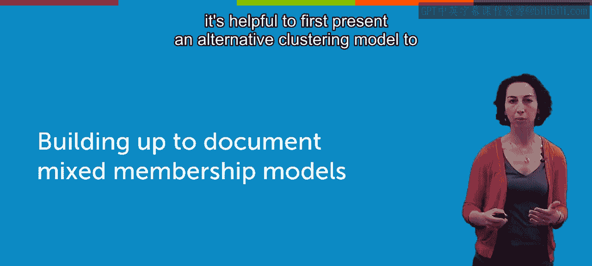
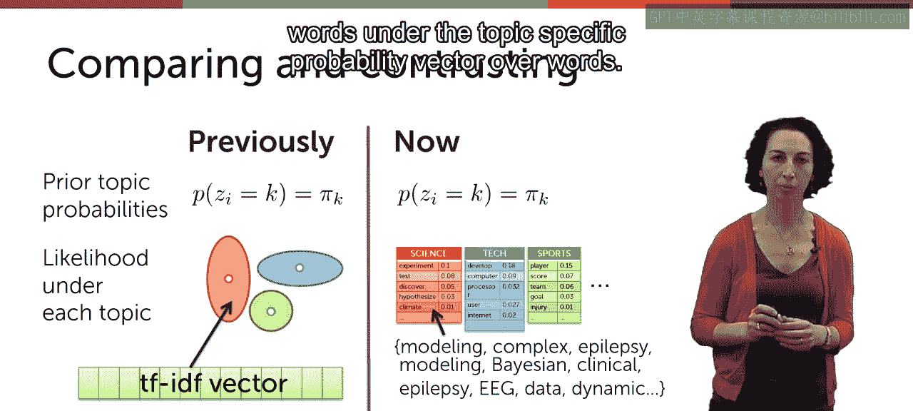

# 机器学习（分类，聚类和检索）：第3-4课：另一种文档聚类模型 🧠

在本节课中，我们将学习一种新的文档聚类模型。我们将从回顾上一模块的高斯混合模型开始，然后介绍一种基于“词袋”表示的替代模型。这种模型使用不同的文档表示方式和概率评分机制，是理解后续混合成员模型的重要基础。

---

上一节我们介绍了使用高斯混合模型对TF-IDF向量表示的文档进行聚类。本节中，我们来看看另一种聚类模型，它基于一种称为“词袋”的文档表示方法。

为了逐步构建文档的混合成员模型，首先介绍一种替代高斯混合模型的聚类模型是有帮助的。

需要强调的是，我们将回到聚类模型的基本假设：每篇文档只被分配到一个单一主题。

---

## 文档的“词袋”表示法 📄

到目前为止，我们使用TF-IDF向量来表示文档，并在整个语料库的TF-IDF向量空间中使用高斯混合模型来发现聚类。

现在，我们将采用一种称为“词袋”的替代文档表示法。以下是其工作原理：

*   我们简单地提取文档中出现的所有单词。
*   将它们放入一个“袋子”中。
*   然后摇晃这个袋子，使得单词的顺序不再重要。

因此，文档的表示将简化为一个无序的单词集合。这里“集合”的概念是宽松的，因为如果一个单词在文档中出现多次，这个“集合”中该单词也会出现多次。所以，唯一单词的重复次数在这里是重要的，这与标准的集合不同。这在形式上被称为“多重集”。

---

## 基于词袋的聚类模型 🧩

现在，让我们为这种新的文档表示法提出一个聚类模型。首先，我们需要指定一篇给定文档与特定聚类相关联的先验概率。

这些主题的先验概率（即主题的普遍性）与我们在高斯混合模型中的设定完全相同，它们代表了整个语料库中各个主题的普遍程度。

然而，我们的似然项将有所不同。因为与高斯混合模型中在特定高斯分布下为每个文档向量评分不同，我们现在将获取文档及其词袋表示，并在一个“主题-单词”概率向量下为这组单词评分。

具体来说：
*   每个主题都将与一个在词汇表所有单词上的概率分布相关联。
*   利用这个分布，我们可以评估出现在该文档中的单词在这个特定主题下的可能性有多大。
*   然后，我们对每个主题都进行此操作，并像在高斯混合模型的例子中一样，结合先验概率和似然项在各个主题之间进行选择。

为了更清晰地说明：对于每个主题（例如关于科技、体育的主题，尽管我们没有这些标签，它们只是聚类1、2、3……），我们都有一个在词汇表单词上的概率向量。在本幻灯片上，我按照单词在该主题中从最可能到最不可能的概率顺序来展示它们，而在上一张幻灯片中，我只是列出了实际出现在数据或特定文章中的单词。

---

## 模型对比：高斯混合 vs. 词袋模型 ⚖️

现在，我们可以比较和对比我们的高斯混合聚类模型与我们刚刚指定的聚类模型。

在这两种模型中：
*   **先验主题概率**：在我们实际查看文档内容之前，文档来自某个给定聚类的概率由这些 `p_k` 给出。在两种情况下，它们的指定方式完全相同。

但它们的区别在于：
*   **高斯混合模型**：文档由TF-IDF向量（或某种向量，如词频向量）表示。我们在每个高斯分布下为该向量评分。请记住，每个聚类由一个高斯分布定义，你需要计算给定数据点在每个高斯分布下的评分，然后结合先验和似然项来确定文档的分配。
*   **词袋模型**：每篇文档都用这种词袋表示法表示。当我们对文档评分时，我们只需查看该文档中每个单词在特定主题的“单词概率向量”下的概率。

---

## 总结 📝

本节课中，我们一起学习了：
1.  从高斯混合聚类模型过渡到一种新的基于“词袋”表示的聚类模型。
2.  “词袋”表示法将文档简化为无序的单词多重集，忽略了单词顺序但保留了词频信息。
3.  新模型的先验设定与高斯混合模型相同，但似然计算方式不同：它基于每个主题的“单词概率分布”来评估文档中单词出现的可能性。
4.  通过对比，我们明确了两种模型在文档表示（TF-IDF向量 vs. 词袋）和评分机制（高斯概率密度 vs. 单词离散概率）上的核心差异。

这种基于词袋和离散概率的聚类模型，为接下来理解更复杂的混合成员模型（如主题模型）奠定了重要基础。