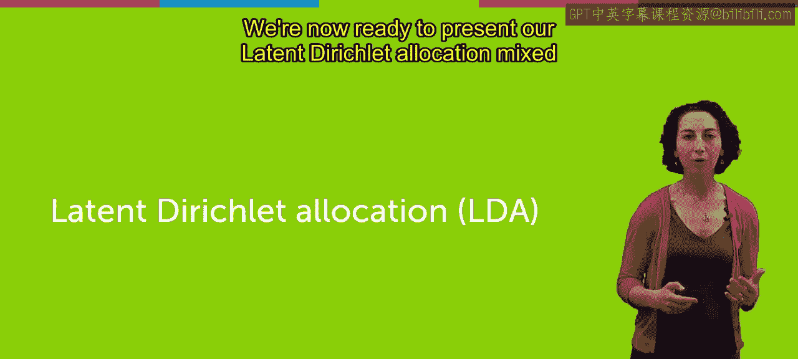
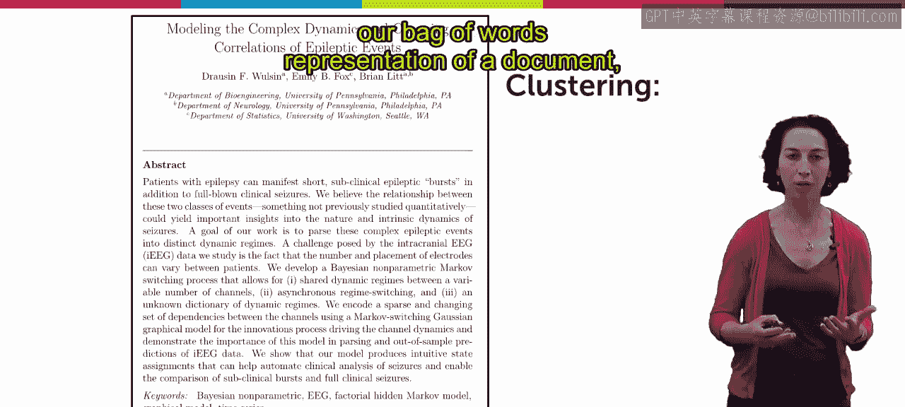

# 华盛顿大学《机器学习（分类，聚类和检索，第3-4课⧸共4课）｜Machine Learning》中英字幕 p178 56_潜在狄利克雷分配（LDA）模型的组成部分.zh_en -BV1Sr421F7N7_p178-

。

We're now ready to present our latent Deersly allocation mixed membership model and remember here our goal is to associate with the document。

 a collection of topics present in that document as well as their relative proportions in the document。

 so how prevalent those topics are。

And remember in the clustery model that we just presented for our bag of Word representation of a document。

 we introduced a set of topic specific vocabulary distributions。

 so associating probabilities over every word in the vocabulary specific to each topic。

And then the clustering model looked to assign an entire document to a single topic。

 and for this assignment， it would score all of the words in the document under that topic distribution。

And then the model also introduces a corpus wide distribution over the prevalence of topics throughout all the documents in this corpus。

 so that is how likely for any given document that we grab that it's from one of these sets of topics。

In latent Deishly allocation， we introduced the same set of topic specific vocabulary distributions。

But now， when we look at a given document。We're looking to assign every word to a single topic instead of assigning the entire document。

Every word is going to have an assignment variable， Z IW， so for the Wth word in document I。

 what topic it's assigned to？Then when we go to score a document。

 we're going to score all of the words under each of these assigned topics。

 So scoring all the orange words under the orange topic， blue words under the blue topic and so on。

 And that's going to determine how good those assignments are。 And finally。

 there's another thing different in LDA。 instead of introducing a corpus wide distribution on these topic prevalences。

Each document is going to have a distribution over the prevalence of topics in that document。So now。

 instead of pi globally throughout the corpus， we have pi I specific to document I。

 and what this vector is going to represent are our desired topic prevalences in this specific document。

