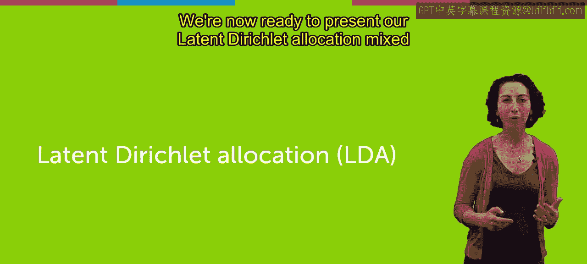
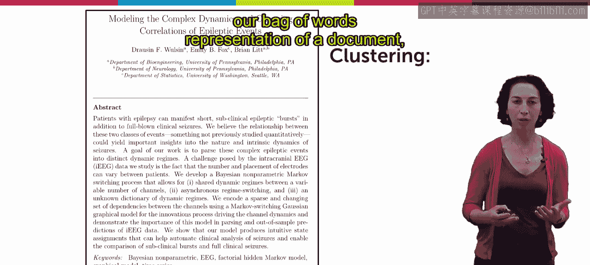

# 机器学习（分类，聚类和检索）：第3-4课：潜在狄利克雷分配（LDA）模型的组成部分 🧩


在本节课中，我们将学习潜在狄利克雷分配（LDA）模型的核心组成部分。我们将了解LDA如何通过为文档中的每个单词分配主题，以及为每个文档定义其特有的主题分布，来构建一个混合成员模型。

---

上一节我们介绍了基于聚类的文档模型，它试图将整个文档分配给一个单一的主题。本节中，我们来看看LDA模型如何对此进行扩展，为文档中的每个单词单独分配主题。



LDA模型的目标是：为文档关联一组主题，并确定这些主题在文档中的相对比例，即每个主题的普遍程度。

---

在之前介绍的基于聚类的词袋文档模型中，我们引入了一组**主题特定的词汇分布**。这意味着，为每个主题关联一个在整个词汇表上的概率分布。

```math
\phi_k \sim \text{Dirichlet}(\beta)
```
其中，`\phi_k` 表示第 `k` 个主题的词汇分布。



---

聚类模型试图将整个文档分配给一个单一的主题。在进行这种分配时，模型会使用该主题的词汇分布来评估文档中的所有单词。

此外，该模型还引入了一个**语料库范围的主题普遍性分布**。这个分布描述了在整个语料库的所有文档中，各个主题出现的可能性有多大。

```math
\pi \sim \text{Dirichlet}(\alpha)
```
其中，`\pi` 表示全局的主题分布。

---

在潜在狄利克雷分配（LDA）模型中，我们同样引入了那组主题特定的词汇分布。

但是，当我们观察一个给定的文档时，我们的目标是为**每一个单词**分配一个主题，而不是将整个文档分配给一个主题。

对于文档 `i` 中的第 `w` 个单词，会有一个分配变量 `Z_{iw}`，用来表示该单词被分配到了哪个主题。

```math
Z_{iw} \sim \text{Categorical}(\pi_i)
```

---

当我们评估一个文档时，我们将根据每个单词被分配的主题来评估所有单词。例如，所有被分配为“橙色”主题的单词将在橙色主题的词汇分布下进行评估，蓝色主题的单词在蓝色主题下评估，以此类推。这些评估将决定这些主题分配的好坏。

---

最后，LDA还有另一个不同之处。它没有引入一个语料库范围的主题普遍性分布，而是让**每个文档**都拥有一个关于其自身内部主题普遍性的分布。

因此，现在不再是全局的 `\pi`，而是针对文档 `i` 的 `\pi_i`。这个向量将代表我们期望的、在这个特定文档中各个主题的普遍程度。

```math
\pi_i \sim \text{Dirichlet}(\alpha)
```

---

本节课中，我们一起学习了LDA模型的关键组成部分：主题特定的词汇分布、为每个单词分配主题的机制，以及每个文档独有的主题比例分布。这些元素共同构成了LDA这个强大的主题建模工具，使其能够捕捉文档中复杂的主题混合结构。