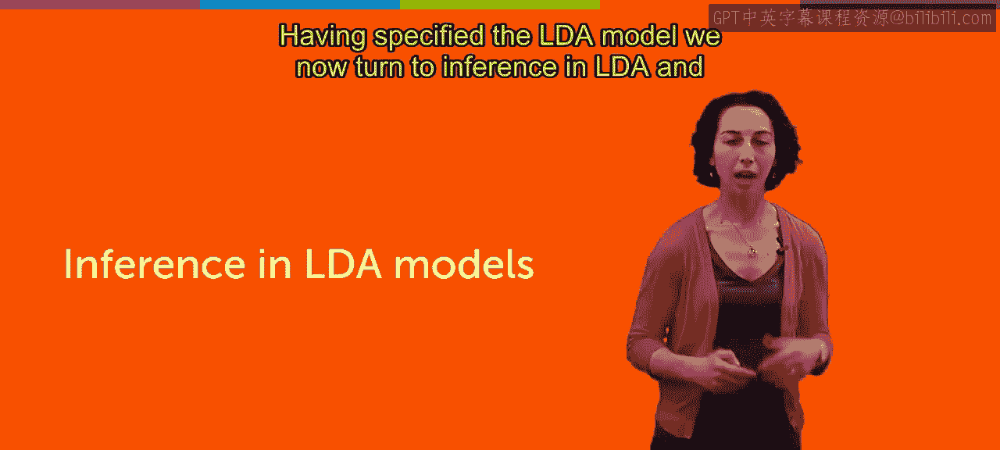
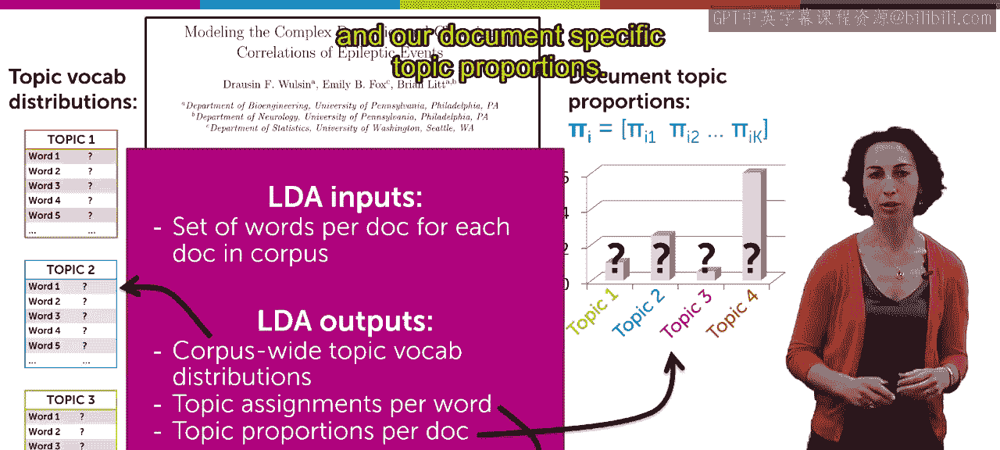
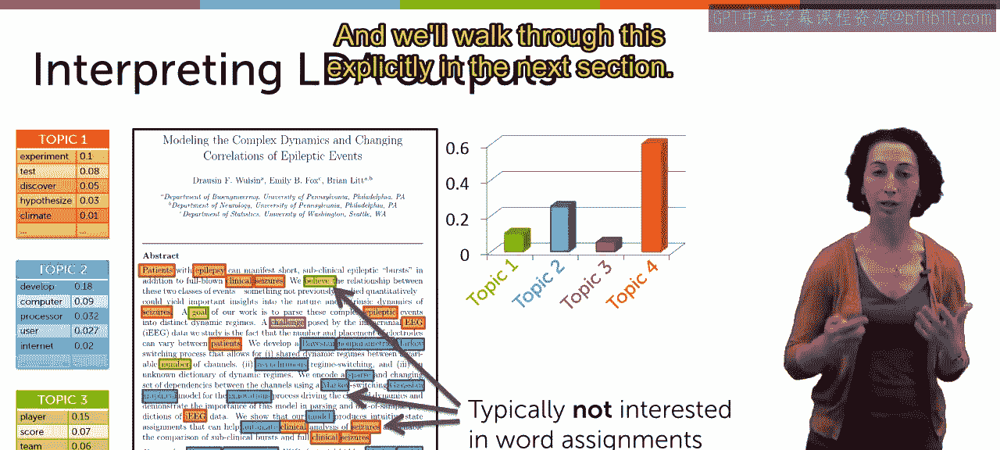

# 华盛顿大学《机器学习（分类，聚类和检索，第3-4课⧸共4课）｜Machine Learning》中英字幕 p179 57_LDA推断的目标.zh_en -BV1Sr421F7N7_p179-

。

Having specified the LDA model， we now turn to inference in LDA。

And remember that our LDA model introduced a set of topic specific vocabulary distributions that are shared throughout the entire corpus。

 and then for every document and every word in every document。

 there's an assignment variable of that word to a specific topic。And then finally。

 for every document， there's the topic proportions in that document。

 so that vector pi I so collectively this represents our model parameters as well as our assignment variables。

But remember that in our unsupervised learning task， we just get words from documents。

 We get a whole bunch of documents and we transform them to our bag of words representation。

 And that's all we have。 And somehow from this， we have to infer all these word assignment variables and all these topic proportions and topic prevalences。

 just from these observed words。 So it actually seems like a really， really challenging task。😊。

So just to be clear， the input to LDA or inference in LDA are。

Seets of words from a collection of documents in a corpus。

 and the output is going to be our set of topic specific vocabulary distributions shared throughout the corpus。

 as well as our document specific word assignments and our document specific topic proportions。

But before we get to algorithms for performing this inference task。

 let's first describe how we might interpret the outputs。

 So one thing we can do is examine the coherence of the learned topics。 And to do this。

 we can take the distribution over words in the vocabulary in every topic and order those words by how probable they are in the topic。

 So we look at the most probable words in every topic。 and then see if this forms a coherent set。

 And if it does， then post facto， we can actually label these topics with things like science and technology and sports and so on。

 And this provides us a qualitative assessment of the topics present in the corpus。

 And one other thing I want to emphasize， though， is that these。

Topic distributions are not typically sparse vector。

 typically they place mass over every word in the vocabulary。

 though if you look at the most probable words， those often form some type of interpretable set if your model's performing well and you're going to explore this in the assignments。

 so I just want to emphasize that the words we're showing here in these lists and the fact that we're only showing a few words is not the full description of each of these topics。

 it's really a much more complicated beast。The other thing we can look at and the thing that we're often very interested in are the topic proportions in every document because this vector can be used to relate documents。

 so what other documents have similar types of topics present in the document that can be used for retrieval tasks。

 something you'll also look at in your assignment and you can also use this type of topic proportion vector to allocate an article to multiple categories so imagine your some new site and you have an article and you need to put that article into a category this type of representation actually allows you to put that article into multiple categories and get more viewership for that article and present it to more people who might be interested in it。

And finally， you can also use these topic proportions to do things like we described before。

 like learning preferences of a given user over a set of topics and this type of description that LDA provides with a set of topics and their relative proportions provides a much more descriptive form than the type of clustering output that we talked about before。

 definitely for the hard assignments， and for the soft assignments as well。

 where really that just captured uncertainty in the assignment。

 but not the fact that they're inherently as specified in the model。

 a set of possible topics associated with every document。

So this lets us do even fancier things in learning user preferences。

And the last thing we haven't described are the word assignment variables and typically honestly we're not actually interested in this。

 we're not actually interested in whether a word in a specific document is associated with the topic related to science things but these assignment variables are going to play a really critical role in inferring the other model parameters that are typically the things of interest and so this is just like what we saw in EM and we'll walk through this explicitly in the next section。

🎼。