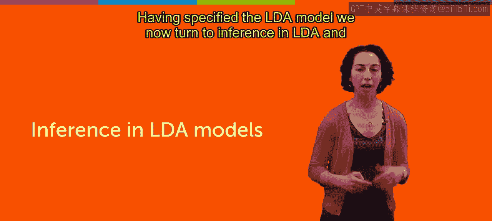
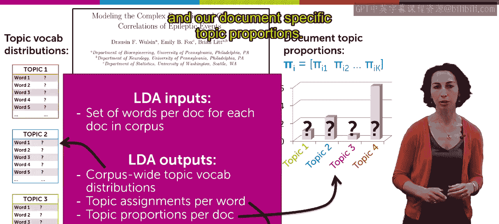
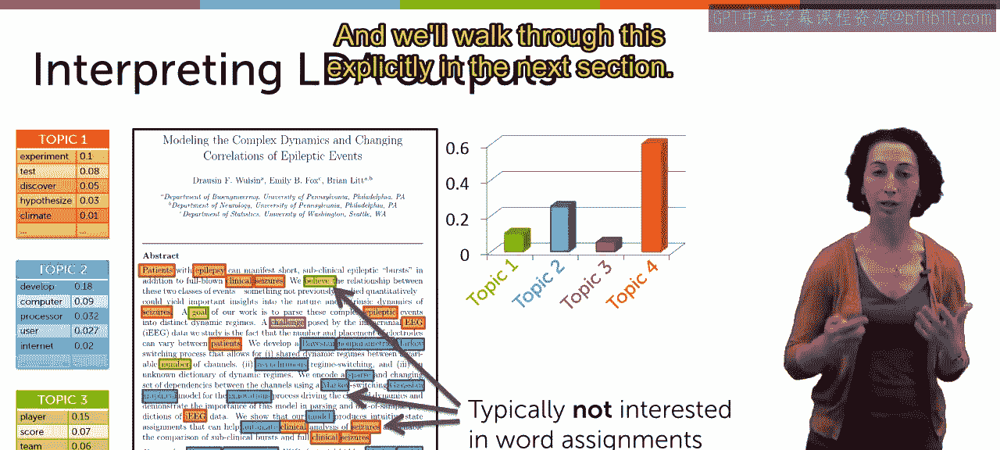

# 机器学习（分类，聚类和检索）：第3-4课：LDA推断的目标

在本节课中，我们将学习潜在狄利克雷分配（LDA）模型的推断目标。我们将明确LDA模型的输入与输出，并探讨如何解释推断结果，例如检查学习到的主题的连贯性以及分析文档的主题比例。

---

## 模型回顾与推断任务

上一节我们介绍了LDA模型的基本结构。现在，我们转向LDA的推断问题。

LDA模型引入了一组在整个语料库中共享的、特定于主题的词汇分布。对于每个文档以及文档中的每个词，都有一个将该词分配给特定主题的分配变量。最后，每个文档都有一个主题比例向量。这些共同构成了我们的模型参数和分配变量。

然而，在无监督学习任务中，我们只获得文档中的词。我们得到大量文档，并将它们转换为词袋表示。我们仅拥有这些数据。从这些观察到的词中，我们必须推断出所有这些词分配变量、所有文档的主题比例以及主题的普遍性。这看起来是一项极具挑战性的任务。

因此，明确地说，LDA或其推断过程的输入是：
*   语料库中一系列文档的词集合。

而输出将是：
*   在整个语料库中共享的一组特定于主题的词汇分布。
*   每个文档特定的词分配变量。
*   每个文档特定的主题比例。

---

## 如何解释推断输出

在讨论执行此推断任务的算法之前，我们先描述如何解释推断的输出。

我们可以检查学习到的主题的连贯性。为此，我们可以获取每个主题下词汇表中词的分布，并按照词在主题中出现的概率对这些词进行排序。我们查看每个主题中最有可能出现的词，然后判断它们是否形成了一个连贯的集合。如果是，我们实际上可以事后为这些主题贴上标签，例如“科学与技术”、“体育”等。这为我们提供了对语料库中存在的主题的定性评估。

需要强调的是，这些主题分布通常不是稀疏向量。它们通常对词汇表中的每个词都分配了一定的概率质量。然而，如果你查看概率最高的词，如果模型运行良好，这些词通常会形成某种可解释的集合。你将在作业中探索这一点。因此，我想强调的是，我们在这些列表中展示的词，以及我们只展示少数几个词的事实，并不是每个主题的完整描述。实际上，每个主题要复杂得多。

我们还可以查看，并且通常非常感兴趣的，是每个文档的主题比例。因为这个向量可以用来关联文档，例如，哪些文档包含相似类型的主题，这可以用于检索任务。你也可以在你的作业中看到这一点。你还可以使用这种主题比例向量将一篇文章分配到多个类别。想象一下，你是一个新闻网站，有一篇文章需要分类，这种表示方式实际上允许你将那篇文章放入多个类别，从而为文章带来更多浏览量，并将其呈现给更多可能感兴趣的人。

最后，你还可以使用这些主题比例来做我们之前描述的事情，比如学习给定用户在一组主题上的偏好。LDA提供的这种描述——一组主题及其相对比例——比我们之前讨论的聚类输出形式更具描述性，无论是对于硬分配还是软分配。软分配实际上只捕捉了分配的不确定性，而不是模型所规定的、每个文档本质上关联着一组可能主题的事实。这使得我们可以在学习用户偏好方面做更高级的事情。

最后，我们尚未描述的是词分配变量。坦率地说，通常我们并不真正对此感兴趣。我们并不真正关心特定文档中的一个词是否与科学相关主题相关联。但是，这些分配变量在推断其他模型参数（通常是真正感兴趣的部分）时将起到至关重要的作用。这就像我们在EM算法中看到的一样，我们将在下一节中详细讨论这一点。

---

## 总结

本节课中，我们一起学习了LDA模型的推断目标。我们明确了推断的输入是文档的词集合，输出是主题词汇分布、文档主题比例和词分配变量。我们还探讨了如何通过检查主题中最可能的词来评估主题的连贯性，以及如何利用文档的主题比例进行文档检索、多类别分类和用户偏好建模。理解这些目标是后续学习具体推断算法的基础。