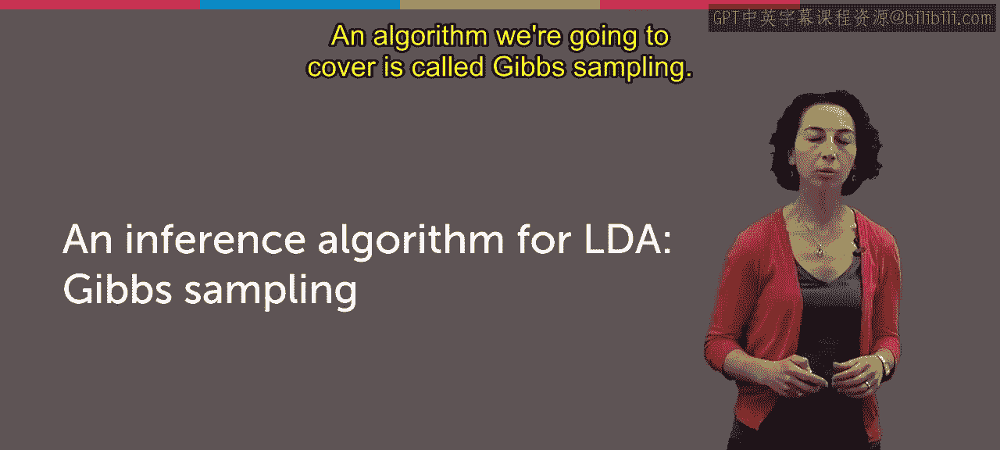
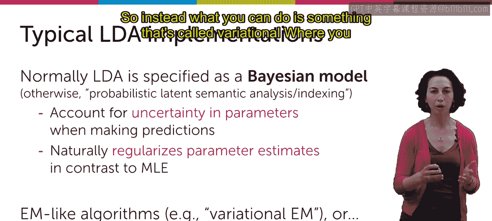

# 华盛顿大学《机器学习（分类，聚类和检索，第3-4课⧸共4课）｜Machine Learning》中英字幕 p180 58_贝叶斯推断的需求.zh_en -BV1Sr421F7N7_p180-

。

Let's now describe a specific algorithm we can use for inference in our LDA model。

 an algorithm we're going to cover is called Gib sampling。

Recall that for the clustering task， we focus on two different algorithms。 One was K means。

 which iterated between the following steps， where we're making hard assignments of data points to clusters。

 and we said that we can view K means as a coordinate ascent algorithm， and as such。

 we can view it as maximizing a given objective function。

We then turned to EM for mixture A Gaussians and showed that we iterated between this E step and M step and again showed that this could be viewed as a coordinate asscent algorithm。

 so in this case we're also maximizing objective function。

 but here we're making soft assignments of data points to clusters。Well， before we get to LDA。

 a natural question is， what can we do for this alternative clustering model we presented where we used a bag of words representation of our document instead of a TFIDF vector and then use this alternative clustering model instead of mixtures of Gaussians。

Well， in this case。We can derive an E M algorithm just like we did for mixtures of Gaussian。

 But here， instead of having a Gaussian likelihood of the TF I DF vector。

 we have what's called a multinoial likelihood of our observed word counts in the document。

 So specifically， we can look at the document and say， well， maybe they are M sub W。

Counts of wordW in this document so we can think of this as MW successes of wordW。

 where the probability of a success was given by the topic specific probability of that given word so we can use this to compute the likelihood of all of our word counts in this document under a given topic。

And so we can think of this alternative clustering model as a mixture of multinoial distributions instead of a mixture of Gaussians。

 and in this case， we can derive an EM algorithm just like we did for a mixture of Gaussians。

But what can we do for our LDA model？Well， here we could derive an EM style algorithm to perform maximum likelihood estimation of our model parameters。

But this maximum likelihood estimation suffers from the same overfitting problem that we saw in the mixture of Gaussians。

 and we talked about issues in high dimensional spaces， but the challenge is even harder here。

 or the issue of overfitting tends to be even more severe in LDA。

 just because of the sheer number of parameters that we have to learn。So instead。

 LDA is actually typically specified as a Bayesian model。

 and when it' not it's not actually called LDA， it's called probabilistic latent semantic analysis or probabilistic latent semantic indexing。

But we've been talking about everything in the context of LDA。

 which kind of swept onto the rug some of the details about this Bayesian specification。

 it's a bit to advance for the purposes of this course。

 but we're going to go through some of the intuitions。

 some of what we get out of this Bayesian approach as well as a Bayesian inference algorithm。

So one thing a Bayesian approach does is it accounts for uncertainty in the parameters when we're making predictions。

 so instead of just doing something like computing the maximum likelihood estimate of our parameters。

 fixing the value of those parameters and then making predictions， we say， well。

The parameter could have been this or it could have been that or it could have been that。

 and we think about averaging over that uncertainty when we're forming our prediction。

 so you can think of this as forming a prediction for each one of these values and computing a weighted average of those predictions based on how much we think the parameter is each one of these values。

And the other thing that a baesian approach does is it naturally regularizes our parameter estimates。

 so if we think about maximizing our objective instead of computing what's called a maximum likelihood estimate。

 you end up with something called a maximum posterii estimate。

 and this is exactly akin to ideas we've talked about many times in the specialization of regularizing the maximum likelihood estimate。

Okay， well， in the context of this Bayesian specification。

 the EM algorithm is no longer tractable because the E step in particular has this intractable expectation。

 so instead what you can do is something that's called variational EM where you introduce an approximation to handle that really complicated expectation。

