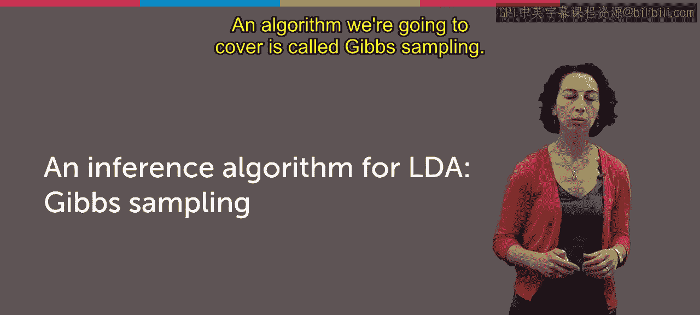
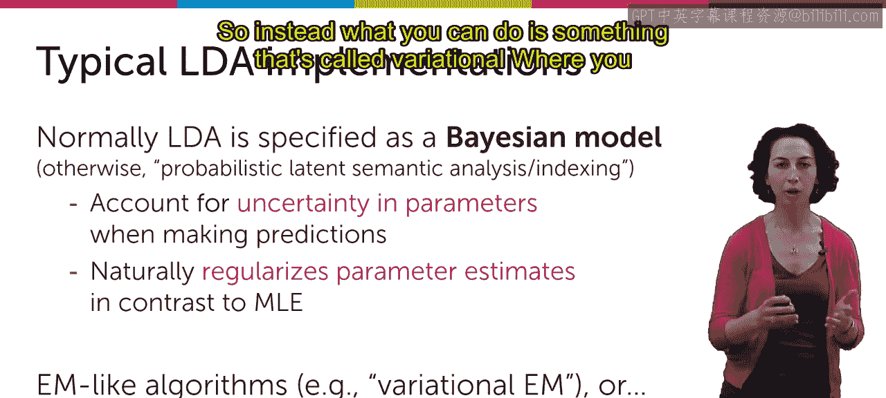

# 机器学习（分类，聚类和检索）：第3-4课：LDA模型中的贝叶斯推断需求 🧠

在本节课中，我们将探讨LDA（潜在狄利克雷分配）模型中的推断问题。我们将了解为什么传统的最大似然估计方法在此处会遇到困难，并介绍贝叶斯推断如何帮助我们解决这些问题。特别是，我们将讨论贝叶斯方法如何通过考虑参数的不确定性来改进预测，并自然地实现参数的正则化。

---

## 从聚类算法到LDA推断

上一节我们介绍了用于聚类的K-means和高斯混合模型EM算法。本节中，我们来看看如何将类似的思想应用于基于词袋表示的文档聚类模型，并最终理解LDA模型推断的特殊需求。

对于使用词袋表示的文档聚类模型，我们可以推导出一个类似于高斯混合模型的EM算法。这里，我们不再使用TF-IDF向量的高斯似然，而是使用文档中观察到的词计数的**多项分布似然**。

具体来说，我们可以查看文档并记录每个词W的出现次数 `M_w`。我们可以将其视为词W的“成功”次数，其中“成功”的概率由特定主题下该词的概率给出。因此，我们可以使用这个来计算在给定主题下，文档中所有词计数的似然。

这个替代的聚类模型可以被视为**多项分布的混合**，而不是高斯分布的混合。在这种情况下，我们可以像推导高斯混合模型一样，推导出一个EM算法。

---

## LDA模型的挑战与贝叶斯方法

那么，对于我们的LDA模型，我们能做什么呢？理论上，我们可以推导出一种EM风格的算法来执行模型参数的**最大似然估计**。

但是，这种最大似然估计存在与我们在高斯混合模型中看到的相同的**过拟合问题**。在高维空间中，挑战甚至更大，过拟合问题在LDA中往往更加严重，这主要是由于我们需要学习的参数数量非常庞大。

因此，LDA实际上通常被指定为一个**贝叶斯模型**。当它不是贝叶斯模型时，它实际上不被称为LDA，而是被称为概率潜在语义分析或概率潜在语义索引。

贝叶斯方法主要带来两个好处：

1.  **考虑参数不确定性**：在进行预测时，贝叶斯方法会考虑参数的不确定性。我们不是简单地计算参数的最大似然估计值、固定这些值然后进行预测，而是认为参数可能是这个值、那个值或另一个值。我们在形成预测时，会基于我们认为参数是这些值的可能性大小，对这些预测进行加权平均。

2.  **自然正则化**：贝叶斯方法自然地正则化了我们的参数估计。如果我们考虑最大化我们的目标（即计算**最大后验估计**），而不是计算最大似然估计，其结果完全类似于我们在专题中多次讨论过的正则化最大似然估计的思想。

---

## 贝叶斯框架下的推断算法

在贝叶斯设定的背景下，标准的EM算法不再易于处理，因为其中的E步涉及一个难以处理的期望计算。

因此，我们可以采用一种称为**变分EM**的方法，通过引入一个近似来处理那个非常复杂的期望。

---

## 总结

本节课中，我们一起学习了LDA模型推断的挑战。我们回顾了从硬分配的K-means到软分配的EM算法在聚类中的应用，并探讨了如何将类似思想扩展到基于多项分布的文档聚类模型。我们重点理解了为什么LDA模型需要采用贝叶斯方法：为了克服最大似然估计带来的严重过拟合问题，并利用贝叶斯推断来考虑参数的不确定性以及实现参数的自然正则化。最后，我们了解到在贝叶斯框架下，标准的EM算法变得难以处理，从而引出了对变分推断等近似方法的需求。