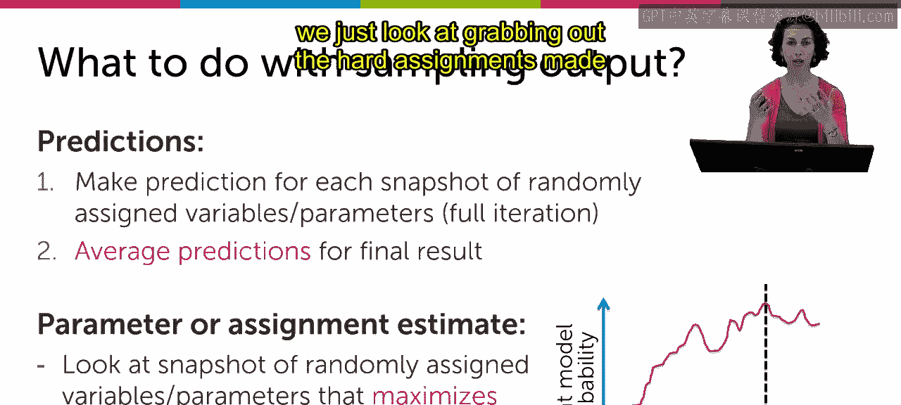

# 华盛顿大学《机器学习（分类，聚类和检索，第3-4课⧸共4课）｜Machine Learning》中英字幕 p181 59_吉布斯采样概览.zh_en -BV1Sr421F7N7_p181-

。

But as an alternative， we can perform basian inference using a totally different algorithm called Gib sampling。

And in Gib sampling， we're going to iteratively provide hard assignments just like we did in K means。

 but these hard assignments are going to be drawn randomly from a specific distribution。

 whereas remembering K means， we just solved an equation and got a solution。

 but the point here is that as we look across these random samples of our model parameters and assignment variables that are being produced by Gib sampling。

 this is capturing the uncertainty in the values that these variables can take。

And the reason we're presenting Gib sampling， in contrast to variational EM is the fact that the updates of our Gib sampling steps tend to be very intuitive and very straightforward to implement。

Okay， so let's look at a couple samples from a Gb sampler to get a little intuition about what's going on here。

 So remember in our LD model here are all our assignment variables and model parameters that we want to do inference over and this is iteration 10000 of a gib sampler and the reason I'm looking so far out at iteration 10000 of the Gib sampler is the fact that in very large models like LD。

 it can take quite a few iterations before we get out of a potentially bad initialization and start getting some reasonable assignments。

 So let's imagine this is iteration 10000。 and these are the values assigned they were randomly assigned to each of these model parameters in assignment variables and then maybe this is sample 10001 and sample 100002 and if I just flip back and forth between these samples and do this a few times we're just going back and forth through these three samples we see how。

Values change， this is the randomness inherent in this algorithm。

And so we can talk about what do we expect to happen as we keep sampling over iterations？Well。

 one thing we can look at here is something called the joint model probability。

 so this is like the likelihood that we monitored before， but in a Bayesian model。

 not only do we have to account for the likelihood of our data given a specific set of model parameters。

 but we also have to look at the probability of those model parameters themselves。And together。

 these two terms form the joint model probability。 And if we look at joint model probability over gib sampling and iterations。

 we tend to get plots that look like the following where there' is this initial burnin period where we're just moving from our initialization to some reasonable space。

 and then we wander around。 and throughout this whole process The joint model probability can go up and down。

 And the reason is because this is a randomized algorithm。

 There's no guarantee that we're going to increase our joint probability。

 This is not an optimization algorithm。 And that's actually the point of it。

 We're actually intending to explore the space of possible solutions。😊。

Rather than converge just to a single point。And this is very similar to what we saw for stochastic gradient descent or ascent。

 where there there was randomness too because we're computing a noisy estimate of the gradient and we showed that our objective function wasn't going to simply monotonically increase or not decrease。

 it might actually go up and down。But the important thing here is that eventually。

 meaning after enough iterations， the random samples that are produced by our Gib sampling algorithm allow us to form what are called correct Bayesian estimates。

 And to provide some examples of what this means if we're thinking of a predictive task。

 we said that Bayesians average over uncertainty in the parameters。 Well。

 what we can do from the output of our Gib sampling is we can look at a given。

Sample and all the assignments， they hard assignments of the model parameters and variables。

And we can form our prediction from those set of assignments， then we can look at our next sample。

 form a prediction， our next sample， form a prediction。

 then we can average over these predictions across the different samples and naturally because of how the Gib sampler exploring uncertainty。

 it's spending more time in high probability regions and less time in low probability regions。

It's forming a correct prediction， a correct Bayesian average over the uncertainty in our parameters。

Another thing we can think about doing is grabbing out what I'll call a good solution and what I mean by a good solution is the set of model parameters and assignment variables that out of the space of everything we've explored that maximize this joint model probability。

 and this is an estimate of what we call that maximum posterior parameter estimate。

So if we look at monitoring joint probability over iterations。

 we just look at grabbing out the hard assignments made at the iteration that maximizes joint probability。

