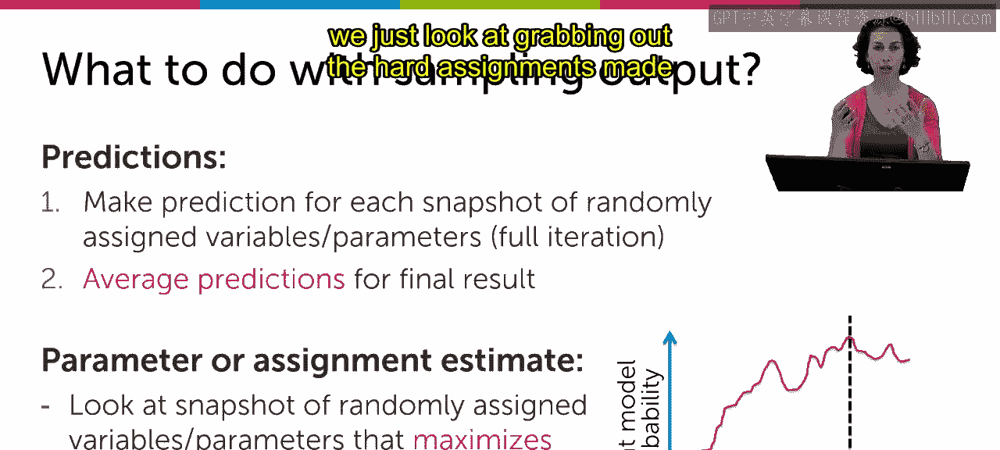
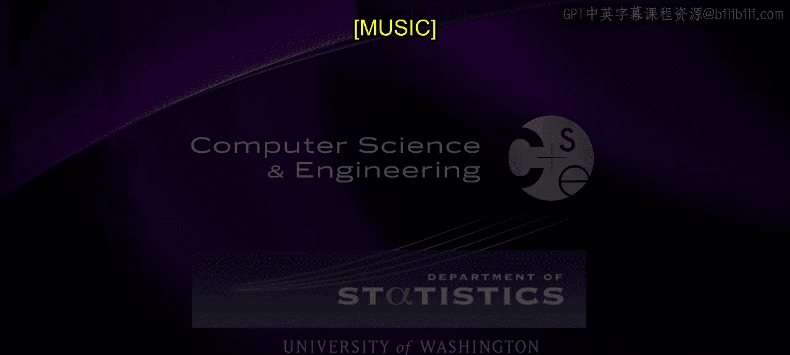

# 机器学习：3-4：吉布斯采样概览

在本节课中，我们将要学习一种名为吉布斯采样的贝叶斯推断算法。我们将了解它与之前方法（如K均值）的区别，理解其工作原理，并探讨如何利用其输出结果进行预测和参数估计。

## 算法概述

上一节我们介绍了变分EM算法，本节中我们来看看另一种完全不同的算法——吉布斯采样。

在吉布斯采样中，我们将迭代地提供硬分配，就像在K均值算法中一样。但这些硬分配是从一个特定的分布中随机抽取的。回想一下K均值，我们只是通过求解方程得到一个确定的解。而吉布斯采样的关键在于，当我们观察由该算法生成的模型参数和分配变量的随机样本时，这些样本捕捉了这些变量可能取值的不确定性。

我们介绍吉布斯采样，是为了与变分EM形成对比，因为吉布斯采样步骤的更新往往非常直观且易于实现。

## 直观理解

为了对吉布斯采样的过程有一个直观的认识，让我们来看几个采样样本。

在我们的LDA模型中，包含了所有我们希望进行推断的分配变量和模型参数。下图展示了吉布斯采样器在第10000次迭代时的状态。之所以要看这么靠后的迭代，是因为在像LDA这样的大型模型中，可能需要相当多的迭代次数才能摆脱可能较差的初始化状态，并开始得到一些合理的分配。

假设这是第10000次迭代的样本，这些值是随机分配给每个模型参数和分配变量的。然后，这可能是第10001个样本，第10002个样本。如果我们在这几个样本之间来回切换，观察几次，就能看到值是如何变化的。这体现了该算法内在的随机性。

## 采样过程与联合模型概率

那么，随着迭代采样的持续进行，我们预期会发生什么呢？

我们可以观察一个称为“联合模型概率”的量。这类似于我们之前监控的似然度，但在贝叶斯模型中，我们不仅要考虑给定特定模型参数集的数据似然度，还要考虑这些模型参数本身的概率。这两个项共同构成了联合模型概率。

如果我们观察吉布斯采样迭代过程中的联合模型概率，通常会得到类似下图的曲线。图中存在一个初始的“预烧期”，我们从初始化状态移动到某个合理的空间，然后在这个空间内徘徊。在整个过程中，联合模型概率可能上升也可能下降。原因在于这是一个随机算法，无法保证我们会增加联合概率。这不是一个优化算法，而这正是它的意义所在——它旨在探索所有可能的解空间，而不是仅仅收敛到一个单一的点。

这与我们在随机梯度下降或上升中看到的情况非常相似，那里也存在随机性，因为我们计算的是梯度的噪声估计，并且我们的目标函数不会简单地单调增加或减少，它实际上可能上下波动。

## 吉布斯采样的输出与应用

但这里重要的是，在经过足够多的迭代后，吉布斯采样算法产生的随机样本使我们能够形成所谓的正确贝叶斯估计。

为了举例说明这意味着什么，如果我们考虑一个预测任务，我们说过贝叶斯方法会对参数的不确定性进行平均。那么，我们可以利用吉布斯采样的输出来做到这一点：我们可以观察一个给定的样本及其所有模型参数和变量的硬分配，并根据这组分配形成我们的预测；然后观察下一个样本，形成预测；再下一个样本，再形成预测。接着，我们可以对不同样本的这些预测进行平均。自然地，由于吉布斯采样器探索不确定性的方式，它会在高概率区域花费更多时间，在低概率区域花费更少时间，从而形成了一个对参数不确定性的正确贝叶斯平均预测。

我们还可以考虑做另一件事，即提取一个“好的解”。所谓“好的解”，指的是在我们探索过的所有空间中，能够最大化联合模型概率的那组模型参数和分配变量。这是对“最大后验参数估计”的一个估计。

因此，如果我们监控迭代过程中的联合概率，只需找出使联合概率最大化的那次迭代所做的硬分配即可。

## 总结

本节课中我们一起学习了吉布斯采样的基本原理。我们了解到它是一种通过随机采样来探索参数空间、捕捉不确定性的贝叶斯推断方法。与优化算法不同，它不追求单调改进目标函数，而是通过生成一系列样本，使我们能够对参数进行贝叶斯平均预测，或从中找出具有高联合概率的解。其更新步骤直观，是处理复杂模型推断的一个实用工具。