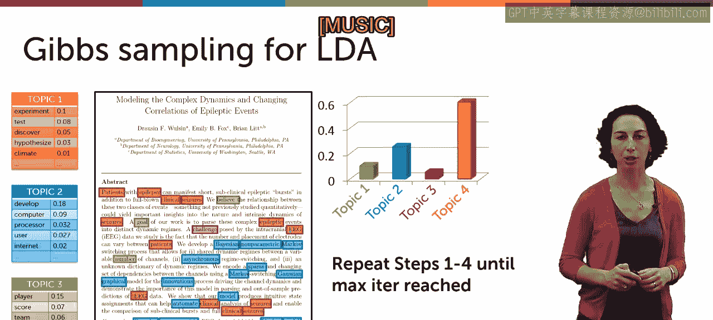

# 华盛顿大学《机器学习（分类，聚类和检索，第3-4课⧸共4课）｜Machine Learning》中英字幕 p182 60_LDA的标准吉布斯采样器.zh_en -BV1Sr421F7N7_p182-

。

Let's now describe the algorithm that produces these random samples， and to begin with。

 let's just present a standard implementation of Gib sampling。

Gip sampling treats both our assignment variables and our model parameters exactly in the same manner。

 whereas remember when we're looking at the EM algorithm。

 there were different updates when we're looking at our assignment variables than our model parameters and what Gb sampling does in its most standard implementation is it just cycles through all of these assignment variables and model parameters and randomly samples each one from a conditional distribution where we're conditioning on the previously sampled values of all the other model parameters and assignment variables and we're also conditioning on our observations。

So from iteration to iteration， what we're conditioning on the values of those assignment variables and model parameters are going to change。

 but the observations， they're always the same set of values， whatever we observed from our data set。

Well， let's look at this in pictures for our LDA model。

 and let's imagine that at some iteration of our Gib sampler。

 we have the following instantiation of all of our assignment variables and model parameters。

 which in this case are the topic vocabulary distributions and the document specific assignment variables of words to topics and the document specific topic proportion vectors。

Well， at the next iteration of our Gib sampler， we might consider reassigning all of our assignment variables of words in a document to a topic。

 so these are the ZIWs for some document I。And when we're going to resample all these variables。

We form a conditional distribution where we're fixing the values of all of the topic vocabulary distributions。

 as well as the topic prevalences in this document。And so a question is。

 what's the form of this conditional distribution。 Well， let's look at just one word。

 let's say EEG in this document。 and let's look at。Let's assume that this is word W。The W youth word。

In。Document I。 and now let's look at。R IW2， which will be。Our notation。

 just like in when we're talking about responsibilities in the EM algorithm。

 this is going to indicate the probability。Of。Assigning。Z IW equals2， meaning word I sorry。

 word W and document I to the second topic。And what's this probability？Well。

 what's the prior probability that I randomly choose a word in this document and that it happens to be from topic two？

Before I actually look at the value of what that word is。Well。

 that's just how prevalent topic two is。In this document。Here we have pi I2 being the。

Prior probability。Of Z I W equals 2， and then we're going to multiply by the likelihood of observing the word EEG within the second topic。

So this will be。Probability of。EEG， the actual value of this。W Youth word in the document。Given。

Z I W equals2， so given and。This probability vector right here， so we're going to grab this out。Okay。

Right here。And。What we do to compute this likelihood is we simply look at topic two。

And we scroll all the way down till we find the word EEG。

 and then we look at the probability of that word， and within this tech topic。

 the probability is probably pretty low。Then the final thing that we do to compute this probability is we have to normalize over all possible assignments。

 so summing over J equals 1 to capital K， total number of topics。We look at。Pi i。J， probability of。

EegG。Under an assignment of the W word and document I to cluster J。Or topic rather J。Okay。

 so this looks exactly like the responsibilities we saw in EM， except here。

When we're looking at the prior probability on a given assignment。

 we're looking specifically within this document because we have these document specific topic prevalences。

And then we're scoring our word now under a given topic probability vector instead of when we looked at EM for mixtures at Gaussians。

 we're scoring a whole vector under a given Gaussian distribution。Okay， the idea is that we would。

 for this specific word， compute the responsibility for every possible topic， not just topic two。

 topic1， two， three， all the way to topic capital K。And then we normalize。

 we look at these normalized numbers， so this whole vector sums to one。

 so this represents what's called a probability mass function。

 so it's a distribution over a set of integers 1 to capital K。

 and then we just draw a value randomly from this distribution。

And that value is going to be our assignment of the word EEG to a given topic。So perhaps。

 for example， for this word EEG， maybe we would assign it to topic one since that's the topic about science。

 but of course。Through this random set of assignments that we're making here。

 we could have drawn any topic to assign to this specific word。Okay， well。

 we repeat this procedure for every word in this document。

And then we can think about reassigning our topic proportions for this document。

 given the set of word assignments that we've just made。

 So what informs these topic proportions for this document。

 Do we care about the topic vocabulary distributions。No， we actually don't。

 all we need are the counts of how many times a given topic was used in this document to inform these topic proportions for this document。

But these counts are going to be regularized by our Bayesium prior because remember。

 we discussed before that we can think of the Bayesium prior as introducing a set of what we call pseudo observations so we can think of every topic as having a fixed number of observations in that topic that bias the distribution。

From just using the observed counts in this document。 So we use these counts。

 both the observed counts in this document， given this sampled set of word assignment variables。

 as well as the parameters of our Bayesium prior to form a distribution over these topic proportions。

 And then we sample these topic proportions from that distribution。

And the specific form of this distribution， however， is beyond the scope of this course。

But the point here is that we can sample these topic proportions and then we repeat this process for every document in our corpus。

 so we repeat sampling the word assignment variables and the topic proportions for each document in our entire data set。

Then having done this， we can turn to the corpus wide topic vocabulary distributions and reassign those as well。

And now when we go to figure out how probable are words within a given topic， what informs that？Well。

 we can simply look at our word assignment variables in the entire corpus now and say， for example。

 for the word EG， we can think of how many times was the word EG assigned to topic1？

And we can use that information to inform us of how probable EEG is under topic one。

 and we can do this for every word in our vocabulary for each one of these different topics。

But again， these counts of topic usage within the corpus are regular by priors placed over these topic vocabulary distributions in our Bayesian framework。

Okay， but in summary， we're going to randomly resample our topic vocabulary distributions and then the gib sampling algorithm repeats these steps again and again and again and again。

 resampling our word assignment variables， our document specific topic proportions and our。

Corpus wide topic vocabulary distributions。Again and again。

 until we run out of our computational budget。

