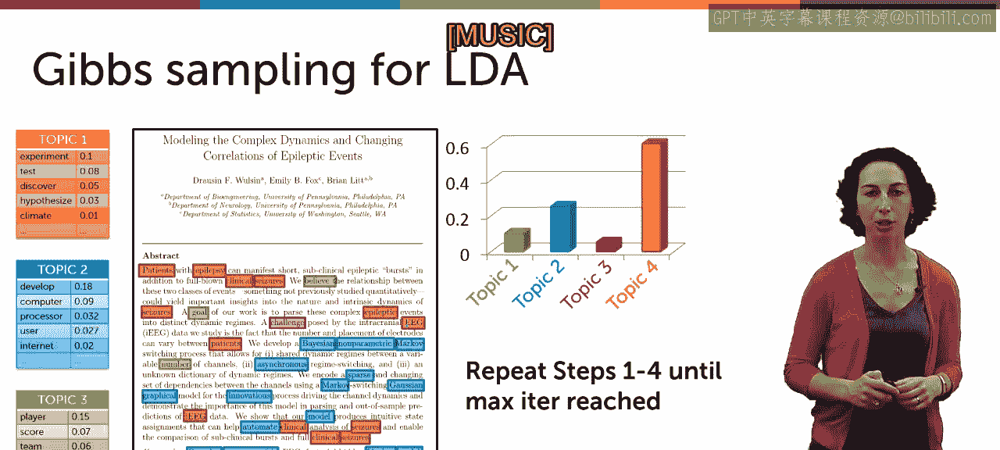
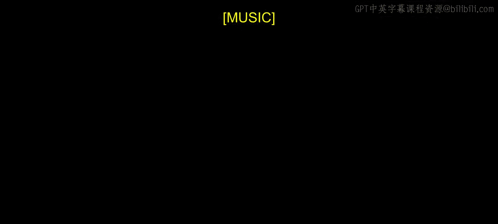

# 机器学习（分类，聚类和检索）：第3-4课：LDA的标准吉布斯采样器 🧠

在本节课中，我们将要学习潜在狄利克雷分配（LDA）模型中的标准吉布斯采样算法。这是一种用于从复杂概率分布中生成随机样本的马尔可夫链蒙特卡洛方法。我们将详细拆解其步骤，并解释它如何迭代地更新模型中的隐藏变量。

## 概述

吉布斯采样是一种迭代算法，它通过依次从每个变量的条件分布中采样，来生成来自联合概率分布的样本。在LDA模型中，这意味着我们要循环采样**词的主题分配变量**、**文档-主题比例向量**以及**主题-词汇分布**。与期望最大化（EM）算法不同，吉布斯采样以相同的方式处理所有变量，并且每一步都是随机采样而非确定性计算。

## 算法详解

上一节我们介绍了吉布斯采样的基本思想，本节中我们来看看它在LDA模型中的具体实现。想象在吉布斯采样的某次迭代中，我们已经有了所有变量（包括主题分配、主题比例和主题-词汇分布）的一个具体实例。

### 采样词的主题分配

在下一轮迭代中，我们首先考虑重新为文档中的每个词分配主题。对于文档 `i` 中的第 `w` 个词，我们计算其属于每个主题 `k` 的**责任**（即条件概率）。

**公式**如下：
`r_{iw}^{(k)} = P(Z_{iw} = k | \text{其他变量}, \text{观测数据}) ∝ π_{ik} * φ_{k, v_{iw}}`

其中：
*   `π_{ik}` 是文档 `i` 中主题 `k` 的先验概率（来自当前文档-主题比例向量）。
*   `φ_{k, v_{iw}}` 是主题 `k` 下生成当前词 `v_{iw}` 的概率（来自当前主题-词汇分布向量）。
*   我们需要对所有可能的主题 `k` 计算这个值，并进行归一化，使其总和为1，形成一个有效的概率质量函数。

以下是计算并采样一个词的主题分配的步骤：

1.  **计算未归一化概率**：对于文档 `i` 中的词 `w`，遍历所有主题 `k`，计算 `π_{ik} * φ_{k, v_{iw}}`。
2.  **归一化**：将所有主题的计算结果求和，然后用每个结果除以总和，得到归一化的责任 `r_{iw}^{(k)}`。
3.  **随机采样**：根据这个归一化的概率分布（即责任向量），随机抽取一个主题 `k` 作为词 `w` 的新分配 `Z_{iw}`。

这个过程会为文档中的**每一个词**重复执行。

### 采样文档-主题比例

在更新了文档中所有词的主题分配后，我们可以基于这些新的分配来更新该文档的主题比例向量 `π_i`。

影响 `π_i` 的主要信息是当前文档中**每个主题被分配到的词的数量**。然而，在贝叶斯框架下，这个计数会与狄利克雷先验分布的参数相结合。我们可以将先验视为引入了一组“伪观测”，从而对仅基于文档内计数的分布进行平滑（正则化）。

具体来说，新的文档-主题比例向量 `π_i` 是从一个以“文档内各主题计数 + 先验参数”为参数的狄利克雷分布中采样得到的。该分布的具体形式超出了本课程范围，但核心思想是：文档内主题使用频次越高，采样出的 `π_i` 中对应主题的概率通常也越高，同时先验确保了分布的合理性。

我们对**语料库中的每一个文档**重复上述“采样词分配”和“采样文档主题比例”的过程。

### 采样主题-词汇分布

更新完所有文档级别的变量后，我们转向更新整个语料库共享的**主题-词汇分布** `φ_k`。

对于每个主题 `k` 和词汇表中的每个词 `v`，我们关心的是：在整个语料库中，词 `v` 被分配到主题 `k` 的次数。这个计数信息，结合我们为 `φ_k` 设置的狄利克雷先验（同样起到正则化作用），共同决定了新的主题-词汇分布。

新的 `φ_k` 向量是从一个以“整个语料库中属于主题k的每个词的计数 + 先验参数”为参数的狄利克雷分布中采样得到的。这样，一个主题下出现越频繁的词，在新分布中获得的概率通常也越高。

## 迭代过程

完成以上所有步骤（更新所有 `Z`, `π`, `φ`）即完成了吉布斯采样的一次迭代。然后，算法会使用新采样得到的值作为条件，重新开始下一轮迭代，再次循环更新所有变量。

**算法流程总结**：
1.  初始化所有变量（`Z`, `π`, `φ`）。
2.  **循环迭代**直到达到预设的迭代次数或收敛：
    *   对每个文档中的每个词，根据当前 `π` 和 `φ` 采样新的主题分配 `Z`。
    *   对每个文档，根据新的 `Z` 和先验，采样新的文档-主题比例 `π`。
    *   对整个语料库，根据所有文档的新 `Z` 和先验，采样新的主题-词汇分布 `φ`。
3.  在多次迭代后，采集的变量值可以被视为来自LDA模型后验分布的（近似）样本。

## 总结

本节课中我们一起学习了LDA模型的标准吉布斯采样器。我们了解到，该算法通过**迭代地、随机地**采样三个核心变量：词的主题分配、文档的主题比例以及主题的词汇分布。每一步采样都基于其他变量的当前值以及观测到的文档数据，并融入了贝叶斯先验以进行正则化。这个过程反复进行，最终生成的样本链可用于近似模型的复杂后验分布，进而进行主题推断和参数估计。