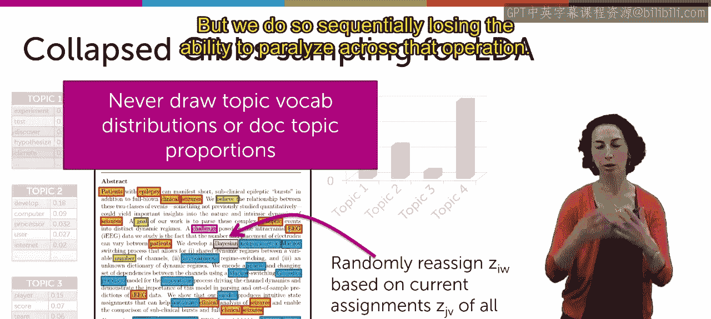

# 华盛顿大学《机器学习（分类，聚类和检索，第3-4课⧸共4课）｜Machine Learning》中英字幕 p183 61_什么是折叠吉布斯采样.zh_en -BV1Sr421F7N7_p183-

。

So this is a standard implementation of a Gib sampler。

 but we can actually do things that are a little bit fancier for example。

 we can do something called collapse Gib sampling。And we're going to describe this in the context of our LDA model and the idea here is the fact that we can actually analytically marginalize over all of the uncertainty in our model parameters and just sample the word assignment variables。

 so we never have to sample our topic vocabulary distributions and all the document specific topic proportions。

 we just go through and iterate sampling these word assignment variables。

And that seems pretty cool because what we've done is we've dramatically dramatically reduced the space in which we're exploring in this Gib sampler。

 and so this can actually lead to much better performance in practice because remember we have very massive vocabularies in general and so we have this distribution over the entire vocabulary for each one of our topics so that's a lot of parameters to think about learning and likewise for every document and our corpus。

 we have a set of probabilities over topics being present in that document。

 so being able to collapse these things away， these model parameters away and just look at these assignment variables in the documents。

😊，Can be quite helpful。So in pictures， what we're saying is that we can completely collapse away all of these model parameters and just look at iteratively resampling our word assignment variables for every word in the document and then every word in the corpus。

But there is a caveat here， and that's the fact that we now have to actually sequentially resample our words。

 given all the other words in the corpus。And we didn't discuss this previously。

 but I want to highlight it now， if you look at the uncollap sampler。

 standard implementation of Gib sampling for LDA， when we looked at a given document。

 we ended up with a data parallel problem for resampling the word indicator variables you could do each word indicator variable completely in parallel all you needed to do was condition on the topic vocabulary distributions and the document specific topic proportions。

And then everything decoupled， there was no dependence on the assignments to other words in the document or in the corpus。

 but now when we don't have these model parameters。

 what informs us of an assignment of a given word to a given topic。Well。

 the other words and the other assignments that were made to those words。

 so we can think of all those other assignment variables in the corpus as a surrogate for the model parameters。

And we'll discuss this in more detail in the coming slides。

 but the take home message here is that we never have to sample our topic vocabulary distributions or the document specific topic proportions。

 we just sample these word indicator variables， but we do so sequentially losing the ability to parallelze across that operation。

