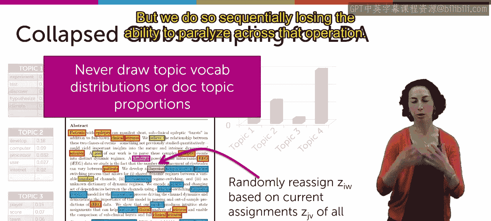

# 机器学习（分类，聚类和检索）：第3-4课：什么是折叠吉布斯采样

在本节课中，我们将学习一种用于潜在狄利克雷分配（LDA）模型的更高级的采样技术——折叠吉布斯采样。我们将了解其核心思想、工作原理，以及它与标准吉布斯采样的区别。

## 概述

上一节我们介绍了LDA模型的标准吉布斯采样实现。本节中，我们来看看一种更精巧的变体：折叠吉布斯采样。这种方法的核心在于，我们可以通过数学分析，将模型参数的不确定性“边缘化”处理，从而只对单词的分配变量进行采样，这能显著提升采样效率。

## 折叠吉布斯采样的核心思想

折叠吉布斯采样是一种针对LDA模型的优化采样策略。其基本思想是，我们可以在数学上**解析地边缘化**模型中的所有参数不确定性。这意味着我们不再需要显式地对“主题-词汇”分布和“文档-主题”比例这些模型参数进行采样。

取而代之的是，我们**仅对单词的分配变量**进行迭代采样。这极大地缩减了吉布斯采样器需要探索的参数空间。在实践中，这通常能带来更好的性能，因为我们通常处理的是海量词汇表，每个主题的词汇分布都包含大量参数，文档的主题比例也是如此。将这些模型参数“折叠”掉，只关注文档中的单词分配变量，非常有帮助。

用公式化的语言描述，在标准吉布斯采样中，我们采样的是联合分布 `P(z, θ, φ | w)`，其中 `z` 是主题分配，`θ` 是文档-主题分布，`φ` 是主题-词汇分布。而在折叠吉布斯采样中，我们通过积分（边缘化）掉 `θ` 和 `φ`，直接对条件分布 `P(z | w)` 进行采样。

## 工作原理与图示

在折叠吉布斯采样中，我们可以完全“折叠”掉所有模型参数，如下图所示，仅对语料库中每个文档的每个单词的分配变量进行迭代重采样。

但是，这里存在一个需要注意的地方：我们现在必须**顺序地**重采样每个单词，条件是语料库中所有其他单词的当前分配状态。

## 与标准采样的关键区别

在之前讨论的未折叠（标准）LDA吉布斯采样实现中，当我们处理一个给定文档时，重采样单词指示变量是一个**数据并行**问题。每个单词的分配可以完全并行计算，因为它只需要以“主题-词汇”分布和“文档-主题”比例为条件。单词之间的分配是解耦的，不依赖于文档或语料库中其他单词的分配。

然而，在折叠吉布斯采样中，由于我们没有这些模型参数，那么是什么来指导我们将一个给定单词分配给一个给定主题呢？答案是：**其他单词及其当前的分配状态**。我们可以将语料库中所有其他分配变量视为模型参数的替代品。这导致我们必须顺序采样，失去了跨该操作并行化的能力。

以下是折叠吉布斯采样的关键步骤概述：

1.  **初始化**：随机为语料库中的每个单词分配一个主题。
2.  **迭代采样**：对于语料库中的每一个单词（按顺序）：
    *   根据当前所有其他单词的主题分配，计算该单词被分配到每个主题的概率。
    *   从这个概率分布中采样，为该单词分配一个新的主题。
3.  **重复**：多次重复步骤2，直到分配状态稳定（收敛）。

## 总结

本节课中，我们一起学习了折叠吉布斯采样。我们了解到，这种方法通过数学上的边缘化技巧，绕过了对LDA模型中“主题-词汇”分布和“文档-主题”比例参数的显式采样，转而仅对单词的主题分配变量进行顺序采样。虽然这牺牲了部分并行性，但极大地减少了参数空间的维度，在实践中往往能获得更优的性能和更快的收敛速度。理解这种采样方法是掌握高级主题模型推断技术的重要一步。