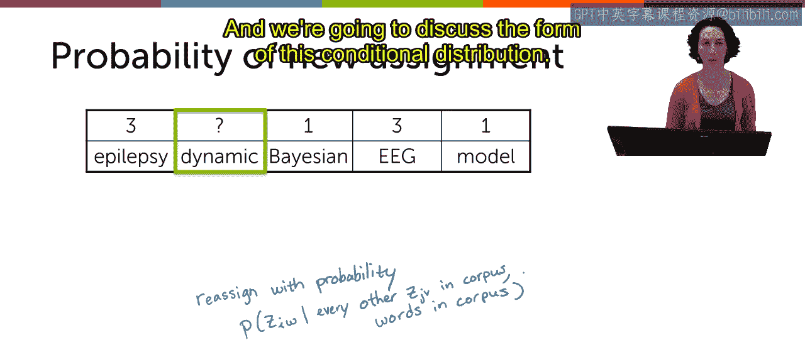

# 华盛顿大学《机器学习（分类，聚类和检索，第3-4课⧸共4课）｜Machine Learning》中英字幕 p184 62_LDA的工作示例：初始设置.zh_en -BV1Sr421F7N7_p184-

。

Okay， well， let's work through an example to make this a little bit more concrete and also specify more details on this collapsellapSk sampling approach。

Okay， so to start with， let's look at the first step of the algorithm。

 which would be to select a document and here we have a very simple。Five word document。

And the first step of the algorithm is to assign every word in this document to a topic。

 So here are a set of randomly assigned topics。 and that's just。

One possible approach for initialization。And like every iterative algorithm we've seen in this machine learning specialization。

 initialization matters a lot， there is theory and give sampling to say that we forget our initialization。

 if we run the thing long enough but sometimes you don't have long enough to run it。

 so I don't want to say that initialization doesn't matter， but for this simple example。

 let's just say that we randomly initialize our topics。Okay。

 then we're going to repeat this process for every document in the corpus and this corpus is a。

Pretty small corpus with very， very simple five word documents。

But now now that we have an initial assignment of every word in the corpus to a topic。

Then what we're going to do is we're going to form some local counts。So。

For document I we're going to start by counting how many times each topic appears。

 so for topic one we see that it appears twice in this document topic two appears once and topic three appears twice。

These are going to be statistics that are local just to this document that we're considering。

 but then we have some global statistics that are corpuswide and in particular what we're going to do is for every word in the vocabulary。

 we're going to maintain account of how many times that word was assigned to a given topic。

So everything up until this point was just setting the stage for us to be able to run our Gib sampler。

 but now that we have these local and global statistics and we've initialized all of our word assignment variables to give us these statistics。

Then we can move on to the G sampler， which is going to iterate through every word and the entire corpus。

And think about resampling it。 So to begin with， let's just look at this second word in this document and think about resampling its value。

 So what I'm going to do is I'm going to remove its current assignment。

 So right now the word dynamic is assigned to topic 2。So once I remove this assignment。

 I'm going to go and decrement all the relevant counts。

 so in this document I have one fewer count of topic2。And within the corpus。

 if I look at the word dynamic， I have one fewer count of dynamic in topic two。So here we're。

Derementing。Counts。After。Removing current。Assignment Z IW equals2。

So now we just have a question mark associated with this word in this document because we've removed its assignment and when we look at reassigning its value。

 so resampling，We're going to form the conditional distribution probability of Z IW given。Every。

Other。Let's say Z J V。In corpus。And all of the words that were observed in the corpus。

And we're going to discuss the form of this conditional distribution。

。