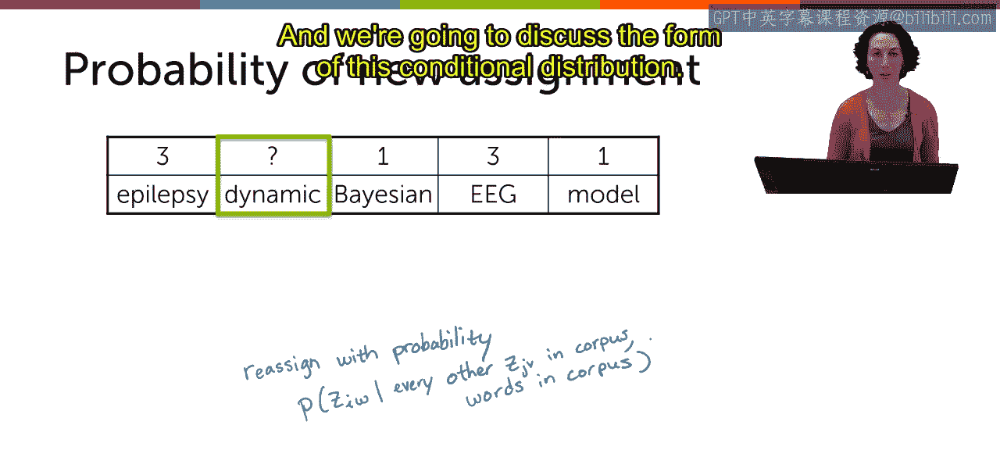

# 机器学习：3-4：LDA工作示例与初始设置 🧠

在本节课中，我们将通过一个具体的工作示例，来详细说明LDA（潜在狄利克雷分配）模型中的吉布斯采样方法。我们将从算法的初始设置开始，逐步讲解如何为文档中的单词分配主题，并建立后续采样所需的关键统计量。

---

## 初始设置与主题分配

上一节我们介绍了LDA模型的基本思想，本节中我们来看看如何为一个简单的文档集进行初始设置。

首先，算法的第一步是选择一个文档。这里我们有一个非常简单的、包含五个单词的文档。

算法的第一步是将这个文档中的每个单词分配到一个主题。以下是随机分配的一组主题，这只是初始化的一种可能方式。

与我们在本机器学习专项课程中见过的每一个迭代算法一样，初始化非常重要。理论上，吉布斯采样在运行足够长时间后会“忘记”初始设置，但有时我们没有足够的时间运行它。因此，初始化并非无关紧要。不过，在这个简单的示例中，我们假设是随机初始化主题。

然后，我们将对语料库中的每一个文档重复这个过程。这个语料库非常小，只包含非常简单的五个单词的文档。

现在，我们已经将语料库中每个单词初始分配到了一个主题。

---

## 构建局部与全局统计量

在完成初始分配后，我们需要构建一些统计量，为后续的吉布斯采样做准备。

对于文档 `i`，我们首先统计每个主题在该文档中出现的次数。例如，主题一出现了两次，主题二出现了一次，主题三出现了两次。这些统计量是局部的，仅针对当前考虑的文档。

同时，我们还需要一些全局的、覆盖整个语料库的统计量。具体来说，对于词汇表中的每一个单词，我们将维护一个计数，记录该单词被分配到某个给定主题的次数。

到目前为止，我们所做的一切都是为了能够运行吉布斯采样器而进行的准备工作。现在，我们有了这些局部和全局的统计量，并且已经初始化了所有单词的分配变量来得到这些统计量。

---

## 进入吉布斯采样阶段

接下来，我们可以进入吉布斯采样阶段，它将迭代遍历整个语料库中的每一个单词，并考虑重新采样其主题分配。

首先，让我们看看这个文档中的第二个单词，并考虑重新采样它的值。我将移除它当前的分配。目前，单词“dynamic”被分配给了主题2。

一旦我移除了这个分配，我将去减少所有相关的计数。因此，在这个文档中，主题2的计数减少了一个。在语料库范围内，如果我查看单词“dynamic”，它在主题二中的计数也减少了一个。

以下是移除当前分配 `Z_iw = 2` 后递减计数的过程。

现在，这个单词在这个文档中只剩下一个问号，因为我们移除了它的分配。当我们考虑重新分配它的值时（即重新采样），我们将基于条件分布 `P(Z_iw | 所有其他 Z_jv 和语料库中观察到的所有单词)` 来进行。我们将在后续讨论这个条件分布的具体形式。

---

## 总结

本节课中，我们一起学习了LDA吉布斯采样的初始设置步骤。我们从一个简单的五词文档开始，随机初始化了单词的主题分配，并建立了后续采样所需的局部文档主题计数和全局单词-主题计数。最后，我们开始进入吉布斯采样的核心步骤，即移除一个单词的当前主题分配，并准备根据条件概率为其重新采样。下一节我们将深入探讨这个条件分布的计算。