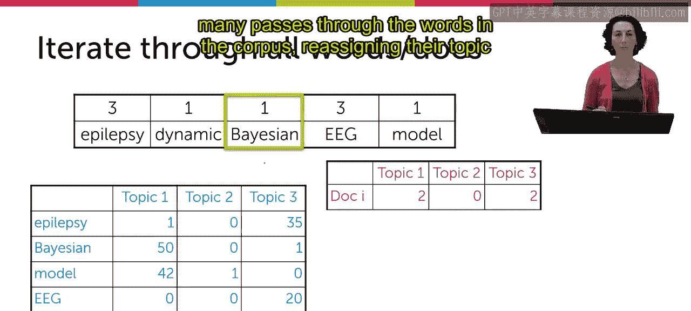
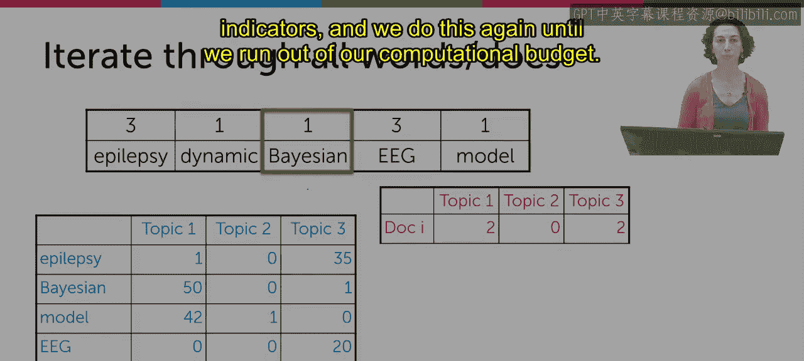

# 华盛顿大学《机器学习（分类，聚类和检索，第3-4课⧸共4课）｜Machine Learning》中英字幕 p185 63_LDA的工作示例：推导重采样分布.zh_en -BV1Sr421F7N7_p185-

。

There are two terms that factor into this probability calculation。

 The first is how much this document likes this topic。So previously。

 we used PI the document specific topic proportions to inform us of this。

 but now when we don't have these topic proportions sampled。

 we look at every other word in the document and see how often the topics were used。

And that's exactly what this equation shows here。In particular， we have the total counts。

Of words in document I to topic K， and then we're going to add alpha。

 which is a smoothing parameter coming from our Bayesian prior。And then in the denominator。

 we have the total number of words。In the I document。

 and then the reason we have a minus1 is because we're ignoring the current word。

When we're forming this count NIK it does not count the word that we've removed the assignment to。

 so when we think about normalizing we normalize by N minus1 and then we have k different topics that had that alpha regularization parameter added to it so we have K times alpha in the denominator so what we see in this plot here is that this document really likes topic one in topic3 because we have two counts of topic one and topic3。

And doesn't like topic two all that much， there are actually no counts of topic two。

 but the only reason there's positive weight on topic two comes from our Bayesian prior。Okay， well。

 this term is then weighted by another term， which has to do with how much。

Each topic likes the observed word so we look at the word dynamic。

 and we look throughout the entire corpus now and we say how many times was that word used by a given topic or assigned to a given topic？

And in equations， it has the following form where corpus wide， we look at the counts of。

The assignments of word dynamic to topic K， and then we have this smoothing parameter again from our Bayesian prior。

And then we just normalize this。And what's the normalization that we use here。

 well we're fixing a given topic and we're just normalizing by how much it likes any word。

 so we're summing over all possible words in the vocabulary and looking at how many times those words were assigned to this topic and then this is the normalization from the prior where V is the size of the vocabulary。

So just to be clear here， when we don't have the topic specific vocabulary distributions that tell us the probabilities of every word in the vocabulary。

 we're going to use the word assignments in the corpus as a surrogate。

And just to interpret this plot here， what we see is that topic one。Really likes this word dynamic。

 that's a topic about things that were more technology based。

 but we see that topic two also likes the word dynamic， but in some different context。

 it's some other topic， so maybe it's a topic about fluid dynamics。

And so the word dynamics is used very frequently in that topic。

Whereas topic three doesn't like the word dynamic very much at all。

So what we see in these pictures is that topic1 fits both the word dynamic as well as the document。

 so the document likes topic1 and topic one likes the word dynamic in topic 2。

 we see that the topic fits the word， so topic  two likes the word dynamic but the document doesn't really like topic2 because it's probably not something about fluid dynamics。

And finally， topic three。Doesn't like the word dynamic， but the document really likes this topic。

 so this might be some other topic present in this document。That is unrelated to the word dynamic。

So when we go to form our probability of a assignment of the word dynamic to any of our topics。

 we simply multiply these two probabilities that we talked about。

So we just look at the area of these squares and this is going to represent the probability of choosing topic one versus topic two versus topic three。

So to draw our assignment， we can think of two different analogies here。

 one is we can think of rolling a K sightd die。Where the probability of every side on that dye is given by the relative proportion of these areas。

Or equivalently， we can think of just throwing a dart。

 So think of stacking up all the green region together， throwing a dart and。

Let's say there's a uniform chance that we hit any part of the green space。

We're most likely to hit this greenspace which would be an assignment to topic one。

 there's some probability of hitting topic2 or topic three。

 but it's less likely so in this case let's say we happen to sample a value of one。

 so an assignment of the word dynamic to topic one。So we see that here， this is our assignment。

 our new assignment of this word in this document。And now what we have to do is we have to go and we have to increment our counts。

So we go to our local counts。And we say， okay， we now need to increase。The counts of topic one。

 so instead of two counts， we have three counts。And then again。

 we go to our corpus wide statistics look at。Dynamic， the word dynamic。

 and now we're going to increment the counts of the word。Dynamic being associated with topic one。

 so this 10 becomes an 11。So in pictures， what we've done is we've simply。

Increased how much topic one likes the word dynamic。And how much document I likes topic one？Okay。

 well， now that we've reassigned this word in this document。

 we can move on to the next word and go through exactly the same process that we did where we remove that count。

 decrement or remove that assignment， and then decrement the counts。

 the associated counts in the local and global tables。

And then we go and we form the probability of an assignment of this word in this document using those two terms。

Of how much the document likes a given topic and how much the topic likes this word Bayesian now in this case。

 and then we go and we resample this value， and then we move to the next word and the next word and we cycle all the way through the words in this document。

 then we move to the next document and we keep going。

And once we've gotten through all the words in the corpus。We continue。

 we go again and again and again and again， doing multiple passes， many。

 many passes through the words in the corpus， reassigning their topic indicators。

And we do this again until we run out of our computational budget。

。