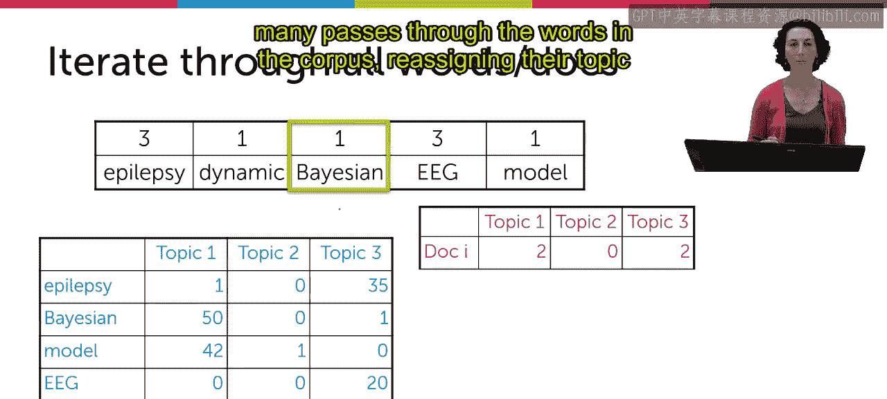
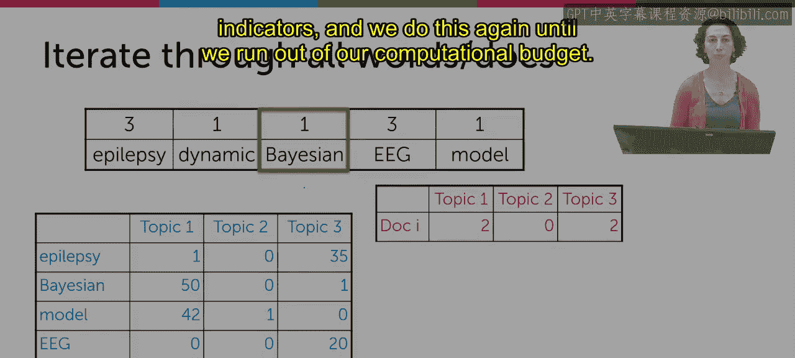

# 机器学习（分类，聚类和检索）：第3-4课：LDA工作示例：推导重采样分布 🧮

在本节课中，我们将学习潜在狄利克雷分配（LDA）模型中的一个核心步骤：如何为文档中的单词重新采样其主题分配。我们将通过一个具体示例，详细拆解计算概率、更新计数以及迭代优化的全过程。

---

## 概述

LDA是一种用于发现文档集合中潜在主题的生成式概率模型。在模型训练过程中，一个关键步骤是使用吉布斯采样为每个单词重新分配其所属的主题。这个过程依赖于两个核心因素：**文档对特定主题的偏好**以及**主题对特定单词的偏好**。我们将通过一个具体的“dynamic”单词示例，一步步展示如何计算重采样分布并更新模型参数。

---

## 重采样分布的计算原理

上一节我们介绍了LDA模型的基本框架，本节中我们来看看如何为单个单词计算其属于各个主题的概率。这个概率由两个主要项相乘得到。

### 1. 文档对主题的偏好

第一项衡量的是当前文档有多“喜欢”某个主题。在LDA的吉布斯采样中，我们无法直接获得文档的主题比例参数 `π`，因此使用文档中已分配给该主题的**单词计数**作为替代，并加上狄利克雷先验的平滑参数 `α`。

其计算公式如下：

**公式：**
`P(文档 i 喜欢主题 k) = (N_{ik} + α) / (N_i - 1 + K * α)`

**变量解释：**
*   `N_{ik}`：文档 `i` 中（**不包括当前正在采样的单词**）被分配给主题 `k` 的单词总数。
*   `N_i`：文档 `i` 中的总单词数。
*   `α`：狄利克雷先验参数，起到平滑作用。
*   `K`：主题总数。

**示例解读：**
假设一个文档中，主题1和主题3各出现了2次，主题2出现了0次。加上先验平滑后，文档对主题1和3的偏好度会高于主题2。主题2的非零概率完全来自于先验参数 `α`。

### 2. 主题对单词的偏好

第二项衡量的是某个主题有多“喜欢”当前这个被观察的单词（例如“dynamic”）。同样，我们使用整个语料库中该单词被分配给该主题的**计数**作为替代，并加上另一个平滑参数 `β`。

其计算公式如下：

**公式：**
`P(主题 k 喜欢单词 w) = (C_{kw} + β) / (C_k + V * β)`

**变量解释：**
*   `C_{kw}`：在整个语料库中，单词 `w` 被分配给主题 `k` 的次数。
*   `C_k`：在整个语料库中，所有单词被分配给主题 `k` 的总次数。
*   `β`：狄利克雷先验参数，起到平滑作用。
*   `V`：词汇表的大小。

**示例解读：**
对于单词“dynamic”，可能技术类主题（主题1）非常喜欢它，而另一个关于流体力学的主题（主题2）也可能频繁使用它。但第三个主题（主题3）可能几乎不使用这个词。

### 3. 形成最终概率

单词“dynamic”在文档 `i` 中被分配给主题 `k` 的最终未归一化概率，是上述两项的乘积：

**公式：**
`P(z_i = k | w, 其他分配) ∝ [ (N_{ik} + α) / (N_i - 1 + K * α) ] * [ (C_{kw} + β) / (C_k + V * β) ]`

我们可以将这两个概率想象成两个长方形的面积，它们的乘积决定了最终采样时选择每个主题的权重。

---

## 采样与更新过程

理解了概率计算后，我们来看看如何根据这个分布进行采样，并更新模型。

### 采样新主题

根据计算出的概率分布，我们可以通过两种等价方式为当前单词采样一个新的主题：
1.  投掷一个 `K` 面的骰子，每个面朝上的概率正比于对应主题的概率值。
2.  将所有主题的概率区域堆叠成一个长条，然后随机投掷一个飞镖，飞镖落在哪个区域，就采样哪个主题。

在示例中，由于文档喜欢主题1，且主题1也喜欢单词“dynamic”，因此采样到主题1的概率最高。

### 更新计数表

采样完成后，我们必须立即更新本地和全局的计数表，以反映这次新的分配。

以下是需要更新的步骤：

1.  **更新文档-主题计数**：在文档 `i` 的本地计数中，将主题 `k` 的计数 `N_{ik}` 加1。
2.  **更新主题-单词计数**：在全局语料库计数中，将单词“dynamic”在主题 `k` 下的计数 `C_{kw}` 加1。

**效果**：这相当于同时增强了“文档 `i` 更喜欢主题 `k`”以及“主题 `k` 更喜欢单词‘dynamic’”这两个信号。

---

## 迭代优化流程

完成一个单词的重新分配后，我们将按照固定的顺序，遍历文档中的每一个单词，以及语料库中的每一篇文档。

以下是完整的迭代循环步骤：

1.  随机初始化所有单词的主题分配。
2.  对于语料库中的每一个单词：
    *   a. **移除**：暂时移除该单词当前的主题分配，并在本地和全局计数表中将其对应计数减1。
    *   b. **计算**：基于更新后的计数，使用上述公式计算该单词属于每一个主题的概率。
    *   c. **采样**：根据计算出的概率分布，为该单词重新采样一个新的主题。
    *   d. **更新**：将新的主题分配记录到该单词上，并在本地和全局计数表中将对应计数加1。
3.  完成一遍对所有单词的遍历后，这称为一次**迭代**或**扫描**。
4.  重复步骤2多次（通常数百或数千次），直到模型参数（即计数分布）趋于稳定，或者达到预设的计算预算。

这个过程就是吉布斯采样，它通过反复地局部更新，最终使整个模型的分配收敛到一个相对稳定的状态，此时我们便得到了文档的主题分布和主题的单词分布。

---

## 总结

本节课中我们一起学习了LDA模型吉布斯采样的核心操作。我们详细拆解了如何为一个单词计算其重采样到各个主题的概率，这个概率由**文档主题偏好**和**主题单词偏好**共同决定。随后，我们演示了如何根据这个概率分布进行随机采样，并立即更新计数以保持状态一致。最后，我们概述了遍历整个语料库进行多次迭代的完整流程，这是LDA模型从随机初始状态逐步学习到有意义主题的关键。理解这个重采样过程，是掌握LDA及其变种模型工作原理的基础。