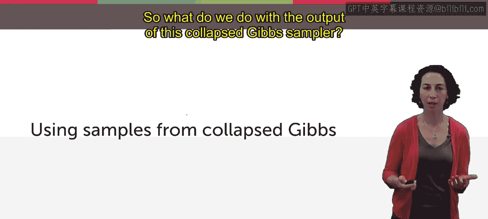
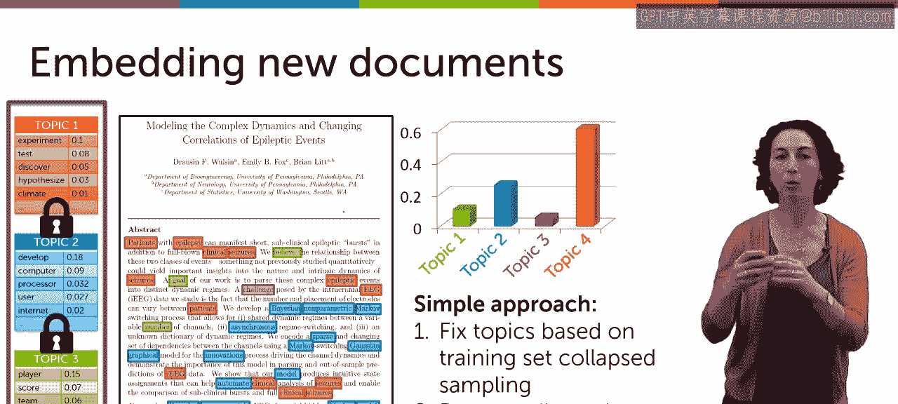

# 华盛顿大学《机器学习（分类，聚类和检索，第3-4课⧸共4课）｜Machine Learning》中英字幕 p186 64_使用折叠吉布斯采样的输出.zh_en -BV1Sr421F7N7_p186-

。

Well， you might be sitting here thinking why are we sampling just the word indicators。

 I don't care about those， Is this just a total waste。

 remember that we discussed before that the thing that we're typically interested in are the topic vocabulary distributions for interpretability of the topics present in the corpus as well as the topic proportions within every document because that's our compact description of the mixed membership of the document。

So what do we do with the output of this collapse G sampler where we have all these samples just of the word indicators？

Well， there are a number of things that you can do and I'm just going to describe one。

 so one thing we can do is we can look at the assignment of all the words。In the corpus。

 that maximize the joint model probability， and it's actually the joint collapse model probability where we've integrated over all these model parameters and just look at the probabilities on these word assignment variables。

And of course， the probability of the words themselves given those assignments。

Then for this best sample of all these word assignment variables。We can think of。Post facto。

 after running our collapsellap G sampler， doing inference on the topic vocabulary distributions。

 because once I've conditioned on a set of topic indicators for every word in my vocabulary。

 or sorry， every word in my corpus， then I can form the conditional distribution on my topic vocabulary distributions。

So this is exactly the distribution that we described at a high level when we talked about our uncollaped standard Gb sampler。

 so we can think about sampling these topic vocabulary distributions。

 and then we can also likewise think about doing what's often called document embedding。

 which is just forming the topic proportion vector for given document。

 so this embedding is just taking this document and forming its mixed membership representation。

And just like in our uncollapsed standard Gb sampler， we can form the conditional distribution。

Of these topic proportions。Just given the word assignments in the document that we're looking at。

So just to reiterate when we look at the topic， vocabulary distributions。

 these are corpus white things， we have to look at the assignments we made throughout the entire corpus to infer these。

 but when we're looking at our document specific topic proportions。

 we just need to look at the assignments made within that specific document。

Then finally you can think of embedding new documents so you get a whole collection of new documents you already ran your collapse give sampler what do you do with these new documents Well the formal thing to do is to completely rerun your sampler with these new documents so added in resample everything for these new documents and then revisit the documents that you've already sampled but often you really can't do that in practice so one thing that you could think about doing which is an approximation procedure is to fix the topic vocabulary distributions using the procedure that we described in the previous slides and then having our topics fixed。

So that's the description we can think of as trained on a set of documents that we've already looked at。

 We can embed new documents just by running an uncollapsed Gib sampler just on that document。

 because remember， to form our。Word assignments in a given document and the topic proportions in that document。

We only need to condition on。

The topic vocabulary distributions， not the other documents in the corpus。

So we can actually embed each one of these new documents in parallel using this type of procedure。

