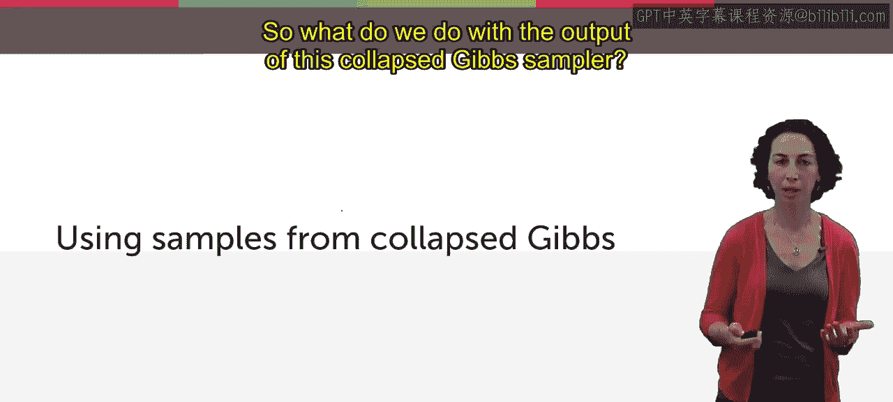
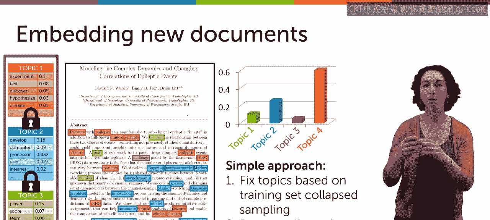

# 机器学习（分类，聚类和检索）：第3-4课：使用折叠吉布斯采样的输出 🧠

在本节课中，我们将学习如何利用折叠吉布斯采样器的输出结果。折叠吉布斯采样器为我们提供了每个单词的主题分配指示变量样本。然而，我们真正关心的通常是主题的可解释性（即主题-词汇分布）以及文档的混合成员关系（即文档-主题比例）。本节将探讨如何从这些单词分配样本中，推断出我们真正感兴趣的模型参数。

---

上一节我们介绍了折叠吉布斯采样器的运行机制，它主要对单词的主题指示变量进行采样。你可能会想，我们为什么要采样这些单词指示变量？我并不关心它们，这是否完全是浪费时间？

请记住，我们之前讨论过，我们通常感兴趣的是**主题-词汇分布**（用于解释语料库中存在的主题）以及**每个文档内的主题比例**（因为这是文档混合成员关系的紧凑描述）。那么，我们该如何处理这个折叠吉布斯采样器的输出呢？我们得到的只是所有这些单词指示变量的样本。

---

## 处理采样输出的方法

有多种方法可以处理这些输出，这里我们将描述其中一种。

我们可以查看语料库中所有单词的分配情况，目标是找到**最大化联合模型概率**的那一组分配。这里指的是折叠模型的联合概率，其中我们已经对所有模型参数进行了积分，只关注这些单词分配变量的概率，当然也包括给定这些分配后单词本身的概率。

然后，对于这组最优的单词分配变量样本，我们可以在运行折叠吉布斯采样器之后，**事后**对主题-词汇分布进行推断。因为一旦我确定了语料库中每个单词的一组主题指示变量，我就可以形成关于我的主题-词汇分布的条件分布。

这实际上就是我们在讨论未折叠的标准吉布斯采样器时，在高层次上描述过的分布。因此，我们可以考虑从这些条件分布中采样主题-词汇分布。

---

## 文档嵌入与主题比例

同样，我们也可以考虑进行所谓的**文档嵌入**，即为给定文档形成其主题比例向量。这种嵌入就是获取这个文档并形成其混合成员关系的表示。

就像在我们的未折叠标准吉布斯采样器中一样，我们可以形成这些主题比例的条件分布，只需给定我们正在查看的文档中的单词分配。

需要重申的是，当我们查看主题-词汇分布时，这些是**语料库级别**的参数，我们必须查看在整个语料库中所做的分配来推断它们。但是，当我们查看特定于文档的主题比例时，我们只需要查看在该特定文档内所做的分配。

---

## 嵌入新文档

最后，你可以考虑嵌入新文档。假设你获得了一整套新文档，而你已经运行了折叠吉布斯采样器，你该如何处理这些新文档？

正式的做法是使用这些新文档完全重新运行你的采样器，即添加这些新文档并重新采样所有内容，然后重新审视你已经采样过的文档。但在实践中，你通常无法这样做。

因此，你可以考虑一种近似程序：使用我们在前面幻灯片中描述的程序来**固定主题-词汇分布**，从而固定我们的主题。我们可以将此描述为在已经查看过的一组文档上进行了“训练”。

然后，我们可以通过仅在该文档上运行一个**未折叠的吉布斯采样器**来嵌入新文档。因为请记住，要在给定文档中形成我们的单词分配和该文档中的主题比例，我们只需要以主题-词汇分布为条件，而不需要语料库中的其他文档。因此，我们可以使用这种类型的程序并行地嵌入每一个新文档。

---

## 总结

本节课中，我们一起学习了如何利用折叠吉布斯采样器的输出。我们了解到，虽然采样器直接输出的是单词的主题分配，但我们可以通过这些分配来推断出核心的模型参数：**主题-词汇分布**和**文档-主题比例**。关键步骤包括寻找最大化模型概率的分配样本，并基于此进行事后推断。此外，我们还探讨了如何将已“训练”好的主题模型应用于新文档的嵌入，这通常通过固定主题分布并针对新文档运行未折叠吉布斯采样来实现。这些方法使我们能够从采样过程中获得可解释且有用的主题模型结果。