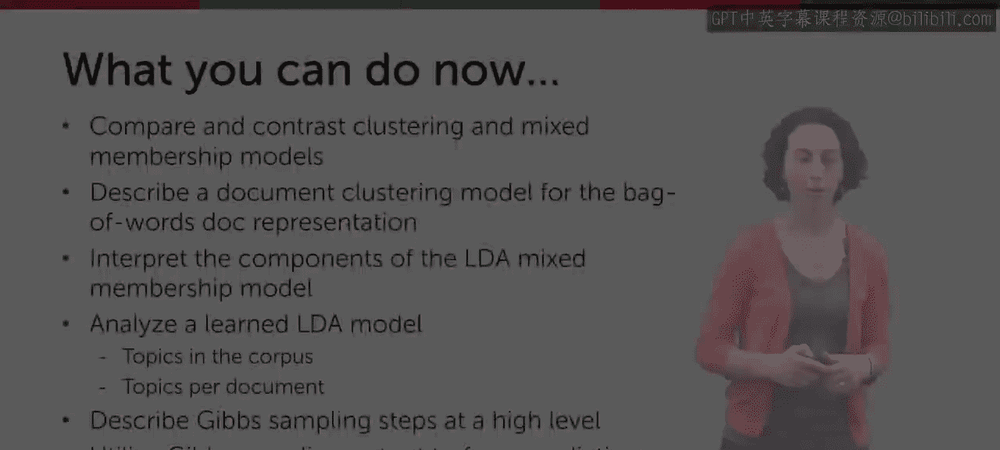
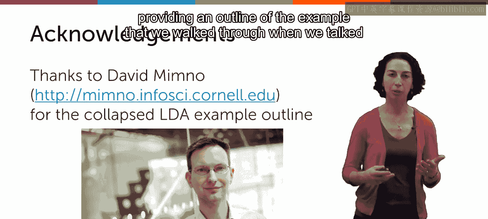
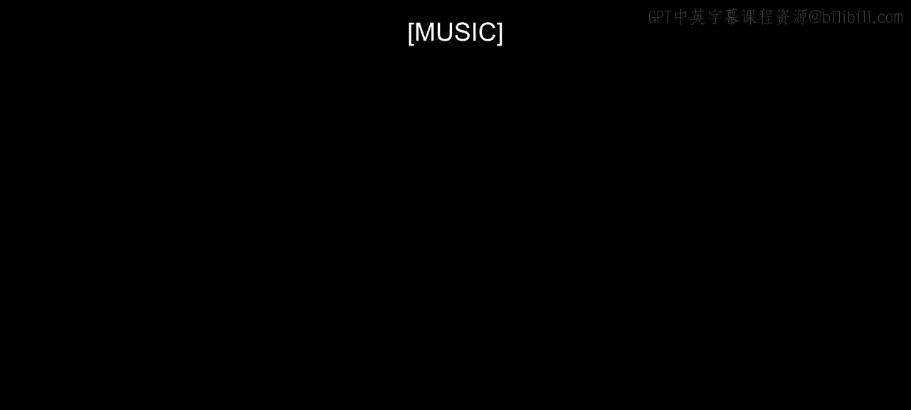

# 华盛顿大学《机器学习（分类，聚类和检索，第3-4课⧸共4课）｜Machine Learning》中英字幕 p187 65_简要回顾.zh_en -BV1Sr421F7N7_p187-

。

Okay， so congratulations， you guys have made it to the end of the last module of this course。

 and so we've covered lots and lots of material in this course。

 and in particular the last couple of modules have been quite advanced and quite intense。

So in this module in particular， we covered latent Deishly allocation or LDA and Gib sampling。

So LDA is a really widely used tool for mixed membership modeling and textcorpora。

 but variants of the LDA model can be used for mixed membership modeling into a huge range of different applications。

And we also covered Gib sampling， which is the most widely used algorithm for Bayesian inference。

We specifically examined it in the context of LDA， but it tends to be the most straightforward algorithm to think about deriving the updates for in any Bayesian model。

That said， it's not always the most scalable algorithm。

 especially just the first implementation you might think of writing down。

 but there's a lot of work in the community on thinking about scaling up。

 give sampling or Gi sampling type algorithms to really large data sets and really big models。

So in conclusion， I want to leave you with a list of things that you should be able to do now that you've completed this module。

 so take a bit of time to reflect on this list and think about all the advances that you've made。

And finally， I want to give a big thanks to David Mimno for providing an outline of the example that we walked through when we talked about collapse give sampling and LDA。

