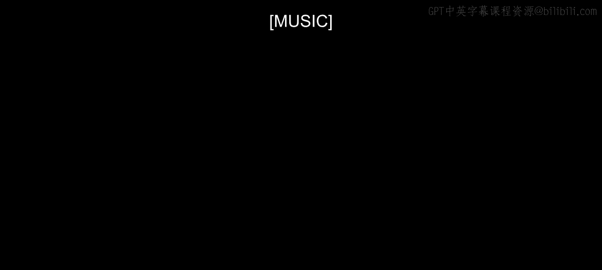
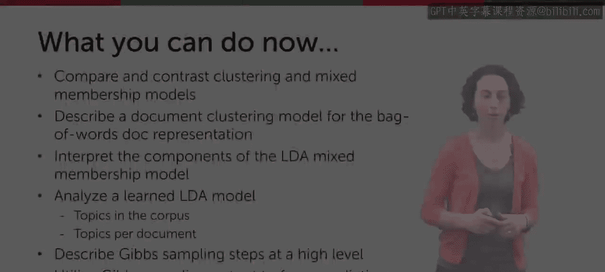
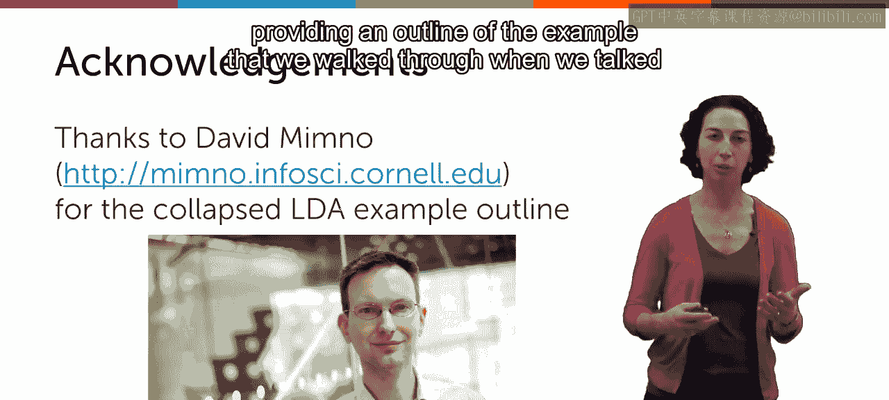
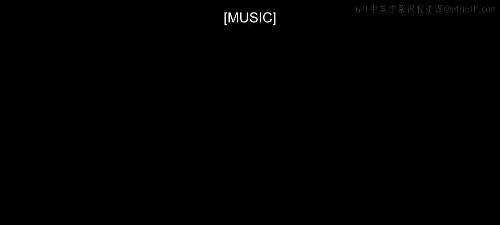

# 机器学习（分类，聚类和检索）：第3-4课：简要回顾

在本节课中，我们将对课程最后一个模块的核心内容进行回顾与总结。我们重点学习了用于主题建模的**潜在狄利克雷分配**模型以及用于贝叶斯推断的**吉布斯采样**算法。

上一节我们介绍了LDA模型和吉布斯采样的基本概念，本节中我们来看看完成本模块学习后，你应该掌握哪些核心技能。

以下是完成本模块后你应具备的能力清单：

*   能够解释**潜在狄利克雷分配**模型及其在文本语料混合成员建模中的应用。
*   理解LDA模型的变体可广泛应用于众多不同领域的混合成员建模问题。
*   能够解释**吉布斯采样**作为最常用的贝叶斯推断算法之一的基本原理。
*   理解如何在LDA模型的上下文中推导和应用吉布斯采样。
*   认识到吉布斯采样通常是推导贝叶斯模型更新公式时最直观的算法。
*   了解吉布斯采样的初始实现可能并非最具可扩展性的算法。
*   知道学术界存在大量关于如何扩展吉布斯采样算法以处理大规模数据集和模型的研究工作。

最后，我们要特别感谢David Mimno，他在我们讲解折叠吉布斯采样与LDA时提供的示例大纲对本课程帮助极大。

本节课中我们一起学习了LDA主题模型和吉布斯采样算法。LDA是文本分析中强大的混合成员建模工具，而吉布斯采样是实现贝叶斯推断的关键算法。虽然它们在处理大规模问题时面临挑战，但相关研究正在不断推动其发展。恭喜你完成了本课程最后一个模块的学习！